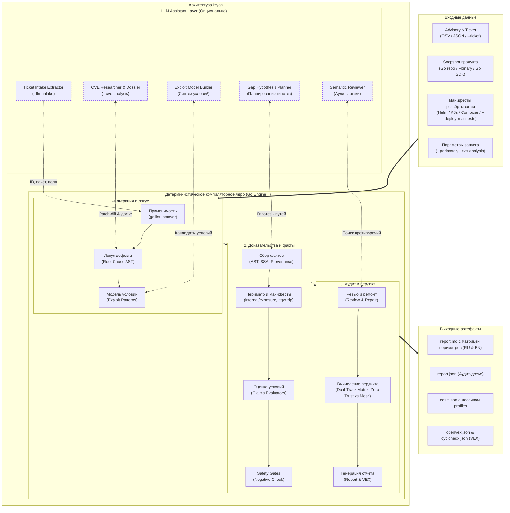
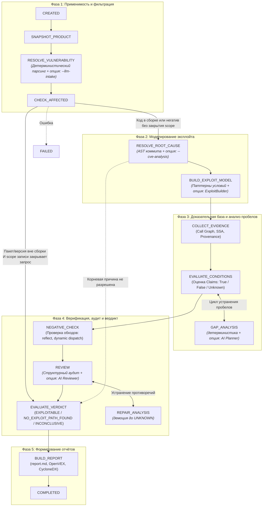
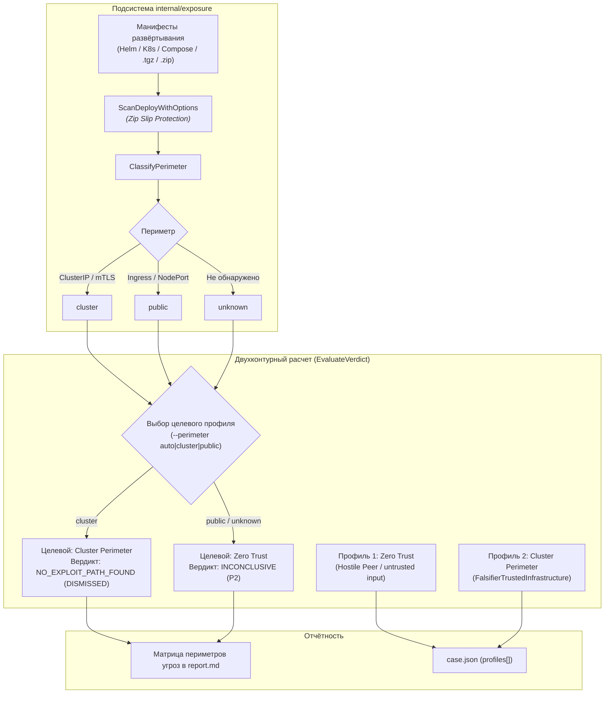

# Архитектура

Настоящий документ описывает архитектуру анализатора **Izyan (Vuln Analyzer)**: функциональные блоки, сквозную стейт-машину, подсистемы статического анализа, разграничение детерминистического компиляторного ядра и LLM-слоя, а также модель данных и подсистему отчетности.

Внутренняя механика реализации — [`dev/analysis-internals.md`](dev/analysis-internals.md); нормативная спека — [`dev/specs/governing-spec.md`](dev/specs/governing-spec.md).

---

## 1. Контекст системы



### Входы:
* **Advisory & Ticket**: документ уязвимости из OSV API (`--vuln`), локальный OSV JSON (`--vuln-file`) или тикет трекера задач (`--ticket`), включая вложенные конверты (Jira / Tracker nested envelope с атрибутами `unit` и `result_text` / `rationale`);
* **Снимок продукта**: путь к Go-репозиторию (`--repo`), опционально собранный бинарник релиза (`--binary`: `build info` + digest-bound build target), версия тулчейна (`--release-go-version` или директива в `go.mod`), флаги сборки (`--build-tags`, `--goos`, `--goarch`);
* **Манифесты развёртывания**: путь к каталогу, внешнему GitOps-репозиторию или архиву чарта (`.tgz`, `.tar.gz`, `.zip`) через `--deploy-manifests`, с автообнаружением в каталогах `deploy/`, `helm/`, `deployments/`;
* **Параметры управления**: режим целевого периметра (`--perimeter auto|cluster|public`), режим AI-исследователя (`--cve-analysis`), семантическое извлечение тикета (`--llm-intake`), флаг fail-fast (`--strict-llm`), отключение LLM (`--deterministic-only`), экспертный базис локуса (`--non-locus-basis`, `--accept-locus-proposals`), разрешение выполнения бинарников репозитория (`--allow-exec`), лимиты памяти (`--mem-limit`).

### Provenance сборки и допуск отрицательных выводов

Снимок несёт не только значения `GOOS/GOARCH`, но и структурный
`ProductTarget` с provenance и scope. Приоритет источников:

```
artifact-build-info > release-metadata > operator-declared > host-default
```

`artifact-build-info` — встроенные `debug.BuildInfo.Settings` артефакта
или обычного `--binary`, связанные с SHA-256 артефакта. `operator-declared`
требует **обоих** флагов `--goos`/`--goarch`; один флаг или только
`--build-tags` остаются `host-default` без scope. `--release` выбирает
identity исходников, `--deploy-manifests` — периметр.

Два независимых гейта допускают `FALSE`/`NOT_AFFECTED`/
`NO_EXPLOIT_PATH_FOUND`: (1) идентифицированная scoped сборка, чьи факты
совпадают с эффективным контекстом; (2) завершённое измерение с
покрытием субъекта/scope. Провал любого — `UNKNOWN`, а не `FALSE` с
оговоркой. Независимые факты (отсутствие модуля в графе, версия вне
диапазона, release-toolchain, ключ конфигурации репозитория,
deployment-policy) гейта 1 не требуют.

Резолв происходит один раз — до загрузки пакетов; affected-resolver,
govulncheck, source-index и negative-verifier делят один контекст
(identity, платформа, tags, CGO, toolchain, vendor/workspace).
Переименование уже загруженного индекса невозможно
(`domain.ErrBuildContextMismatch`), а отрицание описывает только эту
сборку — платформа/tags/CGO/provenance попадают в VEX-утверждение и
rationale.

### Scope записи advisory: `RecordExtent` и `RecordInventory`

Допуск отрицательного вывода состоит из двух независимых осей: **что
измерено в сборке** (build-target и завершённость измерения, выше) и
**какую область запроса покрывает вывод**. Вторая ось — структурная:
`AdvisoryScope` хранит, сколько загруженного документа advisory реально
представлено в модели.

* `kind` — что запрошено (`CVE` или `ADVISORY_ENTRIES`);
* `coverage` — полнота утверждения (`COMPLETE`/`KNOWN_ONLY`);
* `record_extent` — полнота представления документа (`FULL_RECORD`,
  `GO_PROJECTION`, `UNKNOWN`);
* `record_inventory` — census исходного `affected[]`: advisory identity,
  digest документа, все entries с исходными ecosystem/module и списки
  represented/omitted индексов. Перепись снимается до фильтрации
  экосистем и до слияния entries по имени модуля;
* `basis` — человеческое объяснение, никогда не исполняемая политика.

`AllowsNegativeClosure()` требует не только `ADVISORY_ENTRIES` +
`COMPLETE` + точную `GO-`/`GHSA-` identity, но и
`RecordExtent=FULL_RECORD` с валидной digest-привязанной переписью, где
каждая исходная entry представлена как Go-модуль. Проекция широкой
записи, сокращённая до Go-entries, закрывать запрос не может. `COMPLETE`
без структурных полей — legacy-утверждение, а не доказательство: такие
кейсы декодируются, но fail closed (`UNKNOWN`). `Basis` не читается.

Module/version-негативы (модуль отсутствует, версия вне диапазона)
независимы от build-target гейта, но не от scope-гейта: при
`GO_PROJECTION`/`KNOWN_ONLY` они остаются компонентными фактами, а не
закрытием finding-уровня.

**Смешанная запись.** `GHSA-qppj-fm5r-hxr3` (CVE-2023-44487): 22
исходные entries — Go 1 (`golang.org/x/net`), Maven 20, SwiftURL 1.
Перепись даёт `GO_PROJECTION` (22/1/21), закрытие отклоняется;
`v0.17.0` остаётся вне диапазона (`VersionAffected=FALSE`), но
`PackagePresent`/`BuildRelevant` не измерены, запрос не закрыт, итог —
`INCONCLUSIVE`, VEX — `under_investigation`/`in_triage`.

**Неразрешимый root cause** не обрывает кейс без вывода: он уходит в
`EVALUATE_VERDICT`, получает записанный `INCONCLUSIVE` и формирует
отчёты и экспорты (`--strict-llm` — по-прежнему `FAILED`).

---

## 2. Стейт-машина конвейера (Workflow State Machine)

Конвейер анализа реализован как строгая персистентная стейт-машина ([`internal/workflow`](../internal/workflow/)). Каждый переход между состояниями детерминирован и фиксируется на диске в сериализованном снимке `AnalysisCase`.



### Описание стадий стейт-машины

| Состояние | Отвечает на вопрос | Инструменты и методы | Выходные данные |
|---|---|---|---|
| **`SNAPSHOT_PRODUCT`** | «В каком окружении анализируется проект?» | Чтение `go.mod`, `go.sum`, `vendor/modules.txt`, git-коммита, определение локального или целевого Go SDK. | `domain.ProductSnapshot` |
| **`RESOLVE_VULNERABILITY`** | «Что задекларировано в advisory?» | Парсинг OSV JSON, нормализация semver-диапазонов, извлечение affected packages/symbols/aliases. | `domain.Vulnerability` |
| **`CHECK_AFFECTED`** | «Входит ли уязвимый код в сборку продукта?» | `go list -m all` (модуль и версия), `go list -deps` (наличие уязвимого пакета в графе сборки), semver-проверка. Негатив закрывает запрос только при `AllowsNegativeClosure()`: точная запись должна быть представлена полностью (`FULL_RECORD` + полная перепись). Иначе компонентный факт сохраняется, а кейс идёт дальше по конвейеру. | `domain.AffectedResult` + `domain.AdvisoryScope` (`RecordExtent`/`RecordInventory`) |
| **`RESOLVE_ROOT_CAUSE`** | «Где конкретно в коде зависимости находится дефект?» | Загрузка `git diff` фиксирующего коммита, AST-поиск изменённых функций в исходниках зависимости (`FindSymbol`), локализация дефектного локуса (`DefectLocus`). При `--cve-analysis` — запуск автономного AI-исследования. Неразрешённая корневая причина добавляет limitation и уходит в `EVALUATE_VERDICT` (а не обрывает кейс без вывода); `--strict-llm` → `FAILED`. | `domain.RootCauseModel` |
| **`BUILD_EXPLOIT_MODEL`** | «Какие обязательные условия нужны для эксплуатации?» | Классификация уязвимости по CWE и ключевым словам (`internal/exploit`), выбор декларативных паттернов условий (достижимость, внешний ввод, валидация, конфигурация). | `domain.ExploitModel` |
| **`COLLECT_EVIDENCE`** | «Что реально делает код продукта по отношению к дефекту?» | Запуск `govulncheck` (call graph), собственный компиляторный статический анализ (`internal/goanalysis`): поиск вызовов, трассировка происхождения данных (data provenance), поиск санитизаторов и гардов, сетевые слушатели. | `domain.EvidenceGraph` |
| **`EVALUATE_CONDITIONS`** | «Выполняются ли обязательные условия атаки?» | Детерминистические оценщики (`internal/evaluator`): оценка истинности условий (TRUE/FALSE/UNKNOWN) на основе собранных фактов. | Набор `domain.Claim` |
| **`GAP_ANALYSIS`** | «Можно ли устранить пробелы в доказательствах?» | Ограниченный цикл планирования гипотез: целенаправленные повторные трассировки аргументов вглубь дерева вызовов до фикспоинта или исчерпания бюджета. | Новые `Evidence` |
| **`NEGATIVE_CHECK`** | «Действительно ли условие невозможно (нет ли обходов)?» | Негативный верификатор (`Verifier`): проверка отсутствия динамических обходов (рефлексия `reflect`, небезопасные указатели `unsafe`, теги сборки `//go:build`, диспетчеризация через интерфейсы, defect-semantics admission для deadness). | `NegativeVerification` (`VERIFIED` / `CONTRADICTED` / `INSUFFICIENT_SCOPE`) |
| **`REVIEW`** | «Нет ли структурных или логических противоречий?» | Структурные инварианты (запрет TRUE без evidence, запрет FALSE без NV) + опциональный семантический LLM-ревьюер. | `ReviewFindings` |
| **`REPAIR_ANALYSIS`** | «Как устранить замечания ревью?» | Безопасная демоция (понижение) сомнительных claims из FALSE в `UNKNOWN`. | Обновленные `Claim` |
| **`EVALUATE_VERDICT`** | «Каков итоговый статус эксплуатируемости?» | Детерминистическая матрица вычисления вердикта (`NOT_AFFECTED`, `NO_EXPLOIT_PATH_FOUND`, `EXPLOITABLE`, `INCONCLUSIVE`). Отрицательные вердикты требуют `AllowsNegativeClosure()`; без него — `INCONCLUSIVE` с компонентными фактами и limitation. | Итоговый вердикт |
| **`BUILD_REPORT`** | «Как представить результат человеку и системам?» | Генерация двуязычных отчетов по принципу Inverted Pyramid (`report.md`, `report.en.md`), формирование VEX-документов (`openvex.json`, `cyclonedx.json`). | Выходные файлы |

---

## 3. Разделение ролей: детерминистический код и LLM (AI Governance)

В анализаторе действует строгий принцип разграничения: **детерминистический код компилятора Go авторитетен; LLM является лишь вспомогательным генератором предложений (proposals)**.

```text
       ┌────────────────────────────────────────────────────────┐
       │                  LLM-слой (Ассистент)                  │
       │   • Семантический AI-интейк тикетов (--llm-intake)     │
       │   • Автономное CVE Research (Researcher + Dossier)     │
       │   • Предложение кандидатов локуса и Root Cause         │
       │   • Синтез кандидатов модели условий (Exploit Builder) │
       │   • Планирование гипотез в анализе пробелов (Planner)  │
       │   • Семантический ревью диффа и условий (Reviewer)     │
       └───────────────────────────┬────────────────────────────┘
                                   │ Структурированные предложения (JSON)
                                   ▼
       ┌────────────────────────────────────────────────────────┐
       │              Детерминистическое ядро Go                │
       │   • Go AST, SSA, types, semver, build graph            │
       │   • Обязательная компиляторная валидация предложений   │
       │   • Anti-Hallucination Gate (проверка исходного текста)│
       │   • Data Provenance, Call Graph, Negative Verification │
       │   • Исключительное право вынесения вердикта            │
       └────────────────────────────────────────────────────────┘
```

### Матрица ответственности по стадиям

| Стадия | Детерминистический код | Опциональный LLM-слой |
|---|---|---|
| `SNAPSHOT_PRODUCT` | 100% код: `go list`, парсинг модулей | — |
| `RESOLVE_VULNERABILITY`| 100% код: парсинг OSV JSON, regex-извлечение из тикета | **AI Ticket Intake (`--llm-intake`)**: семантическое извлечение ID, пакета и метаданных из свободного текста тикета/чата (с Anti-Hallucination Gate) |
| `CHECK_AFFECTED` | 100% код: сопоставление версий и `go list -deps` | — |
| `RESOLVE_ROOT_CAUSE` | `git diff` парсинг, `FindSymbol` в AST зависимости | **CVE Analysis (`Researcher`) & `RootCauseResolver`**: семантический разбор механизма CVE, формирование досье и Human Remainder |
| `BUILD_EXPLOIT_MODEL` | Классификатор CWE, библиотека паттернов | **AI Exploit Builder**: синтез и адаптация моделей условий эксплуатации |
| `COLLECT_EVIDENCE` | `govulncheck`, сбор доказательств AST/SSA, provenance | — |
| `EVALUATE_CONDITIONS` | Математические evaluators условий | — |
| `GAP_ANALYSIS` | Детерминистический планировщик гипотез | **AI Gap Planner & Fallback ClaimEvaluator**: целенаправленные гипотезы при исчерпании детерминистики |
| `NEGATIVE_CHECK` | Верификатор обходов (`Verifier`): reflect, dynamic markers | — |
| `REVIEW` | Структурные инварианты целостности | **AI Semantic Reviewer**: поиск логических ошибок (только демоция в `UNKNOWN`) |
| `REPAIR_ANALYSIS` | Демоция утверждений (только в сторону UNKNOWN) | — |
| `EVALUATE_VERDICT` | 100% код: детерминистическая логика вердикта | — |
| `BUILD_REPORT` | Рендеринг отчетов, локализация, генерация VEX | — |

### Правила AI-безопасности:
1. **Запрет усиления вердикта**: LLM не может сделать вердикт более «безопасным» или объявить уязвимость закрытой без прохождения компиляторной негативной верификации (`Negative Verification: VERIFIED`).
2. **Безопасное направление ослабления**: Рецензент LLM имеет право только **понизить** уверенность анализатора (демотировать утверждение из FALSE в `UNKNOWN`), если заметил неучтенный контекст.
3. **Режим `--deterministic-only`**: полностью отключает сетевые вызовы к LLM. Анализатор переключается на чистый компиляторный анализ без потери математической строгости.
4. **Режим `--strict-llm`**: fail-fast режим для CI/CD-тестирования AI-компонентов. При отказе API или превышении лимитов токенов кейс завершается со статусом `FAILED`, исключая скрытый fallback.

---

## 4. Подсистемы статического анализа

### 4.1. Управление локусом дефекта (Defect Locus & Basis Separation)
Стандартные базы уязвимостей связывают с CVE все функции, затронутые коммитом исправления (включая вспомогательный транспорт и диспетчеры). Из-за этого `govulncheck` бьет ложную тревогу `REACHABLE` при вызове обычного сервера.

Подсистема локуса ([`internal/rootcause`](../internal/rootcause/)):
* Вычисляет множество **дефектного локуса** $L \subseteq \text{DeclaredSymbols}$;
* Автоматически распознает функции транспорта и диспетчеризации как вспомогательные, формируя рекомендации об исключении (`ProposedNonLocus`);
* Применяет экспертные решения через базис (`--non-locus-basis`) или флаг `--accept-locus-proposals`;
* Формирует фальсификаторы:
  * `FalsifierLocusPackageAbsent` — дефектный пакет физически не скомпилирован;
  * `FalsifierLocusFunctionUnreached` — пакет присутствует в сборке, но уязвимая функция доказанно недостижима.

### 4.2. Анализ происхождения данных (Data Provenance) и Safety Gates
Подсистема Data Provenance ([`internal/goanalysis`](../internal/goanalysis/)) строит дерево происхождения аргументов функций:

* **Классы источников**: `OriginExternalUntrusted` (сеть, HTTP-запросы), `OriginConfiguration` (локальные файлы хоста), `OriginConstant` (литералы и константы Go), `OriginGenerated` (рандом, UUID), `OriginInternalService`, `OriginDatabase`.
* **Constant Payload Isolation**: при вызове парсеров входной payload отделяется от выходного приемника данных. Внутренняя рефлексия парсера по выходной структуре изолируется и не компрометирует константность входных байт (`FalsifierConstantOrGeneratedInput`).
* **Trusted Host Infrastructure**: чтение локальных конфигурационных файлов (`os.ReadFile`) классифицируется как доверенная среда развертывания (`FalsifierTrustedInfrastructure`).
* **Defect-semantics admission (omitted vs defective check)**: проверочное имя и живой sibling-конвейер только номинируют кандидата и не задают семантику дефекта. Билдер разрешает один типизированный контракт из advisory/fix-доказательств: `DEFECTIVE_CHECK` (проверка исполняется, но её логика ошибочна при объявленных аргументах/состоянии), `OMITTED_CHECK` (отсутствие вызова само является уязвимостью) или `UNRESOLVED` (fail-closed). Любой потребитель отрицательного вывода по мёртвости символа требует допущенной invocation-necessity premise: под `DEFECTIVE_CHECK` неисполнение контрактной проверки может опровергать обязательный вызов, под `OMITTED_CHECK` дефектный локус — omission-site на конвейере, а не отсутствующая проверка; `UNRESOLVED` не даёт вердикта (`CODE/ROOT_CAUSE_UNRESOLVED`). Sibling-liveness остаётся наблюдением, а не семантическим вето. GO-2020-0017 (`jwt-go`) — `DEFECTIVE_CHECK` (`VerifyAudience` с `req=false`, массив `aud`), а не missing-call.

### 4.3. База знаний экосистемы (Knowledge Base)
Семантика публичных функций Go вынесена из исполняемого кода в декларативную JSON-базу знаний ([`internal/goanalysis/knowledge.json`](../internal/goanalysis/knowledge.json)):
* Описывает семантику листовых вызовов: источники данных (`os.Getenv`), проброс данных (passthrough: `io.ReadAll`, `bytes.NewBuffer`), санитизаторы, сетевые листенеры (`net.Listen`) и конфигурационные теги структур (`yaml`, `json`, `env`);
* Поддерживает бескомпиляционное расширение через оверлей `--knowledge <file>` для описания внутренних корпоративных библиотек продукта;
* Версионируется (`schema_version`, `data_version`) и хешируется (`digest=sha256`) для 100% воспроизводимости аудита.

### 4.4. Область вывода `library-api`: публичный API библиотеки

Для продукта-библиотеки вопрос «предоставляет ли деплоймент эту нагрузку
атакующему» не имеет ответа внутри артефакта: два потребителя одних и тех
же байтов дают разные приложения (HTTP-обработчик против константы).
Анализатор не выдумывает внешнее происхождение и не подменяет факт
допущением третьей стороны — он публикует **ортогональную область
вывода**:

* `verdict.exploitability_scope: library-api` и
  `profiles[].exploitability_scope` — вывод покрывает границу публичного
  API библиотеки;
* `claims[].control_basis: library-public-api` — TRUE-claim `C-INPUT`
  получен из доказанной связки «публичный формальный параметр → sink»;
* обязательное ограничение (`verdict.limitations`, отчёты, OpenVEX,
  CycloneDX): `Library-API scope: the payload is selectable by a library
  consumer; whether a downstream application exposes that payload to an
  attacker is outside the analyzed product and is not established.`

Значений вердикта по-прежнему четыре: `EXPLOITABLE` не меняет семантику,
а уточняется областью — «выбираемость нагрузки потребителем», а не
«контроль атакующего в деплойменте». Поэтому `DataFlow.Origin` остаётся
`UNKNOWN`, а тексты отчёта никогда не выводят «входные данные от
удалённого клиента» из такого claim.

**Форма продукта** (`product.shape`) доказывается по владению модулями:
корневой модуль и workspace-модули, непустой census пакетов, минимум один
импортируемый публичный пакет и **отсутствие принадлежащего продукту
`package main`**. Вложенный чужой модуль (например
`github.com/stretchr/testify/_codegen`) исключается именно по
принадлежности модулю, а не по имени каталога. Бинарный режим, неполный
census или неизвестное владение дают `UNKNOWN` — не библиотеку.
`ShippingScope.Complete` для библиотеки не требуется: у неё по построению
нет main-корней.

**Свидетель** (`data_flows[].library_input`) фиксируется для каждого
публичного формального параметра с полезным типом (`string`, `[]uint8`,
определённые типы на их основе, канонический `io.Reader`): API и место
объявления, номер/имя/тип параметра, sink и точная позиция его вызова,
номер аргумента, fingerprint формы и id доказательств. Допускаются только
тождественная передача, преобразования, сохраняющие байты, и вызовы,
сохраняющие нагрузку; константная подмена, срезы, числовые конверсии,
непрозрачные преобразования, перезапись параметра, guard/recover на пути и
неразрешённая диспетчеризация отклоняются.

**Допуск claim конъюнктивен:** доказанная библиотечная форма; условие
`ATTACKER_CONTROL` с неотрицательным точным индексом аргумента и обычным
input source; класс `DESERIALIZATION`; CWE-502 из advisory; разрешённый
root-cause sink; свидетель, согласованный с текущей формой и потоком;
разрешимые id доказательств. Свидетель **не** удовлетворяет
`INPUT_CONSTRAINT`, экспозицию, аутентификацию, protocol role,
конфигурацию, достижимость или локус дефекта — эти условия оцениваются
как раньше. Неудачный допуск означает «не доказано», а не «безопасно»:
FALSE-claim и закрытие отрицательного вывода не появляются.

**Отрицательные правила не изменились.** `KNOWN_ONLY` остаётся
`KNOWN_ONLY` (положительный путь он не блокирует, но и не закрывает
запрос), false-safe инвариант и negative-verification гейты прежние;
`Claim.AssumptionIDs` не используется — выбираемость нагрузки
потребителем является код-фактом, а не операторским допущением. Известные
ложные тревоги Podman/Kubernetes этот механизм не «чинит»: у них нет ни
библиотечной формы, ни класса `DESERIALIZATION`.

---

## 5. Подсистема отчётности (Reporting Architecture)

Подсистема генерации отчётов ([`internal/report`](../internal/report/)) реализует принцип **Inverted Pyramid (Executive Summary First)**:

```text
┌────────────────────────────────────────────────────────┐
│ 1. Заголовок и баннер вердикта (Verdict Banner)        │
├────────────────────────────────────────────────────────┤
│ 2. Резюме для трекера (Tracker-Ready Rationale)         │  <-- Готовый текст для Jira / GitLab
├────────────────────────────────────────────────────────┤
│ 3. Рекомендации по устранению (Remediation Plan)       │  <-- Команды go get / go mod tidy
├────────────────────────────────────────────────────────┤
│ 4. Доказательная база (Evidence Dossier)               │  <-- Таблицы проверок и фактов
│    • Анализ применимости (Affected Analysis)           │
│    • Обязательные условия (Claims Status)              │
│    • Точки экспозиции и сетевые листенеры              │
│    • Статус локуса дефекта                             │
├────────────────────────────────────────────────────────┤
│ 5. Технический аудит и методология                     │  <-- Детерминированные vs LLM проверки
└────────────────────────────────────────────────────────┘
```

### Поддерживаемые форматы:
1. **`report.md` (RU)**: человекочитаемый отчет на русском языке с блоком `## Резюме` для вставки в задачу трекера без редактирования;
2. **`report.en.md` (EN)**: дублирующий отчет на английском языке для международных аудитов;
3. **`openvex.json`**: стандартизированный VEX-документ (Vulnerability Exploitability eXchange);
4. **`cyclonedx.json`**: VEX-расширение в формате CycloneDX;
5. **`report.json`**: полный машиночитаемый снимок досье со всеми доказательствами и ограничениями.

Отрицательный вывод на любом уровне (`report.json`, RU/EN Markdown,
OpenVEX, CycloneDX) проходит повторный допуск при рендеринге: если
записанный scope не разрешает закрытие (CVE/алиас, `GO_PROJECTION`,
legacy `COMPLETE` без структурной переписи), кейс экспортируется как
`INCONCLUSIVE` с `under_investigation`/`in_triage`, а компонентные факты
остаются видимыми. `not_affected` в экспорте возможен только при
сохранённом `AllowsNegativeClosure()`.

---

## 6. Двухконтурная оценка угроз (Dual-Track Perimeter) и подсистема exposure

Подсистема `internal/exposure` отвечает за анализ сетевой топологии развёртывания приложения и автоматическую параллельную двухконтурную оценку без необходимости ручного подбора параметров оператором.

### 6.1. Сканирование манифестов и защита от Zip Slip
* **Универсальный сканер (`ScanDeployWithOptions`)**: извлекает сетевые манифесты из локальных каталогов (`deploy/`, `helm/`, `k8s/`, `manifests/`), внешних каталогов (`--deploy-manifests`), соседних GitOps-репозиториев (`<repo>-deploy`, `<repo>-helm`) и упакованных архивов Helm-чартов (`.tgz`, `.tar.gz`, `.zip`).
* **Защита от Zip Slip (Directory Traversal)**: потоковая проверка канонических путей файлов внутри архивов предотвращает чтение и запись за пределами изолированной временной песочницы.

### 6.2. Классификация сетевого периметра (`ClassifyPerimeter`)
Детерминированное сопоставление собранных фактов экспозиции (`domain.ExposureFact`):
* **`cluster` (закрытый кластерный контур)**: только при структурном доказательстве — атрибутированный продукту Service типа `ClusterIP` (либо все сетевые слушатели привязаны к `127.0.0.1` / `localhost` / `unix` и нет неразрешённых inbound-поверхностей). Mesh-политики и исходящие вызовы — лишь корроборация, самостоятельно периметр не устанавливают.
* **`public` (публичный контур)**: обнаружены атрибутированные внешние `Ingress`, `Gateway`, `LoadBalancer`, `NodePort` или проброшенные порты `compose:published-port` на интерфейсах `0.0.0.0`.
* **`unknown`**: манифесты развёртывания не обнаружены; либо найдены манифесты, которые нельзя атрибутировать продукту (шаблонизированное/отсутствующее имя) и содержащие объекты внешней маршрутизации — `Ingress`, `LoadBalancer` могут выставлять `ClusterIP`-сервис наружу и потому ветируют чтение `cluster`.

**Атрибуция манифестов (B35)**: каждый `ExposureFact` несёт `owner` — имя ресурса (`metadata.name` для k8s, ключ сервиса для compose, имя чарта `Chart.yaml` для шаблонизированных Helm-манифестов). Факт засчитывается в периметр только если `owner` совпадает с идентификатором продукта (basename модуля `go.mod`, имя бинаря, имя каталога репозитория) **точно**: совпадение по префиксу (`myapp-db` для `myapp`) помечает ресурс соседним сервисом — его `ClusterIP` не доказывает нашу изоляцию, а его `Ingress`/`LoadBalancer` не доказывает нашу публичность, но ветирует `cluster` (бэкенды Ingress не парсятся — принадлежность маршрута неизвестна). Ресурсы чужих сервисов из общих GitOps-бандлов игнорируются.

### 6.3. Основание доверия и гейт неполной модели
Вердикт `NO_EXPLOIT_PATH_FOUND`, опирающийся на `FalsifierTrustedInfrastructure`, маркируется основанием (`verdict.ground_basis`):
* `declared-trust` — заявленная оператором граница доверия (`--trusted-peer`, `--perimeter cluster`);
* `auto-perimeter` — автоматически детектированная кластерная изоляция;
* `config-origin` — все отслеженные входы резолвятся в локальную конфигурацию хоста.

Основание экспортируется различимо: OpenVEX `justification=vulnerable_code_cannot_be_controlled_by_adversary`, CycloneDX `protected_at_perimeter`/`protected_by_mitigating_control` — trust-grounded негатив не читается как доказанный кодом.

Покрытие неполной модели (`UnresolvedSubjects`) зависит от основания:
* `declared-trust` / `auto-perimeter` объявляют границу доверия, не зависящую от конкретного sink, и формально покрывают неразрешённые субъекты — но для `declared-trust` вердикт кластерного профиля понижается до `INCONCLUSIVE`: заявление оператора не может снять не смоделированную форму эксплойта.
* `config-origin` верифицирован только против **отслеженных** входов разрешённых sink'ов и ничего не говорит о входах неразрешённого субъекта — на неполной модели NEPF не обосновывает (как и `constant-input`).

### 6.4. Двухконтурный движок оценки (Dual-Track Assessment Engine)



---

## 7. Масштабируемость и защита от OOM (Memory Management)

Для стабильной работы на масштабных кодовых базах со сложными транзитивными зависимостями (`grpc`, `go-getter`, `crypto`) реализованы механизмы контроля ресурсов:

1. **AST LRU-кэш пакетов**: синтаксические деревья зависимостей выгружаются из памяти (эвикция) при достижении квот (≤40 пакетов / ≤500 файлов), очищая связанные деревья типов;
2. **Свёртка fan-out вызовов (`classifyCache`)**: мемоизация классификации сайтов вызова предотвращает экспоненциальный комбинаторный взрыв графа вызовов (время анализа `yaml-file` снижено с 413с до 8с);
3. **Трассировочные бюджеты (`evalBudget`)**: попозиционные бюджеты выражений и лимиты сессий трассировки предотвращают зацикливание анализа;
4. **Watchdog оперативной памяти**: фоновый монитор памяти с порогом `--mem-limit` (по умолчанию 4GiB) выполняет принудительный возврат неиспользуемых спанов ОС (`debug.FreeOSMemory()`);
5. **Параллельный тестовый раннер**: утилита `eval` поддерживает параллельный пул воркеров (`-j <workers>`) с переиспользованием скомпилированных артефактов.

---

## 8. Модель данных (Domain Model)

Ключевые сущности ядра ([`internal/domain`](../internal/domain/)):

* **`AnalysisCase`**: агрегат всего анализа (метаданные уязвимости, снимок продукта, граф доказательств, список утверждений, история ревью, итоговый вердикт, профили периметров `Profiles` и аудит вызовов инструментов);
* **`AdvisoryScope`**: requested/resolved identity, `Kind`, `Coverage`, структурные `RecordExtent`/`RecordInventory` и человеческий `Basis`; только полная запись (`FULL_RECORD` + полная перепись) разрешает отрицательный вывод уровня finding;
* **`RecordInventory`**: digest-привязанная перепись исходного `affected[]` — все entries с ecosystem/module и представленные/пропущенные индексы (снимается до фильтрации и слияния);
* **`ThreatProfile`**: профиль модели угроз (`zero_trust` или `cluster_perimeter`) с отдельным вердиктом, приоритетом триажа и обоснованием;
* **`EvidenceGraph`**: направленный граф доказательств, где каждый узел несет криптографический хеш факта, источник его происхождения (`provenance`) и уровень надежности;
* **`Claim`**: формальное утверждение об обязательности и истинности условия эксплуатации (`ConditionID`, `State`: TRUE / FALSE / UNKNOWN, `Falsifier`, результат `NegativeVerification`, список `Limitations`, `ControlBasis` — основание TRUE-вывода);
* **`ProductShape`**: доказанная форма продукта (`LIBRARY` / `APPLICATION` / `UNKNOWN`) с владением модулями, census пакетов, fingerprint и id доказательств;
* **`LibraryInputWitness`**: свидетель связки «публичный формальный параметр → sink-аргумент» с точными позициями, шагами сохранения нагрузки и id доказательств;
* **`ExploitabilityScope`**: область вывода вердикта (`library-api` или пусто для деплоймент-вывода); в `ProfileVerdict` — плоская копия;
* **`Hypothesis`**: след работы планировщика `GAP_ANALYSIS` (какая гипотеза проверялась и к какому результату привела);
* **`ToolExecution`**: аудит вызова внешней утилиты (имя, аргументы, код возврата, длительность, SHA-256 вывода).

---

## 9. Безопасность окружения и изоляция

* **Exec Gate (`--allow-exec`)**: по умолчанию анализатор работает строго статически и не выполняет код из анализируемого репозитория. Запуск сборок и тестов (`go build`, `go test`) разрешен только при явном указании флага `--allow-exec`.
* **Аудируемость вызовов**: любой запуск дочерних процессов протоколируется в `tool_executions` со сверкой контрольных сумм при повторных прогонах.
* **Изоляция секретов**: файл `.env` с ключами доступа к LLM исключен из репозитория (`.gitignore`), а приватные пути хоста маскируются в отчетах.


## 10. Product B triage: человеческий результат и границы полномочий (2026-10-28)

Product B (`internal/productb/triage`, CLI `izyan triage`) — LLM-first
расследование, готовящее решение **для человека**. Product A остаётся
единственным источником authoritative verdict, negative verification и
VEX; Product B не импортирует `internal/evaluator`, `internal/finding` или
`internal/states` и не передаёт им свой judgment, support или Accept.

Один прогон создаёт `decision-package.v4` из live `assessment.v3`, где четыре оси разделены
структурно:

| Ось | Владелец | Что означает |
|---|---|---|
| `judgment` | модель | собственный вывод расследования (verdict/summary/mechanism), сохраняется дословно |
| `proposed_action` + `premises` | модель формулирует, детерминированный слой пере-выводит premises | конкретное действие для человека и его решающее замыкание посылок |
| `support` | `DeriveSupport` | уровень обоснованности **записанных оснований**, не вероятность |
| `machine_disposition` | composer/policy | единственная машинная рекомендация, baseline, профиль, demotions, residual assumptions, triggers, automation |

`technical_assessment`, `facts`, `falsifier_proofs` и `audit` — записи
детерминированного слоя; модель не может их задать (strict decode
отклоняет). `policy_outcome` не входит в пакет: CI-пороги вычисляются
отдельно и не меняют ни пакет, ни человеческое действие.

### Посылки и support

`DeriveSupport` обходит замыкание `decisive_claim_ids` действия и все их
зависимости. Для каждой посылки он перепроверяет привязку:

* `OBSERVATION_FACT` — канонический `det:`/`obs:` locator выбранной
  попытки, статус `OK`, payload digest, snapshot binding и полнота
  покрытия;
* `QUOTED_TEXT` — проверенный fact gate локатор и quote; доказывает
  наличие текста, не его интерпретацию;
* `FALSIFIER_PROOF` — только `VERIFIED` proof с checker basis,
  condition/claim/subject/snapshot/build bindings и полным покрытием.

Уровни: `INSUFFICIENT` (нет необходимой identity/материала), `LIMITED`
(интерпретация/assumption/неизвестное/противоречие/нестабильность или
непроверенная цитата), `SUBSTANTIATED` (решающие фактические листья
измерены/доказаны, интерпретации заземлены), `PROVED_WITHIN_SCOPE`
(допущенный proof contract покрывает конкретный вывод внутри записанных
records). `MEASURED`, `PROVED`, `INTERPRETED`, `ASSUMED`, `UNRESOLVED` и
`CONFLICTING` — разные основания; citation сама по себе не становится
`MEASURED`, а неподдержанная интерпретация не превращается в proof.
Support не влияет на машинную рекомендацию и не является admission-сигналом.

### Deadness observation, optional proposal, admitted falsifier

`symbol-unreachability` — read-only observation capability: замкнутый
scope, статус и build context наблюдения сохраняются в архиве, но
наблюдение само по себе не становится proof. Product B не запускает
kernel автоматически и не минтит proof из deadness; прежняя
nil-premise-проводка удалена.

`falsifier_proposals` опционален и является запросом на детерминированную
проверку. Admission выполняет только приложенный run-pinned
`condition-catalog.v1` (`--condition-catalog`+`--condition-catalog-hash`):
proposal обязан назвать mandatory `condition_id` и допустимый `kind`, а
verifier проверяет покрытие субъектов по записанным наблюдениям. Один
`VERIFIED` admitted proof может дать машинный reduction; proposal без
допуска, open observation или deadness observation — не могут.

Prompt и `lookup_advisory` показывают фактические `condition_id`/`kind`/
`subjects` привязанного каталога либо честную причину недоступности
machine falsifier proposals. Отсутствие каталога/source/semantic premise
— внешнее ограничение proof capability, не agent-repairable feedback:
repair turn получает только malformed proposal ownership (claim/evidence/
unknown condition). Это сохраняет человеческий результат без превращения
отсутствующего producer'а в обязательный шаг ответа.

### Область решения

`scope` фиксирует pinned snapshot, requested ids, captured records с
sha256, boundary (`EXACT_RECORDS`/`INPUT_MATERIAL_ONLY`) и
открытые границы. Один captured record (frozen advisory или finding на
совместимом транспорте) не создаёт CVE-wide вывод;
модельные `record_ids` не расширяют область. `decision.md` печатает эту
область в основной части карточки.

### Человеческое решение, replay и offline evaluation

Accept/Reject — отдельная append-only коллекция `human-decision.v2`,
привязанная к canonical package hash, branch ID, projection hash и assertion IDs.
Комментарий необязателен; reason code следует из выбора. `environment-assertion.v1`
хранит human-owned ответы с explicit supersession, не code facts или falsifiers.
Двухшаговый environment review передаёт напечатанный `--projection-hash` при
Accept/Reject; writer сравнивает его с текущей проекцией под lock. Supersession
после показа отклоняет старый pin, а не принимает невиденную новую ветвь.
`replay.v2` проверяет hashes, пере-выводит support/machine admissibility и выбор
ветви, копирует assertions/reviews verbatim, не создавая Accept или timestamp.
`human_review_plan` заранее содержит полный finite universe для 0–2 вопросов,
включая `unknown`, с максимум семью обязательными посылками. Действительный
ответ не спрашивается повторно; противоречие даёт `CONTRADICTED`/KEEP_OPEN,
overflow/неполная ветвь — `NOT_DECISION_READY`, без нового исследования человека.
Сравнение с внешним контролем (`triage-evaluation.v1`, `izyan eval triage`) —
отдельный offline-контур с собственным exit 1; live-прогон и replay не
требуют baseline или ground truth. `triage-vex-projection.v1` остаётся
default-off, читает только `machine_disposition` и не является
authoritative Product A VEX.

Исторические схемы (`assessment.v1`/`.v2`, `decision-package.v2`/`.v3`,
`human-decision.v1`, `stability-runs.v1`, `replay.v1`) читаются version-specific
history readers без upgrade authority. Этот раздел описывает контракт, а не
измеренный прирост качества или latency.

### Один investigator, одна registry, одна проекция (Phase 4)

Recovery Tasks 8–14 переносят capabilities до завершения cutover. Focused
preservation gate не заменяет owner-run integration/corpus и paired measurement.

| Ответственность | Единственный владелец | Что снято |
|---|---|---|
| Живое человеческое расследование | `internal/productb/triage` (`izyan triage`) | живой agent harness в `izyan research`; R5 flow-драйвер; R6 planner/reassessor |
| Доказательная authority | `internal/evaluator`, `internal/finding`, `internal/states` | `research` больше не собирает собственный verdict compiler |
| Capability/observation registry | `internal/evidencetools` (`ToolContract`) | дублирующие allowlist'ы и confidence-map'ы брокеров |
| Человеческая live-проекция | `decision-package.v4` + `DeriveSupport` + captured `human_review_plan` | Historical `decision-artifact/1` не current human package; pure validators сохранены |

`izyan research` сохраняет только доказательную половину: детерминированную
полосу (`RunDeterministic`), верификатор решения (`VerifyDecision`),
bounded verification plan (`RunVerificationPlanAudited`) и replay
сохранённого хода (`LoadPersistedAgentTurn`). Он не запускает модель,
не эмитит triage action/support package. Current `/5` публикуется canonical
`finding.Project` через exact-record/requested-case adapter со fresh admission.
Historical `/3`, `/4`, slice2 и flow проигрываются через `eval research-replay`
с original bytes/timestamps, `historical_only=true`, `current_admission=false`.
Retained offline `--decision-ready --deterministic-only` probe и recorded-flow
replay имеют реальную семантику; migrated census использует ordinary `research`.

Замороженный B1 (`internal/productb/research`) — evaluation control:
доступен только как `izyan eval research-b1`, с неизменными prompt, model key
и container image. Он не является вторым продуктовым runtime'ом.

## Definitive verdicts: outcome, requested finding and scope (2026-10-26)

The publication contract changed from "verdict or abstain" to three explicit
assessment outcomes. `assessment_outcome: DECIDED` publishes one of
`EXPLOITABLE` / `NOT_AFFECTED` / `NO_EXPLOIT_PATH_FOUND`;
`EXTERNAL_DEPENDENCY` publishes `INCONCLUSIVE` plus the named external facts that
would change the answer; `FAILED` publishes **no verdict** and carries typed
failure codes (`owner/code`) with a diagnostic report. `FAILED` is an analysis
refusal, not a vulnerability verdict. Claims keep `TRUE`/`FALSE`/`UNKNOWN`, so a
failed measurement leaves its claim `UNKNOWN` — the terminal classification
changes, the evidence does not.

The request pipeline is:

```text
CREATED -> SNAPSHOT_PRODUCT -> RESOLVE_VULNERABILITY (exact pin)
  -> DISCOVER_RECORDS -> per-record assessment (CHECK_AFFECTED ... EVALUATE_VERDICT)
  -> ASSESS_RELATED_RECORDS -> COMPOSE_REQUESTED_FINDING -> BUILD_REPORT
```

Discovery (`related`, aliases) nominates candidate records only. A directional
CVE attribution is a separate admitted proposition: the record's own id/alias, or
captured publisher/CNA material bound to the implementation, entry and fix.
Children are separate cases pinned to their own exact bytes; no claims, reviews,
proposals or conclusions cross the boundary. Composition is positive-only and
per profile/build; candidate negatives never close a CVE, and a CVE-wide negative
requires a declared, digest-pinned, completely enumerated corpus whose boundary
is stated verbatim.

`transport-peer` marks a witness-proved peer-input boundary and carries the
mandatory limitation that deployed adversary access is a separate question.

Specialized checkers are capabilities, not defaults. The rooted transport proof
runs only after `Index.TransportProofRequestFor` establishes applicability from
the affected module's own production source — a peer-frame loop that dispatches
on stream admission and stream reset — and returns the discovered mechanism with
the request; `ProveServerTransport` supplies no mechanism default, so an unnamed
mechanism yields a typed gap instead of an assumed lifecycle. The content
(fix) proof likewise runs only after `fixbinding.FixApplicability` resolves at
least one supported security operation in the captured material. A refused
capability is recorded as an observation: the model's nominated protocol role,
its condition params and advisory prose never dispatch a checker, and a refusal
never blocks an independent investigation.
Listener locality (Unix/loopback binding, ClusterIP) no longer selects a trusted
profile: trust needs an operator assertion or an admitted deployment policy.

Every consumer (JSON, Markdown, CLI, scan/eval, tracker, justification,
remediation, research, OpenVEX, CycloneDX) renders the single `requested_finding`
projection; the FINAL envelope is the publish authority, not the workflow
position. See `docs/dev/plans/2026-10-26-02-definitive-verdict.md` (+ Addendum A)
and the measured calibration `docs/dev/reports/2026-10-26-definitive-verdict-calibration.md`.

## Contextual independent fix captures (2026-10-29)

Content proofs use `fixbinding/re-derivation/3`. `AdmissionInput` carries the
caller's current product, vulnerability, exact advisory capture/pin, affected
selection and evidence. `Admit`, `Persist`, `Readmit` and `AdmitModelProof` require
this context; model-only historical proofs have no authority. `Derive` is pure
diagnostic reconstruction. `CaptureDigest` binds complete capture premises into
binding and cover identity. Direct `PatchSources`/`External` maps are projections,
recomputed from independently captured premises or the existing selected splice.

The product t1 manifest authenticates checksum and selection metadata only.
Independent archive h1 plus exact module/version establishes source identity;
complete tree carriers reconcile against that archive. Neither product-local
digests nor vendor membership become independent upstream identity. The existing
rootcause resolver produces both analyze and canonical research proofs; research
retains the real model, advisory capture and evidence before existing assessment.
No new semantic engine or negative-admission rule is introduced.
