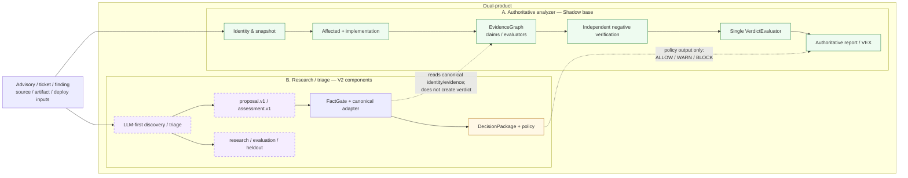
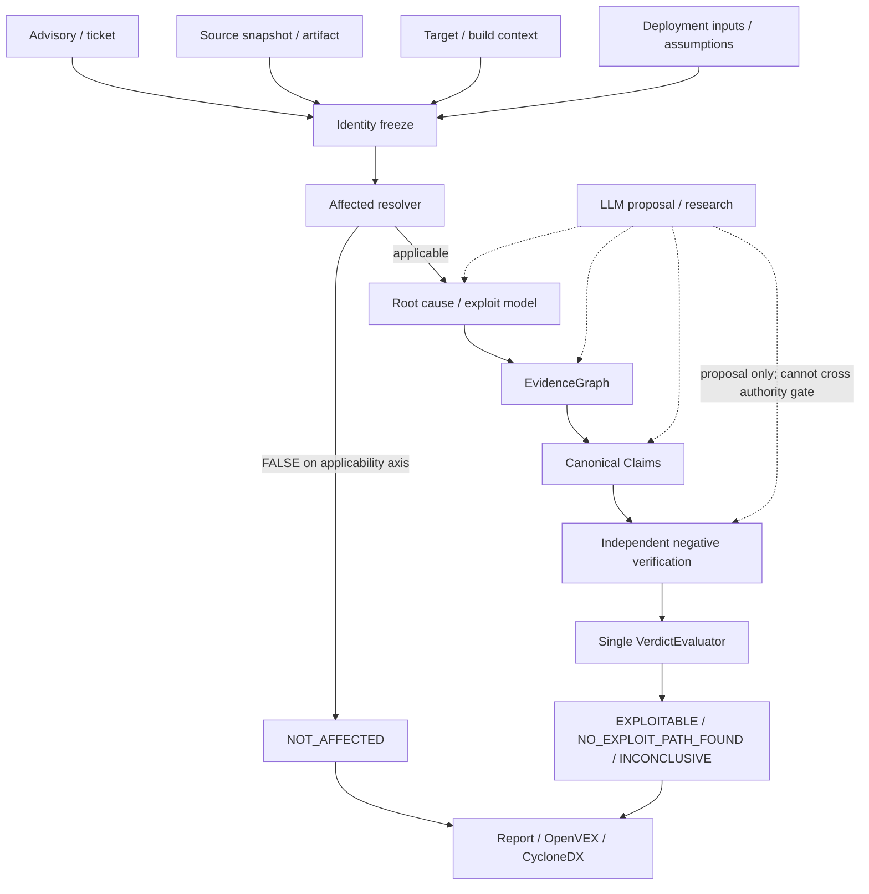

# Целевая архитектура, gap analysis и roadmap консолидации Shadow/V2

**Источник:** delegated `architect` artifacts `agent://TargetArchitectureDoc` (§1–12), `agent://TargetArchSelfSufficiency` (§13 + precise edits) и `agent://PortRevisionArchitect` (§14), 2026-10-20/21; precise edits применены main.
**Статус документа:** `DESIGN_FOR_REVIEW / TARGET SEMANTICS SELF-SUFFICIENT; PORT BACKLOG REVISED; IMPLEMENTATION EVIDENCE STILL INCOMPLETE` (see §14)  
**Канонический путь:** `docs/dev/roadmaps/2026-10-20-target-architecture-and-roadmap.md`
**Примечание:** это target architecture + gap analysis + roadmap; **не implementation specification** и не задаёт exact API-сигнатуры. Документ authoritative для target architecture, authority boundaries, canonical contract semantics, ownership, failure behavior и acceptance gates. Перенесён из `docs/dev/plans/` (там только implementation plans) и из `docs/dev/specs/` (там нормативные спеки). Implementation-спеки — S-01…S-15 из §7.  
**Назначение:** единая основа для последующей разработки implementation-спек. Документ не содержит реализации и не заменяет implementation-spec.

> **Port integrity review (2026-10-20):** independent implementer verdict — `ARCHITECTURE NEEDS REVISION`, `V2 PORT INCOMPLETE`. P0 gaps: `verify_code_absence` ownership, `internal/research` package collision, V2 `domain`/`affected` type mapping, Product B schema ownership. See [`../reports/2026-10-20-07-port-integrity-review.md`](../reports/2026-10-20-07-port-integrity-review.md).
>
> **Port integrity revision (2026-10-21):** §14 revises §§2.3, 2.4.2/2.4.5/2.4.9, 3.3, G-01, Phase 0–3, §13.3.3/13.4.1, §13.5, §7/§8, S-05/S-12/S-15 и §13.6.3. Verdict: `PORT BACKLOG REVISED / STILL INCOMPLETE`. In case of conflict, §14 wins.

**База решения:**

- Shadow `118e10c` — authoritative analyzer base.
- V2 `6bcce89` — reference lane для research, triage и evaluation.
- Целевая форма — **dual-product**:
  1. authoritative deterministic analyzer на базе Shadow;
  2. отдельный LLM-first research/triage product на компонентах V2.

**Главное правило:**

> **LLM may propose; deterministic contracts decide.**

## Статусы утверждений

- **PROVEN** — подтверждено кодом, тестом, сохранённым артефактом или независимой перепроверкой.
- **CLAIMED** — заявлено в документации или измерении, но область применимости ограничена.
- **PLANNED** — целевое состояние, которое ещё требуется реализовать.
- **INFERENCE** — вывод из нескольких источников, не являющийся прямым наблюдением.
- **UNVERIFIED** — свидетельство в просмотренных материалах не найдено.

---

# 1. Назначение, scope и инварианты

## 1.1. Какую задачу решает архитектура

Целевая система отвечает на вопрос:

> Выполняются ли обязательные условия эксплуатации конкретной уязвимости для конкретного продукта, source snapshot или release artifact, build context и deployment assumptions?

Единица анализа:

```text
advisory / ticket
  + source snapshot или release artifact
  + resolved dependency graph
  + target/build context
  + deployment/configuration assumptions
  + persisted evidence
```

Система не должна ограничиваться вопросами:

- присутствует ли зависимость;
- попадает ли версия в affected range;
- вызывается ли уязвимый символ;
- есть ли найденный call path.

Она должна отделять:

```text
identity
  → affectedness
  → vulnerable implementation / exploit locus
  → mandatory exploit conditions
  → evidence
  → TRUE / FALSE / UNKNOWN claims
  → independent negative verification
  → terminal verdict
  → replayable report
```

**Основание:** Shadow `docs/dev/specs/governing-spec.md` §§1–16; Shadow `docs/dev/reports/2026-10-20-02-architecture-status.md` §§1–2; V2 `docs/architecture.md` §§1–2.

## 1.2. Неизменные инварианты

### I-1. `false-safe = 0`

Ни один unsupported safe-negative результат не допускается:

- `NOT_AFFECTED`;
- `NO_EXPLOIT_PATH_FOUND`;
- triage `DISMISSED`;
- triage `LOWERED`;
- эквивалентная безопасная policy-диспозиция.

`false-safe=0` является целевым safety-инвариантом, а не утверждением о том, что любой текущий корпус доказывает универсальную безопасность.

Текущие измерения:

- Shadow: corpus `38/38`, `false-safe=0`; корпоративный census `7 NOT_AFFECTED / 1 NO_EXPLOIT_PATH_FOUND / 10 INCONCLUSIVE` — **PROVEN для сохранённых артефактов**.
- V2: universal verifier `6/85`, `false-safe=0` на all-NE корпусе — **PROVEN как offline measurement**, но positive-class recall не измерен.
- V2 research dev ablation: `2/36 false-safe` — **PROVEN**, поэтому research lane не является production authority.

**Источники:**  
Shadow `docs/dev/reports/2026-10-20-04-cross-solution-decision.md` §§1.1–1.2; `2026-10-20-05-independent-verification.md` таблица проверки; V2 `docs/dev/reports/2026-10-20-02-architecture-status.md` §§3.3–3.6.

### I-2. Identity-bound evidence

Каждое decision-relevant evidence должно быть связано как минимум с:

- advisory ID и frozen advisory bytes;
- ticket digest и извлечёнными claims;
- product source snapshot;
- commit или content digest;
- package и resolved version;
- artifact digest, если используется;
- GOOS/GOARCH, build tags, CGO и toolchain;
- deployment/configuration inputs;
- run/attempt ID;
- tool и tool version;
- scope/completeness metadata.

Несоответствие package/version, source, artifact, target или advisory запрещает использовать evidence для финального вывода.

**Источники:** Shadow `docs/dev/specs/governing-spec.md` §§3–5; Shadow `internal/affected/ticket.go`, `internal/repository/artifact.go`, `internal/domain/target.go`; Shadow `docs/dev/reports/2026-10-20-02-architecture-status.md` §§2.3, 2.10.

### I-3. `NO EVIDENCE != FALSE`

Пустой поиск, отсутствие найденного call path, failed package load, `PARTIAL`, открытая dispatch-модель или исчерпанный бюджет не являются доказательством FALSE.

`FALSE` требует:

1. именованный falsifier;
2. положительное evidence для falsifier;
3. закрытый релевантный scope;
4. независимую negative verification;
5. отсутствие contradictory evidence.

### I-4. Независимая negative verification

Safe-negative verdict невозможен без отдельной проверки:

- subject coverage;
- scope completeness;
- skipped/failed packages;
- function values;
- interface dispatch;
- reflection, unsafe, plugin, linkname и dynamic markers;
- trace/audit pairing;
- artifact/sidecar integrity;
- identity and build binding;
- replay consistency.

Первичный evaluator не может сам создать `NegativeVerification=VERIFIED`.

### I-5. Явный `INCONCLUSIVE`

`INCONCLUSIVE` — нормальный terminal outcome, а не ошибка качества.

Он используется при:

- неизвестной applicability;
- incomplete source/build scope;
- failed SDK/toolchain load;
- unresolved dispatch;
- unknown input control;
- missing advisory subject coverage;
- contradictory identity;
- незавершённой negative verification;
- неразрешённых assumptions.

### I-6. Replay без LLM

Persisted case должен быть повторно проверяемым:

- без нового LLM-вызова;
- без чтения удалённого advisory API;
- без обращения к нестабильному внешнему источнику;
- с повторной проверкой hashes, sidecars, proofs, assumptions и provenance.

### I-7. Policy и evidence не смешиваются

Человеческое утверждение:

```text
«этот конфигурационный источник принадлежит доверенной инфраструктуре»
```

не является кодовым evidence.

Assumption должна иметь отдельные:

- ID;
- scope;
- owner;
- authority;
- source reference;
- digest;
- review/validity date.

### I-8. LLM не имеет authority

LLM может:

- интерпретировать advisory и patch;
- предложить root cause/locus;
- предложить mandatory conditions;
- предложить falsifier;
- выбрать следующий evidence query;
- объяснить limitation;
- дать triage recommendation proposal;
- обнаружить противоречие;
- предложить demotion в `UNKNOWN`.

LLM не может:

- изменить identity;
- создать authoritative evidence;
- расширить advisory subject set;
- установить `ClaimFalse`;
- установить `NegativeVerification=VERIFIED`;
- установить `NOT_AFFECTED`;
- установить `NO_EXPLOIT_PATH_FOUND`;
- заменить `INCONCLUSIVE` на safe verdict;
- превратить triage recommendation в authoritative VEX verdict.

---

## 1.3. Scope

### В scope

1. Shadow как authoritative deterministic analyzer.
2. Identity/ticket/artifact/build binding.
3. Affectedness и implementation axis.
4. Root-cause и exploit-locus verification.
5. EvidenceGraph, claims, evaluators.
6. G1 post-reach configuration route.
7. G2 implementation-presence route.
8. Negative verification и sidecar integrity.
9. Replay без LLM.
10. V2 shipping-scope и dynamic-marker improvements.
11. V2 importer closure.
12. V2 triage shell и proposal-only ingress.
13. FactGate и DecisionPackage adapter.
14. Claimshape, verification, heldout и mutation tooling.
15. V2 research/evaluation lane.
16. CI/CD policy integration.
17. Documentation, ownership и operational contracts.

### Явно out of scope

1. Третья независимая архитектура.
2. V2 как новый authoritative core.
3. Второй verdict engine.
4. Второй evidence или negative-verification contract.
5. Production auto-dismissal на основании LLM output.
6. Универсальный taint engine.
7. Автоматическое доказательство всех runtime, plugin, reflection и cgo behaviours.
8. Гарантированное закрытие case-03, 07/08, 01/02/17/18.
9. Использование research completion как production safety proof.
10. Перенос V2 `internal/domain`, `internal/affected` и `internal/evaluator` поверх Shadow.
11. Пересмотр решения «Shadow base / V2 reference lane».

**Нормативный статус.** Target document + §13 addendum — primary source для target architecture и implementation-спек. `goals-scope.md`, `dev/specs/governing-spec.md` и `dev/decisions/architecture-decisions.md` остаются current-state/provenance для Product A до Phase 0 amendment; после amendment они должны ссылаться на target contracts. Current Product A docs не требуются как primary input для target specs.

---

## 1.4. Адресаты

Документ предназначен для:

- authors implementation-спек;
- implementers;
- reviewers security/evidence contracts;
- владельцев CI/CD integration;
- владельцев benchmark/evaluation corpus;
- maintainers Shadow core;
- maintainers research/triage adapters.

Документ не является пользовательской CLI-инструкцией и не должен использоваться как единственный источник точных API-сигнатур для реализации. Такие сигнатуры должны быть зафиксированы в последующих implementation-спеках.

---

# 2. Целевая архитектура

## 2.1. Product topology

Целевая система состоит из двух продуктов над одной authoritative contract base.

### Product A — Authoritative Analyzer

База: Shadow.

Назначение:

- authoritative applicability;
- affectedness;
- implementation presence;
- root-cause verification;
- exploit-condition evaluation;
- evidence collection;
- negative verification;
- terminal verdict;
- authoritative reports/VEX;
- deterministic replay.

Terminal verdicts:

```text
NOT_AFFECTED
EXPLOITABLE
NO_EXPLOIT_PATH_FOUND
INCONCLUSIVE
```

Единственный source of truth для этих verdicts:

```text
persisted AnalysisCase
  + canonical EvidenceGraph
  + canonical Claims
  + canonical NegativeVerification
  + deterministic VerdictEvaluator
```

### Product B — Research/Triage Product

База: V2 components.

Назначение:

- discovery;
- advisory interpretation;
- root-cause exploration;
- evidence-plan proposal;
- finding triage;
- prioritization;
- CI policy recommendation;
- research reports;
- blind/holdout evaluation;
- model and prompt experiments.

Результаты:

```text
proposal
assessment
recommendation
policy outcome
research category
```

Они не являются authoritative security verdicts.

### Trust boundary



### Главное ограничение topology

V2 triage/research не должен содержать собственного semantic verdict engine.

Допустимы:

- `assessment.v1`;
- `DecisionPackage`;
- `ALLOW/WARN/BLOCK`;
- `DISMISSED/LOWERED/UNCHANGED` как triage vocabulary;
- research categories.

Недопустимо считать их синонимами:

```text
agent NOT_EXPLOITABLE != NO_EXPLOIT_PATH_FOUND
DISMISSED != NOT_AFFECTED
ALLOW != security proof
UNCHANGED != EXPLOITABLE
```

**Основание:** Shadow `2026-10-20-06-approach-decision.md` §§5–6; V2 `docs/dev/specs/agent-triage-v2-spec.md` §§1–3; V2 `docs/dev/reports/2026-10-20-03-architecture-decisions.md` §1.3.

---

## 2.2. Authority model: уровни A/B/C

| Уровень | Назначение | Может делать LLM | Что обязательно deterministic | Результат |
|---|---|---|---|---|
| **A — Discovery** | Advisory interpretation, root cause, exploit model, evidence search | Предлагать locus, условия, sink, query, summary, next step | Identity, advisory binding, source existence, package/symbol validation, evidence collection | `proposal.v1`, research dossier |
| **B — Triage** | Приоритизация и recommendation для уже найденного finding | Предлагать assessment, falsifier, rationale, priority | FactGate, canonical locators, subject binding, scope/coverage, verification, policy | `DecisionPackage`, `ALLOW/WARN/BLOCK`, `DISMISSED/LOWERED/UNCHANGED` |
| **C — Verdict** | Authoritative security conclusion | Не имеет права устанавливать результат | Identity, affectedness, claims, negative verification, replay, VerdictEvaluator | `NOT_AFFECTED`, `EXPLOITABLE`, `NO_EXPLOIT_PATH_FOUND`, `INCONCLUSIVE` |

### Schema-level distinction

#### `proposal`

Недоверенный кандидат:

```text
proposal_id
schema_version
case_identity_ref
advisory_ref
kind
candidate_payload
source = llm | human | research
confidence            # advisory metadata only; не authority
evidence_refs         # references, не доказательство
limitations
```

Proposal **не содержит** полей:

```text
verified
negative_verification
mandatory
coverage_complete
verdict
recommendation
```

#### `recommendation`

Результат triage policy:

```text
recommendation
recommended_profile
support_level
rationale
residual_assumptions
reassessment_triggers
fact_refs
proof_refs
policy_outcome
```

Recommendation не меняет authoritative verdict.

#### `verdict`

Результат только canonical deterministic evaluator:

```text
verdict
reason
affected_axis
condition_ids
claim_ids
negative_verification_ids
coverage
ground_basis
case_identity_ref
replay_metadata
```

---

## 2.3. Component map

| Компонент | Назначение | Текущий дом | Статус в target | Входы | Выходы | Владелец контракта |
|---|---|---|---|---|---|---|
| Identity / ticket guard | Связать advisory, ticket, package/version и analyzed build | Shadow `internal/tracker`, `internal/affected/ticket.go` | **Existing** | Ticket, advisory, package/version, artifact | Identity record, mismatch/refusal | Shadow `internal/domain`, `internal/affected` |
| Snapshot / artifact | Зафиксировать source, commit, artifact, build info, target | Shadow `internal/repository`, `internal/states` | **Existing** | Repo, binary/ZIP, target, toolchain | Snapshot, artifact metadata, digests | Shadow `internal/repository` |
| Affected resolver | Проверить module/version/package/build applicability | Shadow `internal/affected/resolver.go` | **Existing** | Module graph, `go list`, semver, build context | `AffectedResult` | Shadow `internal/affected` |
| Implementation axis | Проверить наличие vulnerable implementation в выбранном target | Shadow `internal/affected/implementation.go`, `internal/domain/implementation.go` | **Existing** | Locus proposal, source, build expressions, target | Implementation presence/absence | Shadow `internal/affected` |
| Root-cause resolver | Найти defect locus и отделить wrappers/transport | Shadow `internal/rootcause` | **Existing; extensions possible** | Advisory, patch, source, proposal | Verified `RootCauseModel` or unresolved | Shadow `internal/rootcause` |
| Exploit model | Сформировать mandatory conditions | Shadow `internal/exploit`, `internal/research` | **Existing; canonicalize** | Root cause, advisory, patterns, proposal | `ExploitModel` | Shadow `internal/exploit` |
| EvidenceGraph | Хранить evidence, paths, flows, tool executions, limitations | Shadow `internal/domain/domain.go` | **Existing; canonical** | Tool observations, source/build facts | Hashable `EvidenceGraph` | Shadow `internal/domain` |
| Go analysis | AST/SSA/types/call graph/provenance/usage | Shadow `internal/goanalysis` | **Existing** | Snapshot, build context | Evidence, scope diagnostics | Shadow `internal/goanalysis` |
| Shipping-scope filter | Отделить shipping LIVE/DYNAMIC/DEAD scope | V2 `internal/goanalysis/unreachability_scope.go`, `unreachability_dynamic.go` | **To port** | Main roots, import graph, init, markers | Scope classification and audit boundaries | Shadow `internal/goanalysis` after port |
| Importer closure | Enumerate reverse importers and dependency closure | V2 `internal/goanalysis/toolscope.go` — `ImportClosure`, `EnumerateImportClosure` | **To port; P0/P1 dependency** | Package/module graph, loader state | Complete importer closure | Shadow `internal/goanalysis` |
| Claims/evaluators | Convert evidence into TRUE/FALSE/UNKNOWN | Shadow `internal/domain`, `internal/evaluator` | **Existing; sole authority** | EvidenceGraph, exploit model, assumptions | Canonical `Claim` | Shadow `internal/evaluator` |
| G1 post-reach | Verify exact sink argument, configuration origin and complete sink closure | Shadow `internal/evaluator/postreach.go` | **Existing** | Sink closure, data flow, assumptions | Verified FALSE claim candidate | Shadow `internal/evaluator` |
| Negative verification | Independently verify falsifier and scope | Shadow `internal/goanalysis`, `internal/research` | **Existing; canonicalize API** | Claim candidate, scope, dynamic checks, audit | `NegativeVerification` | Shadow `internal/evaluator` + persistence in `internal/research` |
| Verdict evaluator | Compute terminal authoritative verdict | Shadow `internal/evaluator/verdict.go` | **Existing; only one** | AffectedResult, Claims, NegativeVerification | Authoritative verdict | Shadow `internal/evaluator` |
| Authoritative sidecars | Persist oversized proof payloads with digest/size/selector | Shadow `internal/evidencetools`, `internal/research/deterministic.go` | **Existing** | Typed proof payload | Content-addressed sidecar ref | Shadow `internal/research` |
| Authoritative replay | Rehydrate and revalidate case without LLM | Shadow `internal/research/replay.go`, `validate.go` | **Existing; adapter extension** | Persisted case, sidecars, assumptions | Replay result/refusal | Shadow `internal/research` |
| Reporting / VEX | Render authoritative report and VEX projections | Shadow `internal/report` | **Existing** | AnalysisCase, verdict, evidence | `report.json`, Markdown, OpenVEX, CycloneDX | Shadow `internal/report` |
| Shipping-scope dynamic relevance | Subject-aware handling of dynamic markers | V2 `internal/goanalysis` | **To port** | Subject, marker, shipping scope | Relevant/open marker classification | Shadow `internal/goanalysis` |
| `agenttriage` | LLM-first finding triage shell | V2 `internal/agenttriage` | **To port through adapter** | `finding.v1`, snapshot, advisory, config | Assessment/proposals, audit | Target `internal/triageadapter`; V2 package remains reference |
| Proposal-only falsifier ingress | Prevent agent from asserting proof fields | V2 `internal/agenttriage/falsifier.go` | **To port** | `assessment.v1` | Validated proposal or rejection | Target triage adapter |
| FactGate | Resolve citations/locators to deterministic facts | V2 `internal/agenttriage/factgate.go` | **To port/adapt** | `det:`/`obs:` refs, canonical evidence | Fact set with completeness | Target triage adapter, using Shadow EvidenceGraph |
| DecisionPackage / policy | Compose recommendation and policy outcome | V2 `internal/agenttriage/composer.go`, `policy.go` | **To port/adapt** | FactGate, verified proofs, baseline, stability | `DecisionPackage`, `ALLOW/WARN/BLOCK` | Target triage adapter |
| Claimshape | Normalize assessment claims for offline verification | V2 `internal/claimshape` | **To port as offline tooling** | `assessment.v1` | Canonical claim shapes / unsupported reasons | Target verification/eval maintainers |
| Verification graph | Check entailment, predicate evidence and proof integrity | V2 `internal/verification` | **To port as offline/admission tooling** | Claim shapes, observations, certificates | Verification result | Target verification/eval maintainers |
| Heldout gate | Offline replay, mutation and cross-run tests | V2 `internal/heldoutgate`, `cmd/heldout-gate` | **To port** | Frozen corpus, proofs, mutations | Admission metrics/gate | Target evaluation maintainers |
| Refindex | Build advisory-symbol and usage reference index | V2 `internal/refindex` | **To port to research/eval lane** | Advisory, module graph, source | `refindex` artifact | Research/eval maintainers |
| Reportcheck | Check citation grounding and report consistency | V2 `internal/reportcheck` | **To port to research/eval lane** | Research report, snapshot, refs | Grounding report | Research/eval maintainers |
| Research lane | LLM-first advisory research and root-cause experiments | V2 `internal/research`, `cmd/izyan research` | **To port as separate product** | Snapshot, frozen advisory, prompt, model | Non-authoritative dossier/category | Research product maintainers |
| Replay adapter | Map V2 replay artifacts to canonical Shadow identity/evidence | New target adapter | **To design** | V2 run, Shadow case refs | Replayable adapter result | Target integration owner |
| Policy output adapter | Map recommendation to CI outcome without VEX authority | New target adapter | **To design** | DecisionPackage, baseline, policy | `ALLOW/WARN/BLOCK` | Target CI/policy owner |
| Schema registry | Version canonical contracts and migration rules | New target documentation/package | **To design** | Shadow/V2 schemas | Versioned schemas, compatibility rules | Architecture owner |
| Ownership/CI registry | Define maintainers, gates, artifact retention and release process | No canonical owner map found | **To design** | Components, contracts, CI | CODEOWNERS-like matrix and gates | Repository maintainers |

---

## 2.4. Canonical contracts и ownership

> **Target-level semantics:** canonical `VerdictResult`, identity-state and failure semantics are defined in §13.2.4–13.2.5. The contract sketches in §2.4.1–2.4.5 are directional; §13 is authoritative for target semantics.

### 2.4.1. `AnalysisCase`

`AnalysisCase` остаётся canonical persisted unit.

**Текущий источник:** Shadow `internal/domain/domain.go`; Shadow `docs/dev/specs/governing-spec.md` §3.

Target contract:

```text
AnalysisCase
  case_id
  schema_version

  Identity
    advisory_id
    advisory_digest
    ticket_digest
    product_module
    source_path / source_commit / source_digest
    artifact_digest / artifact_member
    resolved_dependency_versions
    target
    build_tags
    cgo
    toolchain
    deployment_input_digests

  Vulnerability
  ProductSnapshot
  AffectedResult
  RootCauseModel
  ExploitModel
  EvidenceGraph
  Claims[]
  Assumptions[]
  NegativeVerifications[]
  VerdictResult
  WorkflowStatus
  ReplayMetadata
```

Правила:

- persisted `AnalysisCase`, а не LLM transcript, является source of truth;
- отсутствие identity не может быть компенсировано proposal;
- migration между версиями схемы должна быть explicit;
- `AnalysisCase` не должен содержать вторую triage-specific semantic verdict model.

### 2.4.2. `EvidenceGraph`

`EvidenceGraph` — единая модель authoritative evidence.

**Текущий источник:** Shadow `internal/domain/domain.go`, `EvidenceGraph`; Shadow `docs/dev/specs/governing-spec.md` §§10–11.

Минимальные сущности:

```text
Evidence
ToolExecution
CallPath
DataFlow
Entrypoint
Validation
ConfigurationFact
RuntimeFact
SinkClosure
IngressClosure
ModuleUsage
SkippedPackage
ToolLimitation
Hash
```

Каждое evidence должно иметь:

```text
evidence_id
kind
quality
case_identity_ref
subject
source / file / line range
tool / version / command
content or sidecar_ref
digest
scope
completeness
limitations
```

V2 `Observation` остаётся транспортом/наблюдением и должен адаптироваться в EvidenceGraph. Он не становится вторым authoritative evidence model.

### 2.4.3. `Claim`

Canonical Claim:

```text
Claim
  claim_id
  condition_id
  subject
  result: TRUE | FALSE | UNKNOWN
  evidence_ids
  falsifier
  negative_verification_id
  assumption_ids
  covered_subjects
  coverage
  explanation
  limitations
```

Запрещены как authoritative results:

```text
LIKELY_TRUE
PROBABLY_SAFE
HIGH_CONFIDENCE
NOT_EXPLOITABLE
```

`assessment.v1`, `claimshape` и research prose могут содержать такие значения как model/research fields, но adapter не должен маппить их напрямую в canonical Claim.

### 2.4.4. `AffectedResult`

Affectedness имеет отдельную цепочку:

```text
module present
  → version affected
  → package present
  → build relevant
  → vulnerable implementation present
```

`NOT_AFFECTED` разрешён только из FALSE в этой цепочке.

Symbol unreachability, package call absence или attacker-control absence не превращаются в `NOT_AFFECTED`.

**Текущий источник:** Shadow `internal/domain/domain.go`, `internal/affected/{resolver,implementation}.go`; Shadow `docs/dev/reports/2026-10-20-02-architecture-status.md` §§1.4, 2.9.

### 2.4.5. `NegativeVerification`

Единый contract:

```text
NegativeVerification
  verification_id
  status: VERIFIED | CONTRADICTED | INSUFFICIENT_SCOPE
  falsifier_kind
  condition_id
  evidence_ids
  scope_basis
  complete
  covered_subjects
  dynamic_checks
  trace_ref
  sidecar_ref
  identity_ref
  limitations
```

Обязательные semantics:

- `VERIFIED` означает проверенный конкретный falsifier, а не универсальное доказательство всех свойств;
- `INSUFFICIENT_SCOPE` не допускает safe-negative;
- `CONTRADICTED` демонтирует FALSE claim;
- V2 verification result адаптируется в этот contract;
- V2 `source:kernel` proof может быть evidence для canonical contract, но не отдельным verdict.

### 2.4.6. Assumptions

Assumption не является EvidenceGraph record.

```text
Assumption
  assumption_id
  kind: config-trust | supported-targets | deployment-policy
  statement
  scope
  owner
  authority
  source_ref
  digest
  valid_from
  review_by
  target_matrix
```

Узкий artifact-scoped assumption не может удовлетворить product-wide requirement.

**Текущий источник:** Shadow `internal/domain/assumptions.go`, `internal/repository/assumptions.go`; Shadow status §2.8.

### 2.4.7. Authoritative sidecars

Большие typed proofs сохраняются отдельно:

```text
sidecar_ref
  path
  sha256
  size
  selector
  schema_version
  case_identity_ref
  scope_digest
```

Sidecar:

- является частью authoritative evidence;
- проверяется при rehydration;
- не может быть заменён display prefix;
- tamper, removal, selector mismatch, digest mismatch и forged pin должны fail closed.

**Текущий источник:** Shadow `internal/evidencetools/observation.go`; Shadow `internal/research/deterministic.go`; `2026-10-20-05-independent-verification.md` пункт 16.

### 2.4.8. Proposal и assessment schemas

`proposal.v1`:

- недоверенный;
- identity-bound;
- не содержит authority fields;
- сохраняется для аудита;
- может быть отвергнут без изменения authoritative case.

`assessment.v2`:

- V2 input для triage composer;
- может содержать agent verdict/reasoning как мнение, не как authority;
- `falsifier_proposals` являются proposal-only и опциональны;
- assessment не становится Claim или Verdict без deterministic verification;
- `assessment.v1` — history-only для offline extractors; live decode его не
  принимает.

### 2.4.9. `DecisionPackage`

> **Revised canonical field set:** §14.5. `policy_outcome` is not a
> `DecisionPackage` field; policy result is a separate `PolicyResult`/
> `AutomationStatus`.

`DecisionPackage` — canonical triage recommendation artifact, не authoritative verdict.

```text
DecisionPackage (decision-package.v3)
  schema_version
  run_id, finding_id, execution_mode
  scope                    # snapshot/requested ids/records+sha256/boundary
  judgment                 # model verdict/summary/mechanism
  proposed_action          # human action + decisive claims + reconsider_when
  premises, counterarguments, unknowns
  support                  # level + decisive ids + proof ids/reasons
  technical_assessment     # fact validation, budget/stability/limitations
  machine_disposition      # recommendation/profile/demotions/assumptions/
                           # triggers/conditional_profiles/automation
  facts, falsifier_proofs, audit
```

Правила:

- `DISMISSED` и `LOWERED` production admission остаются default-off;
- unverified reduction → `UNCHANGED`;
- technical failure не превращается в `UNCHANGED`;
- `support` — свойство записанных оснований, не вероятность и не admission;
- `human-decision.v1` хранит Accept/Reject отдельно и никогда не повышает
  machine recommendation;
- `decision-package.v2` — history-only, live replay его не реадмитит;
- `DecisionPackage` не может содержать authoritative semantic verdict, если он не ссылается на canonical Shadow VerdictResult;
- triage-scoped VEX является optional non-authoritative projection.

### 2.4.10. Ownership model

| Contract | Canonical owner |
|---|---|
| Identity, AnalysisCase, Assumption | Shadow `internal/domain` + `internal/repository` |
| AffectedResult | Shadow `internal/affected` |
| EvidenceGraph | Shadow `internal/domain` |
| Claims and evaluator semantics | Shadow `internal/evaluator` |
| NegativeVerification | Shadow `internal/evaluator` with persistence in `internal/research` |
| Sidecar format | Shadow `internal/evidencetools` + `internal/research` |
| Authoritative verdict | Shadow `internal/evaluator/verdict.go` |
| Triage proposal/assessment adapter | New integration layer, target `internal/triageadapter` |
| DecisionPackage/policy | Ported V2 triage layer, constrained by canonical adapter |
| Claimshape/verification/heldout | Offline evaluation layer |
| Research reports/refindex/reportcheck | Research/evaluation lane |
| Authoritative Markdown/VEX | Shadow `internal/report` |
| CI exit policy | Integrated CLI/CI owner, not verdict evaluator |

---

## 2.5. Data and artifact flow

### 2.5.1. Authoritative analysis flow



LLM calls разрешены только на стадиях A/B:

- advisory interpretation;
- root-cause proposal;
- exploit model proposal;
- next evidence query;
- triage assessment;
- report explanation.

LLM не вызывается для replay verdict.

### 2.5.2. Finding-to-triage flow

```text
finding.v1 / generic ticket
  → intake-proposal.v1
  → catalog/ref resolution
  → immutable snapshot
  → frozen advisory
  → bounded read-only agent
  → assessment.v1 + falsifier proposals
  → FactGate
  → canonical identity/evidence adapter
  → claimshape / verification
  → DecisionPackage
  → policy ALLOW/WARN/BLOCK
```

Если canonical proof не может быть построен:

```text
technical error → exit 2
или
unsupported/insufficient evidence → UNCHANGED + limitation
```

Нельзя:

```text
agent NOT_EXPLOITABLE
  → DISMISSED
  → authoritative VEX not_affected
```

без canonical deterministic admission.

### 2.5.3. Что персистится

#### Authoritative product

- raw advisory/ticket bytes;
- identity and snapshot manifests;
- source/artifact references and hashes;
- build/toolchain/target facts;
- assumptions;
- EvidenceGraph;
- tool executions and output hashes;
- claims;
- negative verification;
- sidecars;
- verdict;
- report/VEX;
- replay metadata;
- limitations.

#### Research/triage product

- input finding/ticket;
- catalog/ref resolution;
- snapshot manifest;
- frozen advisory;
- prompt/rules hashes;
- model metadata;
- raw agent output;
- assessment;
- proposal artifacts;
- FactGate results;
- observations/archive;
- DecisionPackage;
- stability attempts;
- policy output;
- audit events;
- replay manifest.

---

# 3. Deployment и operational model

## 3.1. Target commands

| Команда | Назначение | Target status |
|---|---|---|
| `izyan analyze` | Один authoritative deterministic case | Shadow existing |
| `izyan scan` | Анализ набора advisories/modules | Shadow existing |
| `izyan eval` | Deterministic regression corpus | Shadow existing |
| `izyan remediate` | Отдельный remediation workflow | Shadow existing, не расширять scope |
| `izyan research` | LLM-first research lane | Shadow/V2 components, adapter required |
| `izyan triage` | LLM-first CI triage | V2 existing, port to Shadow integration |
| `izyan knowledge` | KB inspection | Shadow existing |
| `izyan-evidence-tools` | Read-only deterministic tools/MCP | V2 existing, adapt identity |
| `heldout-gate` | Offline admission/evaluation | V2 existing, port |
| `claimshape-report` | Claim-shape coverage | V2 existing, port |
| `izyan-refindex` | Research reference index | V2 existing, port |
| `izyan-reportcheck` | Research grounding checks | V2 existing, port |

## 3.2. Execution modes

### Deterministic authority

Default:

```text
LLM: off
authoritative verdict: on
replay: on
```

Supported explicit modes:

- `--deterministic-only`;
- bounded optional LLM proposal mode;
- strict LLM mode for research/CI experiments;
- replay mode without LLM/network.

### Research

- model calls opt-in;
- snapshot read-only;
- prompt and model metadata frozen;
- raw answer persisted;
- research result marked non-authoritative;
- no semantic VEX update.

### Triage

- bounded agent;
- read-only tools;
- FactGate required;
- proposal-only ingress;
- policy outcome separate from semantic verdict;
- dismissal admission default-off.

### Default-off controls

Следующие функции должны оставаться выключенными по умолчанию:

- production semantic auto-dismissal;
- triage `DISMISSED`/`LOWERED` admission без positive holdout gate;
- triage-scoped VEX projection;
- external artifact reads;
- arbitrary repository execution;
- model-based authoritative root-cause replacement;
- LLM-generated negative verification;
- use-based research category as semantic decision.

**Уточнение:** `external artifact reads` default-off относится к unbounded agent tools и Product B research. Явно переданный, digest-bound release artifact Product A является штатным input channel и не требует включения этого контроля.

**Основание:** Shadow CLI `docs/cli.md`; V2 `cmd/izyan/triage.go`; V2 `docs/cli.md` §§triage/replay; V2 status §§3.6–3.7.

## 3.3. Artifact layout

Target run directory:

```text
<out>/<case-or-finding-id>/
  identity.json
  input/
    advisory.json
    ticket.json
    finding.json
  snapshot/
    manifest.json
    source-ref.json
    artifact-ref.json
  assumptions.json
  rules/
    ruleset.json
    prompt.json
  evidence/
    evidence-graph.json
    tool-executions.jsonl
    observations.jsonl
  sidecars/
    <content-addressed-proof>.json
  claims.json
  negative-verification.json
  case.json
  verdict.json
  decision-package.json          # triage only
  assessment.json                # triage/research only
  report.json
  report.md
  report.en.md
  report.audit.md
  openvex.json
  cyclonedx.json
  audit/
    events.jsonl
  replay.json
  metrics.json
```

Часть layout уже существует в Shadow/V2, но единый layout является **PLANNED** и должен быть закреплён отдельной implementation-spec. Owner: S-01; replay path compatibility: S-09 (§14.3/§14.6).

## 3.4. Exit behavior

### Triage

Сохранить V2 contract:

| Exit code | Значение |
|---:|---|
| `0` | Пакет(ы) доставлены; явные `--fail-on` пороги не нарушены; human decision записан. Это доставка, **не** машинное reduction- или VEX-разрешение. |
| `1` | Package собран, но сработал явно заданный `--fail-on` |
| `2` | Technical error, integrity/provenance drift или невозможность построить корректный package |

`2` имеет приоритет над `1`. Accept/Reject человека не меняет ни один
exit code и не повышает machine recommendation. Offline
`izyan eval triage` имеет собственные exit-коды сравнения и не является
live-гейтом.

### Authoritative analyzer

**PLANNED:** единый CLI contract:

- `0` — анализ завершён с любым честным verdict, включая `INCONCLUSIVE`;
- `2` — техническая ошибка, identity mismatch, corrupted artifact, failed persistence, replay mismatch;
- identity refusal — **не semantic verdict**: выдаётся refusal/error artifact и exit `2`; никогда не рендерится как `NOT_AFFECTED`;
- отдельный policy exit для CI не должен менять semantic verdict.

## 3.5. CI integration

CI должен проверять:

1. Shadow deterministic corpus:
   - `38/38`;
   - `false-safe=0`;
   - no unexpected verdict drift.
2. Census guard:
   - baseline manifest;
   - expected `7/1/10` до изменения input harness;
   - explicit drift review.
3. Sidecar tamper/removal tests.
4. Replay without LLM.
5. Triage mutation/cross-run tests.
6. Positive holdout gate before any admission.
7. Documentation/schema consistency.
8. Artifact retention and digest availability.

## 3.6. Observability

Обязательные metrics:

### Authority

- verdict counts;
- `INCONCLUSIVE` drivers;
- affected-axis outcomes;
- claim TRUE/FALSE/UNKNOWN counts;
- negative verification statuses;
- skipped packages;
- open dynamic markers;
- scope completeness;
- replay success/failure;
- sidecar rehydration failures;
- identity mismatches;
- tool errors and budgets.

### Research/triage

- proposal count;
- accepted/rejected proposal count;
- FactGate complete/partial/unknown;
- verified falsifier count;
- unsupported proof count;
- `DISMISSED`/`LOWERED`/`UNCHANGED`;
- policy outcomes;
- stability flips;
- cross-run/provenance failures;
- positive/negative holdout metrics;
- analyst review time;
- research latency and cost.

---

# 4. Security и trust boundaries

## 4.1. Prompt injection

Недоверенными считаются:

- advisory text;
- ticket text;
- source comments;
- README;
- repository files;
- deployment manifests;
- model-generated content;
- external citations.

LLM получает только bounded read-only tools. Prompt injection не должен:

- менять system contract;
- выбирать произвольный ref;
- читать внешние файлы;
- обращаться к секретам;
- писать в source snapshot;
- объявлять verified proof;
- менять verdict или policy.

## 4.2. Model output

Model output:

- валидируется schema;
- сохраняется raw;
- проходит identity and subject checks;
- не может содержать authority fields в proposal ingress;
- не используется как proof без independent deterministic verification;
- при нестабильности демотируется в recommendation `UNCHANGED` или research limitation.

## 4.3. Identity substitution

Гейт должен блокировать:

- другой CVE/advisory;
- другой package/version;
- другой source commit;
- другой artifact;
- другой target;
- другой build tag set;
- foreign sidecar;
- cross-run observation;
- stale evidence.

Ticket package/version mismatch должен оставаться refusal/unknown, а не автоматически превращаться в `NOT_AFFECTED`.

## 4.4. Cross-run leakage

Каждая observation/proof должна содержать:

```text
run_id
case_id
snapshot_digest
advisory_digest
build_context_digest
scope_digest
```

C14 или эквивалентный gate должен отвергать:

- proof из другой попытки;
- proof из другого finding;
- stale archive;
- foreign sidecar;
- mismatched tool arguments;
- altered observation.

## 4.5. Sidecar tampering

Удаление, изменение, forged digest, selector mismatch или size mismatch должны приводить к:

```text
replay failure / INCONCLUSIVE / technical error
```

но никогда к safe-negative.

## 4.6. Admission gates

Safe triage admission требует:

1. mandatory condition source;
2. complete subject coverage;
3. complete deterministic observation;
4. independent verification;
5. identity/build binding;
6. replay success;
7. positive and negative labels;
8. measured positive-class recall;
9. stability and cross-run isolation;
10. no regression against Shadow authority corpus.

---

# 5. Gap analysis

## 5.1. Реестр gaps

| ID | Компонент | Current state | Target state | Тип | Зависимость | Риск | Priority | Acceptance / exit criterion |
|---|---|---|---|---|---|---|---|---|
| G-01 | Importer closure | V2 имеет `ImportClosure`/`EnumerateImportClosure` и `evidencetools/verify_code_absence.go` (порт в Shadow — S-03b); triage falsifier зависит от этих структур, которых в Shadow нет | Единый importer-closure contract в Shadow `internal/goanalysis` | missing | Shadow baseline | Без него port не компилируется и scope остаётся неполным | P0 | Shadow содержит совместимый closure API; `verify_code_absence` и adapter компилируются; failed/open closure остаётся blocking |
| G-02 | Shipping scope | V2 реализует main/import/init roots, DEAD-only pruning и subject-aware dynamic relevance; в Shadow аналогичный scope filter не является текущим canonical port | Scope filter в Shadow kernel с сохранением open/unknown semantics | missing | G-01 | Filter может скрыть LIVE/UNKNOWN и создать false-safe | P0 | Adversarial fixtures подтверждают: `LIVE`, `UNKNOWN`, `PARTIAL`, skipped и open dispatch не становятся safe-negative |
| G-03 | Evidence contract | Shadow имеет `EvidenceGraph`; V2 имеет `Observation`, `ObservationArchive`, `claimshape`, verification | Один canonical EvidenceGraph; V2 observations — adapter input | duplicate | G-01 | Два evidence semantics и semantic drift | P0 | Для одного case существует одна canonical evidence projection; no second authoritative evidence schema |
| G-04 | Claims contract | Shadow `Claim` и V2 claimshape/assessment используют разные уровни | Shadow Claim — единственный authoritative claim; V2 claimshape — offline projection | duplicate | G-03 | Model assessment может попасть в verdict | P0 | Contract tests отвергают direct mapping `assessment → ClaimFalse/VERIFIED` |
| G-05 | Verdict engine | Shadow `internal/evaluator/verdict.go` authoritative; V2 имеет собственный evaluator/triage composer | Один Shadow `VerdictEvaluator` | duplicate | G-03/G-04 | Два источника `NOT_AFFECTED`/`NO_EXPLOIT_PATH_FOUND` | P0 | Все authoritative verdicts проходят Shadow evaluator; V2 evaluator не вызывается в authority path |
| G-06 | Negative verification | Shadow NV/sidecar/replay зрелые; V2 verification graph/C14 силён как offline shell | Один canonical NV contract с V2 adapter | duplicate | G-03/G-05 | Разные значения `VERIFIED` и `COMPLETE` | P0 | Shadow и V2 fixture results маппятся в один status model; contradictions/blockers preserved |
| G-07 | Triage admission | V2 dismissal capability default-off; `6/85`, `0/39 eligible`, positive recall отсутствует | Admission только после positive holdout, recall и integrity gates | unsafe | G-03–G-06 | Silent auto-dismissal и false-safe | P0 | До gate production recommendation не создаёт semantic close/VEX not_affected; gate имеет recorded `default-off` result |
| G-08 | Positive holdout | V2 85-run verifier corpus состоит из human-NE cases; exploitable recall не измерен; для ≥95% precision claim требуется ≥59 admissions | Pinned positive/negative/inconclusive corpus и measured recall | missing | G-07 | Precision/completion создают ложное чувство safety | P1 | Positive labels, ≥59 eligible admissions для заявленного lower bound, recall и false-safe metrics опубликованы |
| G-09 | Advisory subject coverage | V2 B46: 39/85 без symbol source, 11 после alias merge без admitted source | Deterministic approved alias/fix-diff/source resolver или explicit unsupported outcome | missing | G-08 | Unsupported finding может быть dismissed | P1 | Нет `DISMISSED` без independent mandatory-condition source; unsupported остаётся `UNCHANGED/INCONCLUSIVE` |
| G-10 | Source-index variants | V2 B37: rename/signature variants и wrappers дают 87 limitations | Generic source-index resolution или explicit unresolved state | missing | G-01/G-09 | Реальный subject может остаться вне scope | P1 | Reviewed fixtures проходят resolver; unresolved variant сохраняется как limitation |
| G-11 | Case-03 | Enriched advisory содержит 39 symbols; `may_call=127`, `dep_sites=3`, два live `NodeIterator.MoveNext`; symbol-less route корректно отвергнут | Product capability для declared-symbol closure или честный durable `INCONCLUSIVE` | missing/product gap | G-01/G-02/G-09 | Нельзя обещать safe closure | P1 | Either complete declared-symbol evidence + NV, or report remains explicit `INCONCLUSIVE` with blockers |
| G-12 | Cases 07/08 | IBM MQ package load blocked by external SDK/header context; `may_call=1009`, `dispatch=14`, limitations remain | Reproducible external SDK build context, then re-evaluate scope | operational | Owner SDK | Без SDK source scope incomplete | P1 | SDK availability and build manifest recorded; absent SDK never yields safe-negative |
| G-13 | Cases 01/02 | Positive reachability exists; missing authoritative attacker-controlled input/exploitability capability | Approved positive exploitability/input-control route or explicit product limitation | missing/product gap | Owner security/product | Reachability cannot establish `EXPLOITABLE`; no safe negative | P1 | Cases remain `INCONCLUSIVE` until approved capability; no closure by better symbol absence |
| G-14 | Cases 17/18 | `amqp091-go.Channel.Qos` is `USED`; input control of relevant arguments unresolved | Input-control/provenance capability or explicit unresolved policy | missing/product gap | Owner security/product | Same | P1 | No safe conclusion from static usage; product output names unresolved input control |
| G-15 | Census harness wiring | Ticket-backed case-04 is `NOT_AFFECTED/COMPLETE`, but census omitted aligned source/artifact/assumptions and reports `INCONCLUSIVE` | Census passes exact identity-aligned inputs | operational | Baseline archive | Measurement confuses product behavior and harness incompleteness | P1 | case-04 census matches ticket-backed result; case-03 remains validly open |
| G-16 | Stale docs and headers | Shadow status header references `4b25b64`, V2 status header references `210de52`; current refs differ. Old `Shadow/docs/dev/specs/shadow-analyzer-agent-spec.md` remains in tree | Canonical docs marked current/superseded with source-pinned inventory | stale | G-17 | Implementers may follow obsolete contract | P1 | Old spec explicitly marked `SUPERSEDED`; status headers include verified commit/ref; source tree wins over stale reports |
| G-17 | Second architecture contract | Shadow and V2 source trees diverged; V2 docs cannot be treated as inventory for Shadow contracts | One canonical target architecture and adapter boundaries | duplicate/stale | G-03–G-06 | New implementation may merge incompatible domains | P0 | Implementation specs prohibit wholesale merge of V2 domain/affected/evaluator |
| G-18 | Ownership | Reviewed documents do not provide a stable component/contract/CI owner matrix | Named maintainers or repository-owned CODEOWNERS equivalent | missing/operational | G-03–G-07 | Unsafe changes may bypass security review | P1 | Every canonical contract and gate has owner, reviewer group and escalation path |
| G-19 | CI baseline | Shadow and V2 have separate commands/artifacts/gates; no unified consolidation gate | One CI matrix for authority, adapters, replay and evaluation | operational | G-18 | Port can regress baseline unnoticed | P1 | CI runs all phase gates and publishes hashes/results |
| G-20 | Replay integration | Shadow replay and V2 triage/research replay exist separately; unified adapter not implemented | Replay across canonical case, triage package and research artifacts | missing | G-03/G-06 | Cross-product replay may trust wrong artifact | P1 | Replay works offline and rejects foreign/stale proof |
| G-21 | Deployment contract | Shadow `internal/exposure` has authoritative perimeter semantics; V2 triage has deployment context but different policy boundaries | Deployment facts/assumptions adapter with explicit ground basis | duplicate/unsafe | G-03/G-06 | Deployment assertion can bypass code scope | P1 | `declared-trust`, `auto-perimeter`, `config-origin` remain distinct; missing manifests never prove isolation |
| G-22 | Evidence index | V2 `evidence-index.v1` is documented as design-only/not implemented | Either implement it as adapter or explicitly defer it | missing | G-03/G-06 | Triage cannot deterministically bind claims to evidence | P1 | Canonical locators resolve to Shadow evidence or capability remains `UNCHANGED` |
| G-23 | Research root cause | V2 real-case locus recall measured as `0`; dev ablation `2/36 false-safe` due misidentification | Research metrics and identity binding improve, but no authority promotion | unsafe/quality | G-09 | Completion can mask wrong advisory/locus | P1 | Research lane reports identity accuracy/locus P/R; never changes authoritative verdict |
| G-24 | Provenance after divergent histories | Shadow/V2 histories differ and include pre/post filter-repo provenance concerns | Logical source mapping and pinned integration refs | stale/operational | G-16 | Wrong commit mapping and non-reproducible diffs | P2 | Integration manifest records refs, mapping and source hashes; raw SHA is never silently equated |
| G-25 | Operational artifact retention | Important Shadow measurements live under external `va-tmp` paths; not all raw stdout is repository-pinned | Retained baseline bundle with manifest and hashes | operational | G-19 | Future reviewers cannot reproduce safety claims | P1 | Baseline bundle contains census, guard, corpus, case-03/04/10 reports, sidecars and hashes |
| G-26 | Normative document scope | `goals-scope.md`, `governing-spec.md` и `architecture-decisions.md` описывают только Product A (authoritative analyzer); dual-product, Product B, V2 adapters и target contracts нормативно не зафиксированы | Normative delta: keep/amend/supersede matrix per §13.6; explicit Product A/B scope; new ADR for dual-product and adapter boundary | missing/normative | G-17, G-18 | Реализация может либо следовать старой нормативной базе, либо обойти её; specs будут противоречить current normative docs | P0 | Для каждой затронутой секции goals-scope/governing-spec/ADRs зафиксировано keep/amend/supersede; ADR добавлен; S-01/S-02 ссылаются на exact sections; old agent spec superseded |

### 5.2. Product gaps versus promised closure

Следующие cases являются **product gaps and explicit stop states**, а не обещаниями ближайшего closure:

| Cases | Current blocker | Target policy |
|---|---|---|
| Case-03 | Enriched 39-symbol advisory, open `may_call`, live dependency sites | Closure только при complete declared-symbol proof; иначе `INCONCLUSIVE` |
| Cases 07/08 | External IBM MQ SDK/header/library context unavailable | No closure without real SDK; no stub-based safe result |
| Cases 01/02 | Static reachability есть, authoritative attacker-control/input evidence нет | Remain `INCONCLUSIVE` until owner-approved capability |
| Cases 17/18 | `Channel.Qos` used, argument control unresolved | Remain `INCONCLUSIVE` until input-control capability |
| Cases 15/16 | No retained typed falsifier proposal and no verification trace | Remain `INCONCLUSIVE` until independently verifiable evidence |

**Источники:** Shadow `docs/dev/plans/2026-10-20-01-remaining-work-roadmap.md` §1; Shadow `docs/dev/reports/2026-10-20-05-independent-verification.md` пункты 6–7; Shadow status §§3.2–3.5.

---

# 6. Roadmap phases 0–5

## Phase 0 — Governance, contract freeze и source-of-truth boundary

### Goal

Зафиксировать единую authority model до изменения кода.

### Deliverables

1. Canonical contract registry:
   - `AnalysisCase`;
   - identity;
   - EvidenceGraph;
   - Claim;
   - AffectedResult;
   - NegativeVerification;
   - assumptions;
   - sidecar;
   - proposal;
   - assessment;
   - DecisionPackage.
2. Authority matrix A/B/C.
3. Explicit adapter boundary V2 → Shadow.
4. Ownership matrix.
5. Supersession map для stale docs.
6. Unified baseline artifact manifest.
7. Mark `shadow-analyzer-agent-spec.md` as superseded by:
   - Shadow governing spec;
   - target architecture;
   - canonical triage spec after port.
8. Normative delta для текущей нормативной базы: `goals-scope.md`, `governing-spec.md`, `architecture-decisions.md` — keep/amend/supersede по секциям; новый ADR для dual-product и adapter boundary; явное разделение Product A/B scope; section-level matrix — §13.6.

### Dependencies

None.

### Can parallelize

- Documentation supersession and source inventory can proceed in parallel with ownership matrix.
- Schema registry must precede implementation of adapters and migrations.
- Baseline artifact inventory may proceed in parallel, but final baseline gate depends on this phase.

### Exit gate

Phase 0 complete only when:

- every authoritative field has one owner;
- no authoritative component has two verdict/evidence/claim contracts;
- every V2 component is classified `to port`, `offline`, `research-only` or `deferred`;
- stale docs are marked;
- normative delta для `goals-scope.md`, `governing-spec.md`, `architecture-decisions.md` зафиксирован, и на него ссылаются S-01/S-02;
- all P0 unknowns are closed;
- §14.4 Phase 0 gates pass: schema registry completeness, V2 component inventory, type mapping, condition catalog/proposal ingest, collision/ADR/ownership;
- implementation specs can reference exact upstream contracts.

## Phase 1 — Shadow baseline preservation и integration branch

### Goal

Зафиксировать reproducible baseline до переноса V2 components.

### Deliverables

1. Integration branch from Shadow.
2. Pinned refs:
   - Shadow `118e10c`;
   - V2 `6bcce89`.
3. Archived external baseline artifacts.
4. Baseline command manifest.
5. Shadow replay and sidecar integrity gate.
6. Census harness input wiring design.
7. CI job definitions for authority baseline.

### Strict sequence

```text
pin refs and artifacts
  → run baseline checks
  → archive output and hashes
  → only then modify scope/kernel code
```

### Acceptance gate

All of the following must be recorded:

- Shadow corpus `38/38`, `false-safe=0`;
- census `7/1/10` with no unexplained drift;
- case-04 ticket-backed `NOT_AFFECTED/COMPLETE`;
- case-10 `NO_EXPLOIT_PATH_FOUND/COMPLETE`;
- sidecar tamper/removal fail-closed;
- replay without LLM;
- baseline artifact hashes.

The corpus and census numbers are expected baseline measurements, not universal claims.

## Phase 2 — Deterministic scope kernel port

### Goal

Перенести V2 scope hygiene в Shadow без изменения authority semantics.

### Deliverables

1. `ImportClosure`.
2. `EnumerateImportClosure`.
3. Importer-closure structures and diagnostics.
4. Shipping-scope roots:
   - `main`;
   - transitive imports;
   - `init`;
   - target/build context.
5. DEAD-only pruning.
6. Subject-aware dynamic-marker relevance.
7. Discarded-site audit.
8. Function-value/interface dispatch integration.
9. Adversarial scope fixtures.

### Strict sequence

```text
ImportClosure API
  → verify_code_absence / falsifier compile integration
  → shipping-scope filter
  → dynamic relevance
  → adversarial fixtures
  → corporate matrix rerun
```

### Can parallelize

- Fixture design may proceed while importer closure API is implemented.
- Documentation of scope semantics may proceed in parallel.
- Corporate rerun must wait for all kernel changes and tests.

### Acceptance gate

1. `verify_code_absence.go` and kernel/falsifier scratch harness compile against Shadow; full triage falsifier adapter gate is Phase 3.
2. `LIVE`, `UNKNOWN`, `PARTIAL`, skipped-package and open-dispatch cases never become safe-negative.
3. Filtered-site counts are recorded separately from verified closures.
4. Shadow corpus retains `false-safe=0`.
5. Corporate matrix reports:
   - number of applicable groups;
   - number of complete observations;
   - number of verified closures;
   - number and categories of remaining blockers.
6. `0/39` previous V2 closure result is not treated as success or failure without recomputation under the integrated scope.

## Phase 3 — Canonical triage adapters

### Goal

Подключить V2 triage shell к Shadow identity/evidence contracts без второго verdict engine.

### Deliverables

1. `finding.v1` → canonical identity adapter.
2. Frozen advisory/snapshot adapter.
3. Proposal-only falsifier ingress.
4. FactGate over Shadow evidence and canonical locators.
5. `assessment.v1` adapter.
6. DecisionPackage adapter.
7. Policy adapter:
   - `ALLOW`;
   - `WARN`;
   - `BLOCK`.
8. Stability and replay adapter.
9. Default-off semantic dismissal gate.

### Strict sequence

```text
identity adapter
  → evidence/locator adapter
  → proposal-only ingress
  → FactGate
  → verification
  → DecisionPackage composer
  → policy and replay
```

### Acceptance gate

End-to-end fixture must show:

```text
finding
  → read-only agent
  → proposal-only assessment
  → FactGate
  → deterministic verification
  → DecisionPackage
  → policy result
  → offline replay
```

Mandatory negative tests:

- proposal with `verified=true` rejected;
- proposal with verdict/recommendation fields rejected;
- foreign snapshot rejected;
- cross-run proof rejected;
- partial observation cannot produce dismissal;
- unstable attempts demote to `UNCHANGED`;
- VEX projection remains denied unless admission gate passes.

Production semantic auto-dismissal remains off.

## Phase 4 — Research/evaluation lane integration

### Goal

Перенести V2 research/eval value without promoting it to authority.

### Deliverables

1. `claimshape`.
2. `verification`.
3. `heldoutgate`.
4. `cmd/heldout-gate`.
5. mutation and cross-run harness.
6. `refindex`.
7. `reportcheck`.
8. frozen prompt/recovery/replay tooling.
9. root-cause and identity metrics.
10. research artifact adapter to canonical identity.

### Can parallelize

После Phase 0 и стабилизации canonical schemas допустимы две независимые ветки:

- offline verification/heldout tooling;
- research/refindex/reportcheck lane.

Их общий admission/evaluation gate выполняется только после завершения обеих веток.

### Acceptance gate

1. All supported assessment shapes map to canonical verification inputs.
2. Unsupported shapes remain explicit `UNSUPPORTED`, never silently admitted.
3. Offline replay requires no LLM or network.
4. Cross-run and mutation controls remain non-admitting.
5. Research output cannot modify Shadow verdict/VEX.
6. Research reports expose:
   - advisory identity;
   - source identity;
   - root-cause P/R;
   - citation grounding;
   - salvage status;
   - limitations.
7. Positive-class absence remains explicitly recorded; no production admission is inferred from an all-NE corpus.

## Phase 5 — Admission, CI hardening и product gaps

### Goal

Проверить, может ли часть triage capability получить controlled admission, и закрепить operational ownership.

### Strict sequence

```text
positive-labeled corpus
  → heldout replay
  → recall/precision/stability measurement
  → controller-approved admission decision
  → optional user-facing switch
```

### Deliverables

1. Positive exploitable holdout.
2. Negative and inconclusive holdout.
3. ≥59 independent eligible admissions for a claimed ≥95% precision lower bound.
4. Positive-class recall.
5. Baseline-bound false-safe metrics.
6. Cross-run/provenance isolation.
7. CI exit and artifact retention.
8. Deployment/SDK/input-control experiments.
9. Owner review for cases 03/07/08/01/02/17/18.
10. Decision:
    - capability admitted with documented scope; or
    - capability remains default-off with explicit rationale.

### Acceptance gate

Phase 5 exits only after one of two recorded outcomes:

#### Admission

All gates pass:

- `false-safe=0`;
- positive recall measured;
- sufficient eligible admissions;
- stable identity/provenance;
- replay passes;
- no Shadow regression;
- controller-approved scope.

#### Non-admission

At least one gate fails, and the result records:

- failed metric;
- corpus and hash;
- limitation;
- owner;
- next experiment or explicit deferral.

Until then, production triage remains `UNCHANGED`/`WARN`/`BLOCK` oriented and does not perform semantic auto-dismissal.

---

# 7. Spec backlog для следующих implementation-спек

> **Revised backlog:** §14.6 adds S-03b, S-06b, S-08b, S-16, S-17 and revises S-01…S-15. In case of conflict, §14.6 wins.

## S-01. Canonical identity and case-bundle contract

**Scope**

- `AnalysisCase`;
- advisory/ticket identity;
- source/artifact/build/target binding;
- schema version;
- mismatch/refusal states;
- migration from current Shadow persisted cases.

**Depends on:** Phase 0.  
**Closes:** G-03, G-17, G-20.  
**Definition of done**

- schema and field ownership published;
- package/version mismatch tests;
- foreign artifact tests;
- replay identity tests;
- migration/refusal rules documented;
- no adapter can widen identity.

---

## S-02. EvidenceGraph, Claim и NegativeVerification unification

**Scope**

- map Shadow evidence to canonical contract;
- map V2 observations to adapter input;
- canonical `Claim`;
- canonical `NegativeVerification`;
- completeness and scope semantics;
- assumptions separation.

**Depends on:** S-01.  
**Closes:** G-03, G-04, G-05, G-06.  
**Definition of done**

- one canonical schema registry;
- no duplicate authoritative types;
- `TRUE/FALSE/UNKNOWN` semantics tested;
- `VERIFIED/CONTRADICTED/INSUFFICIENT_SCOPE` semantics tested;
- V2 unsupported/partial observations remain non-admitting.

---

## S-03. ImportClosure and EnumerateImportClosure port

**Scope**

- port V2 `goanalysis.ImportClosure`;
- `EnumerateImportClosure`;
- importer closure diagnostics;
- dependency and module ownership structures;
- integration with `verify_code_absence.go`.

**Depends on:** S-01, Phase 1 baseline.  
**Closes:** G-01.  
**Definition of done**

- Shadow build passes;
- all importer closure states are persisted;
- failed/partial closure is blocking;
- reverse importer fixtures pass;
- no direct verdict logic in closure package.

---

## S-04. Shipping-scope and dynamic-marker kernel integration

**Scope**

- main/import/init roots;
- DEAD-only pruning;
- subject-aware marker relevance;
- function-value and interface dispatch;
- discarded-site audit;
- scope completeness.

**Depends on:** S-03.  
**Closes:** G-02, partial G-10/G-11.  
**Definition of done**

- adversarial fixtures for LIVE/DEAD/UNKNOWN;
- open dispatch blocks negative;
- skipped package blocks negative;
- filtered noise and verified closure measured separately;
- corpus and census safety gates pass.

---

## S-05. Shadow deterministic baseline and census harness contract

**Scope**

- baseline command manifest;
- corpus/census artifact retention;
- exact source/artifact/assumption wiring;
- case-04 and case-03 input alignment;
- external artifact hash bundle.

**Depends on:** S-01.  
**Closes:** G-15, G-25.  
**Definition of done**

- baseline manifest reproducible;
- corpus `eval/corpus-real.json` pinned by SHA-256; `38/38`, `false-safe=0`;
- census expected distribution recorded;
- case-04 ticket-backed result reproduced by census;
- absent input is surfaced as limitation.

---

## S-06. Proposal-only falsifier ingress adapter

**Scope**

- V2 `assessment.falsifier_proposals`;
- Shadow identity binding;
- proposal schema;
- forbidden authority fields;
- advisory subject binding;
- bounded feedback.

**Depends on:** S-01, S-02.  
**Closes:** G-04, G-07, G-09.  
**Definition of done**

- malformed/forged proposal rejected;
- proposal cannot set mandatory/verified/coverage/verdict;
- advisory without subject source remains unsupported;
- proposal is replayable and hash-bound.

---

## S-07. FactGate and canonical locator adapter

**Scope**

- `det:` and `obs:` locator resolution;
- mapping to Shadow EvidenceGraph;
- COMPLETE/PARTIAL/UNKNOWN;
- source and artifact identity checks;
- no pseudo-locator admission.

**Depends on:** S-02, S-06.  
**Closes:** G-03, G-06, G-22.  
**Definition of done**

- every admitted fact resolves to canonical evidence;
- partial/unknown facts cannot support safe reduction;
- foreign/cross-run locators are rejected;
- evidence-index design either implemented or explicitly deferred.

---

## S-08. DecisionPackage and policy adapter

**Scope**

- `DecisionPackage`;
- `DISMISSED/LOWERED/UNCHANGED`;
- `ALLOW/WARN/BLOCK`;
- baseline comparison;
- `--fail-on`;
- default-off dismissal;
- non-authoritative VEX boundary.

**Depends on:** S-07.  
**Closes:** G-07, G-19.  
**Definition of done**

- technical error exits `2`;
- policy hit exits `1`;
- package remains unchanged by policy;
- unverified reduction becomes `UNCHANGED`;
- no package directly changes Shadow verdict.

---

## S-09. Replay, stability и sidecar adapter

**Scope**

- unified replay manifest;
- sidecar rehydration;
- stability attempts;
- cross-run binding;
- `VERIFIED → UNKNOWN` demotion;
- provenance drift → technical error.

**Depends on:** S-02, S-08.  
**Closes:** G-06, G-20.  
**Definition of done**

- replay works without LLM/network;
- malformed/foreign sidecar fails closed;
- unstable attempts do not select “best” result;
- replay result includes `rerender_of`/source run binding.

---

## S-10. Claimshape and universal verification port

**Scope**

- V2 `claimshape`;
- `verification` capabilities;
- predicate-evidence separation;
- unsupported shape semantics;
- canonical Shadow evidence adapters.

**Depends on:** S-02, S-07.  
**Closes:** G-04, G-07, G-08.  
**Definition of done**

- all supported shapes have deterministic contracts;
- unsupported claims remain explicit;
- auxiliary scope facts cannot establish predicate truth;
- mutation and cross-run suites pass.

---

## S-11. Heldout gate, positive corpus и admission protocol

**Scope**

- positive/negative/inconclusive corpus;
- frozen manifests;
- grouped holdout;
- recall;
- ≥59 eligible admissions criterion;
- controller-approved admission record.

**Depends on:** S-10.  
**Closes:** G-07, G-08.  
**Definition of done**

- corpus hashes pinned;
- positive-class recall measured;
- false-safe and unverified-reduction counters published;
- capability remains default-off unless all gates pass;
- admission decision is reproducible offline.

---

## S-12. Research/refindex/reportcheck integration

**Scope**

- V2 `refindex`;
- V2 `reportcheck`;
- V2 research lane relocation (internal/research collision);
- frozen prompts;
- research replay;
- citation grounding;
- root-cause metrics;
- research/authority boundary.

**Depends on:** S-01, S-02.  
**Closes:** G-09, G-23.  
**Definition of done**

- V2 research lane relocated; no merge into Shadow `internal/research`; import guard passes;
- research artifact contains identity and prompt hashes;
- root-cause P/R and identity accuracy are measured;
- salvage-only runs are marked;
- research category cannot alter authoritative verdict;
- recall `0` and misidentification are surfaced as metrics.

---

## S-13. Deployment and assumption adapter

**Scope**

- Shadow perimeter facts;
- V2 deployment context;
- `declared-trust`, `auto-perimeter`, `config-origin`;
- product ownership/attribution;
- missing-manifest behavior;
- deployment digest binding.

**Depends on:** S-02, S-07.  
**Closes:** G-21.  
**Definition of done**

- absent manifests do not imply isolation;
- foreign services are not attributed to product;
- policy assumption never enters EvidenceGraph;
- ground basis is preserved in report/VEX.

---

## S-14. Cases 03/07/08/01/02/17/18 capability specs

**Scope**

Separate specs, not one generic “close remaining cases” task:

1. case-03 declared-symbol closure experiment;
2. IBM MQ SDK/build-context reproducibility for 07/08;
3. approved positive input-control capability for 01/02;
4. approved input-control capability for 17/18.

**Depends on:** S-03, S-04, S-13 where applicable.  
**Closes:** G-11, G-12, G-13, G-14.  
**Definition of done**

Each spec must explicitly define one of:

- verified closure path;
- durable `INCONCLUSIVE` contract;
- required external input;
- owner decision and stop condition.

No spec may define “reduce INCONCLUSIVE rate” as its only acceptance criterion.

---

## S-15. Ownership, CI and operational retention

**Scope**

- contract owners;
- security reviewers;
- CI matrix;
- baseline artifact retention;
- report and sidecar retention;
- release process;
- stale documentation policy.

**Depends on:** S-01, S-05.  
**Closes:** G-16, G-18, G-19, G-25.  
**Definition of done**

- owner matrix published;
- CI gates are named;
- external baseline artifacts have hashes and retention policy;
- stale docs are superseded;
- every implementation spec names its contract owner.

---

# 8. Traceability matrix

> **Source status:** Product A and V2 normative documents below are provenance/current-state only. The primary input for S-01…S-15 is this target document plus §13 addendum.

| Decision / source | Component | Gap | Phase | Implementation spec |
|---|---|---|---|---|
| **Target architecture + §13 addendum** | **Target contracts, authority, boundaries** | **G-01–G-26** | **0–5** | **S-01…S-15** |
| `2026-10-20-04-cross-solution-decision.md`: Shadow base, V2 reference | Product topology, adapter boundary | G-02, G-03, G-05, G-17 | 0–3 | S-01, S-02, S-06, S-08 |
| `2026-10-20-05-independent-verification.md`: `DECISION STANDS`; ImportClosure dependency | `internal/goanalysis`, `evidencetools`, triage falsifier | G-01 | 1–2 | S-03 |
| `2026-10-20-06-approach-decision.md` §§5–6 | Authority A/B/C, LLM boundary, dual-product | G-04, G-05, G-07 | 0, 3, 4 | S-01, S-02, S-06, S-12 |
| Shadow governing spec §§3–13 | AnalysisCase, EvidenceGraph, Claim, verdict | G-03–G-06 | 0–3 | S-01, S-02 |
| Shadow status §§2.3, 2.8–2.13 | Identity, sidecars, G1/G2, replay | G-06, G-20, G-21 | 1, 3 | S-02, S-09, S-13 |
| V2 triage spec §§1–3, 5–6 | Intake, FactGate, DecisionPackage, policy | G-04, G-07, G-19 | 3 | S-06, S-07, S-08 |
| V2 status §§3.2, 3.6–3.7 | Kernel, universal verifier, default-off admission | G-02, G-07, G-08 | 2, 4, 5 | S-04, S-10, S-11 |
| V2 roadmap R-01/R-02/R-03/R-04 | Identity, positive corpus, eligibility | G-08, G-09, G-23 | 4–5 | S-10, S-11, S-12 |
| V2 roadmap R-05–R-11 | Importer closure, dispatch, source index, condition falsifiers | G-01, G-02, G-09, G-10 | 2, 5 | S-03, S-04, S-14 |
| Shadow remaining-work roadmap §1 | Cases 03/04/07/08/15/16/01/02/17/18 | G-11–G-15 | 1, 2, 5 | S-05, S-14 |
| Shadow `docs/cli.md`, V2 `docs/cli.md` | Commands, flags, replay, exit behavior | G-19, G-20 | 1, 3, 5 | S-08, S-09, S-15 |
| Current source inventory and stale headers | Documentation and source-of-truth policy | G-16, G-24, G-25 | 0–1 | S-05, S-15 |

---

# 9. Risks и falsifiers архитектуры

## 9.1. Риски

| Риск | Последствие | Ограничитель |
|---|---|---|
| V2 adapter начинает выдавать собственный verdict | Two-authority drift | Contract tests: only Shadow VerdictEvaluator may emit authoritative verdict |
| Shipping filter скрывает unresolved scope | False-safe | DEAD-only pruning; LIVE/UNKNOWN/PARTIAL/open markers block |
| ImportClosure port неполон | False absence | Complete closure contract and failed-package denominator |
| Research completion воспринимается как safety | Unsafe product interpretation | Separate schemas, labels, VEX denial, default-off admission |
| Positive holdout не собран | Precision claim invalid | No admission; remain default-off |
| Case-specific exception появляется в verifier | Generality loss and hidden false-safe | Generic claimshape contracts; no CVE-specific branch |
| Sidecar retention incomplete | Replay cannot validate proof | Content-addressed retention manifest and CI tamper tests |
| Stale docs are used as implementation inventory | Wrong port scope | Source tree and tests override docs; supersession markers |
| Unclear ownership | Security contract changes without review | Contract owner matrix and required reviewers |
| External SDK assumptions are hidden | False closure for 07/08 | Build manifest; missing SDK remains explicit blocker |
| Input-control capability is conflated with reachability | Incorrect `EXPLOITABLE` or safe-negative | Separate reachability and control conditions |
| Deployment assumptions bypass code evidence | Trust overreach | Separate assumptions and `ground_basis` |

## 9.2. Falsifiers

Архитектуру следует пересмотреть, если matched evidence покажет одно из следующего:

1. Shadow не воспроизводит собственный baseline:
   - corpus no longer `false-safe=0`;
   - case-04 loses complete implementation proof;
   - case-10 loses complete negative proof;
   - sidecar/replay integrity can be bypassed.
2. После adapter integration V2 evidence cannot be soundly represented in Shadow EvidenceGraph without semantic loss.
3. V2/LLM-first production на matched positive/negative/inconclusive corpus показывает:
   - `false-safe=0`;
   - measured positive recall;
   - complete identity binding;
   - complete scope;
   - independent negative verification;
   - replay without new model call.
4. Triage obtains:
   - positive-labeled holdout;
   - `universal-eligible > 0`;
   - ≥59 independent admissions;
   - measured recall;
   - no cross-run leakage;
   - no Shadow regression.
5. Human review effort and total cost are materially lower for LLM-first while safety/audit/replay are not worse.
6. Product goal changes from authoritative analyzer to human-only research assistant.

### Минимальные эксперименты

#### E-1. Matched safety benchmark

Одинаковые:

- advisory bytes;
- ticket;
- source/artifact;
- target/build context;
- deployment assumptions;
- human labels.

Сравнить:

- deterministic-only;
- Shadow + LLM helper;
- LLM-first triage/research;
- any gated admission candidate.

Метрики:

- false-safe;
- positive recall;
- safe-negative precision;
- `INCONCLUSIVE`;
- identity mismatch;
- scope violations;
- replay mismatch;
- analyst time.

#### E-2. Corporate closure benchmark

Использовать:

- Shadow 18-ticket census;
- cases 03/04/07/08/10;
- cases 01/02/17/18.

Отдельно измерять:

- safe closure;
- correct `INCONCLUSIVE`;
- required evidence;
- human review time;
- SDK/runtime prerequisites;
- number of assumptions.

#### E-3. Identity/replay adversarial test

Мутировать:

- advisory ID;
- package/version;
- source commit;
- artifact digest;
- target;
- build tags;
- sidecar;
- tool output;
- subject set;
- completeness;
- model answer.

Ожидаемо:

```text
refusal / INCONCLUSIVE / replay failure / technical error
```

Никогда:

```text
new safe-negative
```

#### E-4. Scope kernel experiment

На fixtures проверить:

- reverse importer closure;
- shipping main/import/init;
- skipped package;
- interface dispatch;
- function values;
- dynamic marker;
- build tags;
- cgo;
- dependency-internal callers.

Измерять отдельно:

- discarded noise;
- complete closures;
- open closures;
- safe-negative count;
- unresolved count.

---

# 10. Open questions, assumptions и blindspot pass

## 10.1. Design-unknowns gate

**Статус: `CONDITIONAL`.**

- Открытых P0 user-owned decisions нет.
- P1 unknowns имеют владельца, default assumption и measurable closure gate.
- Production implementation не должна начинаться для P1, если он меняет identity, evidence, security boundary, verdict authority или migration semantics.

## 10.2. Открытые вопросы

| ID | Нерешённый вопрос | Почему важен | Default assumption | Владелец / способ закрытия | Priority |
|---|---|---|---|---|---|
| U-01 | Какой окончательный schema version и migration policy для текущих Shadow `case.json`? | Влияет на replay и совместимость артефактов | Новые runs используют versioned canonical schema; старые cases replay-only до explicit migration | S-01 migration spec + replay fixtures | P1 |
| U-02 | Где физически размещается adapter: `internal/triageadapter`, `internal/integration` или другое? | Влияет на ownership и dependency direction | Adapter layer не импортирует V2 domain в Shadow authority; конкретное имя выбирается implementation-spec | Архитектурный owner в S-01/S-06 | P1 |
| U-03 | Кто владеет positive-labeled triage corpus? | Без owner нельзя завершить admission | Capability остаётся default-off | Security/evaluation owner; S-11 | P1 |
| U-04 | Доступен ли реальный IBM MQ SDK для 07/08? | Без него package scope остаётся incomplete | Cases остаются `INCONCLUSIVE`; stub не считается prerequisite | Product/SDK owner; S-14 | P1 |
| U-05 | Одобрена ли authoritative positive input-control capability для 01/02/17/18? | Static reachability недостаточна для `EXPLOITABLE` | Cases остаются `INCONCLUSIVE` | Product/security owner; отдельные S-14 specs | P1 |
| U-06 | Какая deployment packaging model будет canonical для CI? | Влияет на artifact retention и replay | Один CLI с subcommands и отдельными offline tools | CI/operations owner; S-15 | P1 |
| U-07 | Какой retention period для sidecars и baseline artifacts? | Replay и audit зависят от долговечности proofs | Retain не менее периода CI/security audit, exact срок закрепляется policy | Operations owner; S-15 | P1 |
| U-08 | Нужен ли общий service/API поверх CLI? | Может изменить deployment и trust boundary | Нет: target — CLI/binaries; API deferred | Product owner; отдельный design decision при необходимости | P2 |
| U-09 | Как будет публиковаться triage recommendation в tracker? | Tracker-channel не должен менять package | Только downstream adapter; ядро не меняет DecisionPackage | CI/tracker owner; S-08/S-15 | P2 |

### Blocking user-owned choice

Отдельного blocking вопроса нет. При утверждённой цели authoritative analyzer и `false-safe=0` безопасные defaults однозначны:

- production auto-dismissal остаётся off;
- unresolved external inputs остаются `INCONCLUSIVE`;
- canonical authority остаётся Shadow.

## 10.3. Подтверждённые допущения

1. Shadow `118e10c` является исходной точкой интеграции.
2. V2 `6bcce89` используется как source/reference для port scope, но не как authoritative base.
3. `NOT_AFFECTED` и `NO_EXPLOIT_PATH_FOUND` остаются различными verdict routes.
4. LLM остаётся proposal/research/triage layer.
5. `INCONCLUSIVE` является допустимым продуктовым outcome.
6. Positive input-control capability не считается доступной без отдельного owner approval.
7. IBM MQ SDK не считается доступным, пока его headers/libraries/build context не закреплены артефактом.
8. V2 docs с устаревшим HEAD не являются доказательством current source state.
9. Source tree, tests и pinned artifacts имеют приоритет над stale reports.
10. Triage `DISMISSED/LOWERED` не проецируется в authoritative VEX без admission gate.

## 10.4. Blindspot register

| Направление | Blindspot | Текущая защита | Следующая проверка | Priority |
|---|---|---|---|---|
| Границы компонентов | Adapter может случайно импортировать V2 verdict semantics | Authority matrix | Compile-time dependency review + contract tests | P1 |
| Данные | Observation и EvidenceGraph могут потерять completeness metadata | Canonical contract planned | Malformed/partial/truncated fixtures | P1 |
| Состояния | Technical error может стать `UNCHANGED` | V2 exit-channel contract | Exit 0/1/2 integration tests | P1 |
| Повторы | Stability может выбрать лучшую попытку | V2 demotion semantics | Multi-attempt replay fixture | P1 |
| Миграция | Старый `case.json` может выглядеть валидным, но иметь старую семантику | Schema version planned | Explicit migration/refusal tests | P1 |
| Безопасность | Prompt injection через source/advisory может менять agent intent | Read-only bounded tools | Adversarial prompt corpus | P1 |
| Нагрузка | Importer closure может сделать kernel неприемлемо дорогим | Bounds exist in V2 | Measurement on corporate matrix | P2 |
| SDK/cgo | Failed package load может быть исключён из denominator | Shadow keeps skipped packages | SDK-present/absent paired run | P1 |
| Deployment | Missing manifests могут быть ошибочно прочитаны как isolation | Shadow perimeter semantics | Unknown/public/cluster fixture matrix | P1 |
| Наблюдаемость | Raw external baseline artifacts могут исчезнуть | Current artifacts partially outside repo | Retention manifest and hash archive | P1 |
| Критерии приёмки | Noise reduction может ошибочно считаться closure | Roadmap separates metrics | Gate requires verified closures separately | P1 |

---

# 11. Контракт передачи в реализацию

Соблюдай принятые решения, допущения и ограничители.

1. Shadow остаётся единственным authoritative verdict engine.
2. V2 components переносятся только через adapter или в offline/research lane.
3. Не создавать второй `AnalysisCase`, `EvidenceGraph`, `Claim`, `NegativeVerification` или `VerdictEvaluator`.
4. `ImportClosure` и `EnumerateImportClosure` являются обязательной частью port scope.
5. `UNKNOWN`, `INCONCLUSIVE`, `PARTIAL`, skipped package, unresolved dispatch и failed SDK не могут стать safe-negative.
6. Proposal/assessment не могут содержать или устанавливать authoritative proof fields.
7. Auto-dismissal остаётся default-off до positive-labeled holdout, recall и admission gate.
8. Любая implementation-spec должна ссылаться на:
   - canonical contract;
   - contract owner;
   - upstream dependency;
   - exact acceptance gate;
   - replay behavior;
   - failure behavior;
   - security review surface.
9. Case-03, 07/08, 01/02 и 17/18 являются product gaps; их нельзя закрывать косметическим изменением статуса или ослаблением verifier.
10. Stale документация не может использоваться вместо current source inventory.
11. Внешние claims должны быть помечены `PROVEN`, `CLAIMED`, `PLANNED` или `UNVERIFIED`.
12. Каждый implementation spec обязан содержать negative tests для:
   - identity substitution;
   - cross-run leakage;
   - partial scope;
   - sidecar tampering;
   - malformed proposal;
   - unstable retry;
   - technical failure.

Если обнаружится факт, который меняет контракт, данные, безопасность, доверительную границу, миграцию или ownership либо опровергает P0/P1 assumption:

1. остановить реализацию;
2. зафиксировать факт и источник;
3. указать затронутые contracts/components;
4. не скрывать отклонение локальным workaround;
5. вернуть изменение на повторный `design-unknowns`;
6. сохранить рабочее дерево в безопасном состоянии.

---

# 12. Итоговая целевая форма

```text
Authoritative product
  Shadow deterministic core
    → identity
    → affectedness
    → implementation axis
    → root cause / exploit model
    → EvidenceGraph
    → claims
    → independent negative verification
    → single VerdictEvaluator
    → authoritative report/VEX
    → replay without LLM

Research / triage product
  V2 components
    → discovery
    → advisory interpretation
    → root-cause proposals
    → proposal-only falsifier ingress
    → FactGate
    → claimshape / verification
    → DecisionPackage
    → ALLOW / WARN / BLOCK
    → research/eval metrics
    → replay without LLM where applicable

Shared rule
  LLM may propose.
  Deterministic contracts decide.
```

Архитектура готова к разработке implementation-спек при условии, что Phase 0 сначала закрепит canonical contracts, ownership и supersession map, а Phase 1 зафиксирует Shadow baseline.

# 13. Target architecture self-sufficiency addendum

## 13.0. Статус и порядок источников

Этот addendum является частью target-документа и уточняет §§1–12. Он не создаёт третью архитектуру и не меняет утверждённое решение:

- Product A — authoritative deterministic analyzer на базе Shadow;
- Product B — отдельный research/triage product на компонентах V2;
- Shadow остаётся единственным источником authoritative security verdict;
- V2 не получает второй `AnalysisCase`, `EvidenceGraph`, `Claim`, `NegativeVerification` или `VerdictEvaluator`.

После добавления этого раздела порядок источников для implementation-спек следующий:

1. **Target-документ §§1–12 и этот addendum** — primary source для target architecture, границ, контрактной семантики, ownership, failure behavior и acceptance criteria.
2. **Pinned source paths** — источник фактических текущих API, типов, файлов, тестов и уже реализованных деталей.
3. **Product A/V2 documentation** — provenance/current-state material; не обязательный primary input для target implementation-спек.
4. **Implementation-spec** — точные JSON/Go API-сигнатуры, migration steps, CLI flags, test fixtures, operational parameters и конкретные owner names.

Текущие Product A документы не должны требоваться для того, чтобы понять, **какой target contract должен быть реализован**. Они могут использоваться для проверки происхождения решения или текущей реализации.

Статусы:

- `[PROVEN]` — подтверждено source tree, тестом или сохранённым артефактом;
- `[CLAIMED]` — есть только документальное утверждение или ограниченное измерение;
- `[PLANNED]` — target behavior, ещё не полностью реализовано;
- `[UNVERIFIED]` — в просмотренных материалах подтверждение не найдено.

---

## 13.1. Self-sufficiency audit

### 13.1.1. Target-level вопросы, которые ранее требовали Product A/V2 docs

| Вопрос | Почему ранее требовалось читать Product A/V2 docs или source tree | Где должен быть ответ | Решение в target |
|---|---|---|---|
| Что именно входит в identity case? | Target перечислял поля, но не задавал обязательность, freeze point, mismatch/refusal behavior и binding precedence | Target + точная serialization в S-01 | Identity состоит из advisory/ticket, source/artifact, package/version, target/build, deployment и run identity. |
| Когда mismatch является отказом, а когда `INCONCLUSIVE`? | В target были отдельные упоминания refusal/unknown, но не было матрицы | Target; error codes — S-01/S-15 | Contradictory identity → refusal/technical error; incomplete but honest identity → `INCONCLUSIVE`; никогда не `NOT_AFFECTED`. |
| Какая полная state machine Product A? | Target показывал flow, но не описывал terminal/error transitions | Target; handler/API details — S-05 | Зафиксирован end-to-end pipeline от `CREATED` до report/replay. |
| Как `NOT_AFFECTED` отличается от `NO_EXPLOIT_PATH_FOUND`? | Target содержал правило, но не полную precedence matrix | Target; evaluator tests — S-02 | `NOT_AFFECTED` только applicability/implementation axis; symbol unreachability и input absence дают только `NO_EXPLOIT_PATH_FOUND`. |
| Что является canonical evidence? | Target говорил о `EvidenceGraph`, но не полностью отделял V2 Observation, sidecar и raw tool output | Target; schemas — S-02 | `EvidenceGraph` — единственная authoritative evidence model; Observation — adapter input; raw output — provenance artifact. |
| Кто может создать `VERIFIED`? | Требовалось сопоставлять Shadow negative verifier и V2 verifier | Target; implementation adapter — S-02/S-10 | Только deterministic verifier; evaluator, LLM и FactGate сами `VERIFIED` не создают. |
| Как обрабатывается failed tool/package load? | Product A docs содержали детали `UNKNOWN`, V2 docs — отдельный error channel | Target; exact error structures — S-02/S-05/S-09 | Tool failure записывается как limitation и оставляет зависимый claim `UNKNOWN`; unrecoverable orchestration/persistence failure — technical error. |
| Как устроены replay и sidecar integrity? | Требовалось читать Shadow replay/sidecar implementation и V2 replay contract | Target; exact manifests — S-09 | Replay offline, без LLM/network; hashes, sidecars, identity и proof status recomputed. |
| Как устроен Product B agent loop? | В target был только краткий pipeline | Target; concrete tool registry — S-06/S-07/S-12 | Зафиксированы immutable input, bounded read-only tools, proposal-only output, repair limit, stability и replay. |
| Что такое `VALID` в FactGate? | Требовалось читать V2 FactGate и falsifier specs | Target; locator implementation — S-07 | `VALID` означает воспроизводимость ссылки, но не semantic truth и не proof. |
| Какие данные пересекают границу A↔B? | В target была схема trust boundary, но не data contract boundary | Target; wire schemas — S-01/S-02/S-06/S-08 | Добавлена явная таблица cross-product data и ownership. |
| Что сохраняется от Shadow, что портируется, что deprecated? | В component map был статус, но не единый migration delta | Target; implementation plans — S-03…S-15 | Добавлена current→target delta matrix. |
| Какие Product A docs остаются нормативными? | Existing target оставлял их normative base до amendment | Target + Phase 0 normative delta | Они становятся provenance/current-state; target становится primary source для target implementation. |
| Что именно нужно автору S-01…S-15? | Existing traceability перечисляла источники, но не отделяла primary input от provenance | Target | Добавлена spec input map для каждого S-01…S-15. |

### 13.1.2. Что остаётся задачей implementation-spec, а не target-документа

Следующие сведения не должны перегружать target architecture:

- точные Go struct tags и JSON field ordering;
- окончательные schema versions и migration code;
- имена пакетов adapter layer;
- точные CLI flags и command wiring;
- concrete error codes/constants;
- concrete database/filesystem layout beyond target artifact classes;
- performance budgets и memory limits;
- exact retry/backoff parameters;
- test fixture names and golden files;
- CODEOWNERS names, retention period and deployment-specific credentials;
- implementation details of V2 ports;
- choice between equivalent internal package names, если dependency direction не меняется.

Эти детали относятся к S-01, S-05, S-09, S-15 или соответствующей capability spec. Они не требуют переосмысления target authority model.

---

## 13.2. Product A — authoritative analyzer

### 13.2.1. Inputs и identity binding

Product A принимает один immutable analysis input bundle:

```text
AnalysisInput
  frozen advisory
  optional raw ticket/finding
  source snapshot or release artifact
  resolved dependency graph
  target/build context
  deployment inputs
  declared assumptions
  run configuration
```

#### Advisory и ticket

Обязательные identity fields:

```text
advisory_id
advisory_aliases
advisory_bytes_digest
ticket_bytes_digest, если ticket присутствует
ticket_extracted_claims_digest, если claims извлечены
declared_package
declared_version
declared_component
```

Правила:

1. Advisory bytes замораживаются до первого decision-relevant анализа.
2. Удалённый advisory API не является replay dependency.
3. Ticket package/version claim не может быть молча заменён фактическим package/version анализируемого build.
4. Contradiction между ticket, advisory и analyzed artifact не превращается в `NOT_AFFECTED`.
5. LLM extraction является proposal; canonical ID, package, version и source ref валидируются deterministic code.

#### Source/artifact identity

```text
source_commit
source_tree_digest
source_root
artifact_digest
artifact_member
artifact_build_info_digest
resolved_dependency_graph_digest
```

Source snapshot и release artifact — разные identity channels. Evidence одного канала не может быть использовано как evidence другого без explicit adapter и matching digest.

#### Target и build context

```text
GOOS
GOARCH
build_tags
CGO
toolchain
release_toolchain_source
vendor/module mode
build_context_digest
```

`go.mod` или локальный Go toolchain не являются достаточным доказательством release toolchain, если target требует authoritative release facts.

#### Deployment и assumptions

Deployment manifests, perimeter facts и operator assertions разделяются:

```text
deployment_input_digest
assumption_ids
ground_basis
```

Assumption не становится `EvidenceGraph` record. Она может ограничить threat model, но не подменяет source/build evidence.

#### Identity gate

До evidence collection выполняется identity freeze:

```text
IDENTITY_ACCEPTED
IDENTITY_REFUSED
IDENTITY_INCOMPLETE
```

Семантика:

| Состояние | Причина | Допустимый результат |
|---|---|---|
| `IDENTITY_ACCEPTED` | Все обязательные identity fields согласованы | Анализ продолжается |
| `IDENTITY_REFUSED` | Contradictory package/version/advisory/source/artifact/target identity | Refusal/technical error; safe verdict запрещён |
| `IDENTITY_INCOMPLETE` | Данные формально валидны, но обязательный axis не разрешён | `INCONCLUSIVE` с named limitation; safe-negative запрещён |

`IDENTITY_REFUSED` не является semantic verdict и не может быть преобразован в `NOT_AFFECTED`.

---

### 13.2.2. Product A pipeline и states

Target state machine:

```text
CREATED
  → SNAPSHOT_PRODUCT
  → RESOLVE_VULNERABILITY
  → CHECK_AFFECTED
  → RESOLVE_ROOT_CAUSE
  → BUILD_EXPLOIT_MODEL
  → COLLECT_EVIDENCE
  → EVALUATE_CONDITIONS
  ⇄ GAP_ANALYSIS
  → NEGATIVE_CHECK
  → REVIEW
  ⇄ REPAIR_ANALYSIS
  → EVALUATE_VERDICT
  → BUILD_REPORT
  → COMPLETED
```

#### `CREATED`

Создаётся run/case identity и конфигурационный manifest. До identity freeze никакой observation не может поддерживать verdict.

#### `SNAPSHOT_PRODUCT`

Фиксируются:

- source/artifact identity;
- dependency graph;
- target/build context;
- release toolchain;
- deployment inputs;
- analysis limits.

#### `RESOLVE_VULNERABILITY`

Нормализуются:

- canonical advisory ID;
- aliases;
- affected ranges;
- affected packages/symbols;
- fix references;
- advisory subject set.

Неизвестный или contradictory advisory input не создаёт authoritative claim.

#### `CHECK_AFFECTED`

Проверяется canonical affected chain:

```text
module present
  → version affected
  → package present
  → build relevant
  → vulnerable implementation present
```

`NOT_AFFECTED` разрешён только на этой цепочке при complete deterministic FALSE.

#### `RESOLVE_ROOT_CAUSE`

Root cause/locus:

- отделяется от wrappers, transport и dispatch;
- проверяется against dependency source;
- связывается с advisory/fix evidence;
- остаётся unresolved при ambiguous/not-found/identity mismatch.

Неverified LLM locus — только proposal.

#### `BUILD_EXPLOIT_MODEL`

Создаётся минимальный набор mandatory conditions и supporting factors.

Mandatory conditions должны иметь:

```text
condition_id
subject set
argument/role binding
required coverage
evaluation semantics
```

Supporting factor не может один изменить security verdict.

#### `COLLECT_EVIDENCE`

Собираются:

- source/build facts;
- module/package usage;
- call paths;
- data flows;
- entrypoints;
- validations;
- configuration/perimeter facts;
- tool execution records;
- scope and completeness diagnostics.

#### `EVALUATE_CONDITIONS`

Каждое mandatory condition получает ровно один canonical result:

```text
TRUE | FALSE | UNKNOWN
```

`TRUE` требует positive evidence.  
`FALSE` — positive falsifier evidence, а не пустой поиск.  
`UNKNOWN` сохраняется при open scope, failed tool, unresolved dispatch, unknown input control или exhausted budget.

#### `GAP_ANALYSIS`

Разрешены bounded targeted checks. Gap loop не может:

- расширять identity;
- создавать evidence из prose;
- превращать failure в FALSE;
- обходить subject coverage;
- выбирать лучший результат из нескольких stochastic attempts.

#### `NEGATIVE_CHECK`

Каждый FALSE claim, влияющий на safe-negative, проходит independent verification:

```text
VERIFIED
CONTRADICTED
INSUFFICIENT_SCOPE
```

Проверяются:

- expected/checked subject set;
- skipped/failed packages;
- build tags и target;
- reverse importers;
- function values;
- interfaces;
- reflection/unsafe/plugin/linkname;
- dynamic markers;
- trace/audit pairing;
- sidecar and identity binding.

#### `REVIEW`

Structural reviewer проверяет immutable package:

- TRUE без evidence;
- FALSE без valid negative verification;
- dangling references;
- root-cause/model mismatch;
- scope gaps;
- contradictory evidence;
- strong verdict with limitations.

LLM reviewer может только предложить finding. Repair loop допускает только demotion, обычно:

```text
FALSE → UNKNOWN
```

#### `EVALUATE_VERDICT`

Единственный authoritative evaluator применяет precedence:

```text
complete applicability FALSE
    → NOT_AFFECTED

all mandatory conditions TRUE
    → EXPLOITABLE

mandatory FALSE
  + named falsifier
  + NegativeVerification=VERIFIED
    → NO_EXPLOIT_PATH_FOUND

otherwise
    → INCONCLUSIVE
```

`NOT_AFFECTED` и `NO_EXPLOIT_PATH_FOUND` никогда не являются синонимами.

#### `BUILD_REPORT`

Рендерятся только persisted case и canonical contracts. Report renderer не пересчитывает verdict из prose.

`INCONCLUSIVE` получает полноценный report с:

- unresolved conditions;
- limitations;
- missing scope;
- failed tools;
- assumptions;
- next evidence requirements.

`IDENTITY_REFUSED` получает refusal/error artifact, но не safe VEX result.

---

### 13.2.3. Product A component boundaries

| Component | Owns | Must not own |
|---|---|---|
| Identity/ticket guard | Advisory/ticket/package/version/build binding | Verdict, evidence creation |
| Snapshot/artifact resolver | Source/artifact/build identity and digests | Semantic exploitability |
| Affected resolver | Module/version/package/build/implementation applicability | Reachability-based `NOT_AFFECTED` |
| Root-cause resolver | Verified vulnerable locus | Final condition result |
| Exploit-model builder | Mandatory conditions and subjects | Proof of those conditions |
| Go analysis kernel | Source/build/call/provenance observations | Semantic policy |
| EvidenceGraph assembler | Canonical evidence projection and hash | Triage recommendation |
| Claim evaluator | `TRUE/FALSE/UNKNOWN` per condition | Independent `VERIFIED` |
| Negative verifier | Falsifier scope and bypass checks | Terminal verdict |
| Reviewer/repair | Structural consistency and demotion | Verdict promotion |
| VerdictEvaluator | Four Product A terminal verdicts | Policy `ALLOW/WARN/BLOCK` |
| Report/VEX renderer | Projection of persisted verdict and evidence | Reinterpretation of case |
| Replay validator | Offline integrity and deterministic recomputation | New network/LLM facts |
| Product B adapter | Read-only proposal/evidence integration | Product A authority |

Ни один V2 component не может импортироваться в Product A authority path таким образом, чтобы принести собственный verdict/evidence semantics.

---

### 13.2.4. Canonical contracts and ownership

#### `AnalysisCase`

`AnalysisCase` — canonical persisted unit Product A:

```text
AnalysisCase
  case_id
  schema_version
  identity
  vulnerability
  product_snapshot
  affected_result
  root_cause_model
  exploit_model
  evidence_graph
  claims[]
  assumptions[]
  negative_verifications[]
  reviews[]
  verdict_result
  workflow_status
  replay_metadata
  limitations
```

Ownership:

- persisted case: Shadow `internal/domain`;
- identity and snapshot: `internal/domain`, `internal/repository`, `internal/affected`;
- migration/refusal rules: S-01.

`AnalysisCase` не содержит triage-specific semantic recommendation model.

#### `EvidenceGraph`

`EvidenceGraph` — единственная authoritative evidence model.

Каждый decision-relevant evidence обязан иметь:

```text
evidence_id
kind
quality
case_identity_ref
subject
source/file/line or artifact locator
tool/version/command
content or sidecar_ref
digest
scope
completeness
limitations
```

V2 `Observation` и `ObservationArchive` являются transport/adapter inputs. Они не становятся вторым authoritative evidence schema.

#### `Claim`

```text
Claim
  claim_id
  condition_id
  subject
  result: TRUE | FALSE | UNKNOWN
  evidence_ids
  falsifier
  negative_verification_id
  assumption_ids
  covered_subjects
  coverage
  explanation
  limitations
```

Agent labels (`NOT_EXPLOITABLE`, `PROBABLY_SAFE`, confidence и т.п.) не маппятся напрямую в canonical Claim.

#### `AffectedResult`

`AffectedResult` покрывает applicability, а не exploitability:

```text
module present
version affected
package present
build relevant
vulnerable implementation present
```

Только complete FALSE на этой цепочке может породить `NOT_AFFECTED`.

Следующие результаты не являются `NOT_AFFECTED`:

- symbol unreachability;
- no product call path;
- constant input;
- absent attacker control;
- failed package load;
- open dispatch.

#### `NegativeVerification`

```text
NegativeVerification
  verification_id
  status: VERIFIED | CONTRADICTED | INSUFFICIENT_SCOPE
  falsifier_kind
  condition_id
  evidence_ids
  scope_basis
  complete
  covered_subjects
  dynamic_checks
  trace_ref
  sidecar_ref
  identity_ref
  limitations
```

`VERIFIED` означает проверку конкретного falsifier с заданным scope. Это не означает, что весь possible runtime behavior доказан.

#### Assumptions

```text
Assumption
  assumption_id
  kind
  statement
  scope
  owner
  authority
  source_ref
  digest
  valid_from
  review_by
  target_matrix
```

Assumption не входит в EvidenceGraph и не может быть использована как самостоятельный code fact.

#### Sidecars

```text
sidecar_ref
  path
  sha256
  size
  selector
  schema_version
  case_identity_ref
  scope_digest
```

Sidecar является частью authoritative proof. Tamper/removal/selector mismatch/size mismatch/digest mismatch блокируют safe-negative.

#### `VerdictResult`

```text
VerdictResult
  verdict
  reason
  affected_axis
  condition_ids
  claim_ids
  negative_verification_ids
  assumption_ids
  ground_basis
  coverage
  case_identity_ref
  replay_metadata
  limitations
```

`VerdictResult` создаёт только Product A `VerdictEvaluator`.

#### Ownership summary

| Contract | Owner |
|---|---|
| Identity, `AnalysisCase`, assumptions | Shadow `internal/domain`, `internal/repository`, `internal/affected` |
| `AffectedResult` | Shadow `internal/affected` |
| `EvidenceGraph` | Shadow `internal/domain` |
| Claims/evaluator semantics | Shadow `internal/evaluator` |
| `NegativeVerification` | Shadow `internal/evaluator` + persistence layer |
| Sidecars | Shadow `internal/evidencetools`, `internal/research` |
| `VerdictResult` | Shadow `internal/evaluator/verdict.go` |
| Triage proposals/assessment adapter | Target integration layer |
| `DecisionPackage` and triage policy | Ported V2 triage layer under target boundary |
| Claimshape/verification/heldout | Offline evaluation layer |
| Reports/VEX | Shadow `internal/report` |
| CI exit policy | Integrated CLI/CI owner, not evaluator |

---

### 13.2.5. Failure semantics

| Failure | Persisted meaning | Product A semantic result | Safe-negative allowed? |
|---|---|---|---|
| Contradictory advisory/package/version/source identity | `IDENTITY_REFUSED` | Refusal/technical error | No |
| Missing mandatory identity field | `IDENTITY_INCOMPLETE` | `INCONCLUSIVE` or technical error if case cannot be persisted | No |
| Incomplete source/build scope | `scope=PARTIAL/UNKNOWN` | `INCONCLUSIVE` | No |
| Skipped or failed package load | Tool limitation + incomplete denominator | Dependent claims `UNKNOWN`; usually `INCONCLUSIVE` | No |
| Failed optional tool | `ToolExecution` failure + limitation | Continue if independent evidence suffices; otherwise `INCONCLUSIVE` | No |
| Failed mandatory tool | Failed tool evidence + unknown condition | `INCONCLUSIVE` | No |
| Unresolved interface/function value/reflection/dynamic marker | Open scope marker | `INCONCLUSIVE`, unless independent route closes the exact condition | No by absence |
| LLM refusal/unavailable in optional proposal lane | Proposal absent/limitation | Deterministic analysis continues; unresolved parts remain `INCONCLUSIVE` | No |
| Malformed/forged proposal | Proposal rejected and audited | Product A case unchanged | No |
| Sidecar missing/tampered/foreign | Integrity failure | Replay failure, `INCONCLUSIVE` or technical error | Never |
| Persisted case cannot be written | Persistence error | Technical error; no semantic verdict | No |
| Replay identity/hash mismatch | Replay drift/error | Technical error or deterministic demotion according to mismatch class | No |
| Review finds unsupported strong claim | Repair/demotion record | Claim demoted to `UNKNOWN`; verdict recomputed | No |
| Exhausted analysis budget | Budget limitation | `INCONCLUSIVE` | No |

Technical failure must not be silently converted into `UNCHANGED` in Product A. `UNCHANGED` belongs to Product B triage recommendation vocabulary.

---

### 13.2.6. Replay, reporting and CI

#### Replay

Product A replay:

1. reads only persisted run directory;
2. validates schema versions and migration eligibility;
3. validates advisory/ticket/source/artifact/build identity;
4. validates EvidenceGraph and sidecar hashes;
5. validates assumptions and scope digests;
6. recomputes negative verification and VerdictEvaluator;
7. rerenders report/VEX from recomputed persisted state;
8. does not call LLM;
9. does not query advisory API;
10. does not read mutable external repository state.

Persisted `VERIFIED` is not trusted without recomputation.

#### Reporting

Product A authoritative outputs:

```text
case.json
verdict.json
report.json
report.md
report.en.md
report.audit.md
openvex.json
cyclonedx.json
tracker_comment.md, if configured
replay.json
```

Rules:

- report is projection, not source of truth;
- `INCONCLUSIVE` must remain visible;
- refusal and technical error must not render as safe VEX;
- triage `DecisionPackage` cannot overwrite Product A report/VEX;
- VEX output must preserve `ground_basis` and assumptions where relevant.

#### Exit behavior

Target-level contract:

```text
0 — honest Product A analysis completed, including INCONCLUSIVE
2 — identity refusal, technical failure, persistence failure,
    corrupted artifact, replay mismatch or unrecoverable integrity failure
```

A separate CI policy exit may be layered above the semantic verdict but must not modify it.

#### CI gates

Minimum Product A gates:

- deterministic corpus baseline;
- census artifact and identity-aligned harness;
- `false-safe=0` for the pinned corpus;
- sidecar tamper/removal rejection;
- replay without LLM/network;
- no unexpected verdict drift;
- artifact/hash retention;
- explicit `INCONCLUSIVE` denominator and driver metrics.

---

### 13.2.7. Current Shadow: retain, adapt, deprecate

Retain as Product A foundation:

- identity and ticket/build binding;
- affected resolver;
- implementation axis;
- root-cause and exploit-model verification;
- canonical EvidenceGraph;
- evaluator and reviewer;
- sidecar/replay integrity;
- report/VEX renderer;
- deterministic corpus and census harness.

Adapt:

- `internal/goanalysis` for V2 importer closure and shipping scope;
- negative verification API to canonical `NegativeVerification`;
- replay manifest to support cross-product refs;
- report/CI integration for dual-product artifacts;
- research lane to consume canonical identity without changing authority.

Deprecate or supersede:

- duplicate V2 domain/affected/evaluator contracts in Product A path;
- direct mapping from agent assessment to Product A Claim/Verdict;
- old `shadow-analyzer-agent-spec.md`;
- any documentation that presents V2 research/triage as authoritative Product A verdict.

---

## 13.3. Product B — research/triage product

### 13.3.1. Intake: `finding.v1` / generic ticket

Product B accepts:

```text
finding.v1
  finding_id
  advisory_ref
  package/version or PURL
  source/snapshot reference
  baseline finding
  scanner metadata
  optional deployment/config context
  input_bytes_digest
```

It may also accept generic text, JSON or stdin through an intake adapter. The original bytes are retained and hashed.

Intake resolution may use a bounded LLM, but:

- LLM fields are candidates;
- IDs, package, version, source ref and selected ref are checked deterministically;
- unknown or conflicting fields remain unresolved;
- mutable HEAD, arbitrary ref and unstated source are not silently selected;
- no finding may proceed as a different identity.

Default-off admission applies to the entire semantic dismissal path, not to read-only research itself.

---

### 13.3.2. Agent loop and bounded tools

Product B runs one bounded agent session per finding/attempt:

```text
finding + frozen advisory + immutable snapshot
  → hypothesis
  → bounded read-only tool
  → observation
  → claim/evidence reference
  → alternative check
  → bounded repair
  → assessment.v1
```

Agent may:

- read frozen advisory;
- inspect the permitted snapshot;
- use catalog/ref resolution;
- query source/build/dependency facts through allowlisted tools;
- propose root cause, condition, falsifier and next check;
- record evidence refs and limitations;
- demote its own claim when contradictions appear.

Agent may not:

- execute arbitrary shell commands;
- write to source snapshot;
- read other runs, ground truth or neighboring snapshots;
- create evidence IDs;
- mark an observation `COMPLETE` by assertion;
- set `verified`, `mandatory`, `coverage`, `negative_verification`, `recommendation` or authoritative `verdict`;
- select final policy;
- change Product A identity or verdict.

Bounds are part of run identity:

```text
max_llm_steps
max_tool_calls
max_source_bytes
max_advisory_bytes
timeout
tool catalog hash
prompt/ruleset hash
snapshot hash
```

Tool failure is returned as failure/limitation, never as absence.

---

### 13.3.3. Proposal-only falsifier ingress

`assessment.falsifier_proposals` is the only permitted agent ingress for candidate negative proof.

Allowed fields:

```text
proposal_id
claim_id
condition_id
kind
subjects
evidence_refs
```

Forbidden agent fields:

```text
status
verified
mandatory
coverage
negative_verification
recommendation
verdict
```

A proposal is:

- untrusted;
- identity-bound;
- replayable;
- subject-bound;
- auditable;
- insufficient by itself for `DISMISSED` or `LOWERED`.

The mandatory condition must come from a deterministic source:

- canonical Product A exploit model;
- versioned capability/rule registry;
- approved checker contract.

Advisory prose, model reasoning and FactGate `VALID` do not independently establish necessity.

---

### 13.3.4. FactGate and canonical locators

FactGate validates reproducibility and binding of references. It does not establish semantic truth by itself.

Canonical locator namespaces:

```text
det:<canonical-deterministic-evidence-id>
obs:<persisted-observation-id>
```

Pseudo-locators are not admissible proof:

```text
file:line
free-form path
model reasoning
bare sha256
search:
list_files:
```

FactGate checks:

- locator syntax;
- referenced artifact existence;
- source/snapshot identity;
- advisory/finding identity;
- package/version/subject binding;
- run/attempt binding;
- digest;
- tool arguments;
- scope and completeness;
- cross-run isolation;
- stale/foreign sidecar rejection.

FactGate statuses:

```text
VALID
INVALID
CONFLICTING
UNAVAILABLE
UNREFERENCED
```

`VALID` means “the reference can be reproduced in the permitted snapshot.” It does not mean:

```text
claim is true
scope is complete
falsifier is verified
recommendation is allowed
```

A partial/unknown/foreign fact cannot support safe reduction.

---

### 13.3.5. Verification and `DecisionPackage`

Supported assessment claim shapes are mapped through:

```text
assessment
  → claimshape
  → canonical observation/evidence adapter
  → deterministic verification
  → DecisionPackage
```

Unsupported shapes remain explicit `UNSUPPORTED`, `UNKNOWN` or `UNCHANGED`.

`DecisionPackage` contains:

```text
schema_version
run_id
finding_id
baseline
technical_assessment
recommendation: DISMISSED | LOWERED | UNCHANGED
recommended_profile
support_level
facts
proof_refs
evidence_refs
residual_assumptions
reassessment_triggers
conditional_profiles
stability_result
policy_outcome
audit_ref
replay_ref
```

Rules:

- `DISMISSED` requires admitted deterministic proof;
- `LOWERED` requires an approved rule and sufficient support;
- unsupported/partial/unstable proof gives `UNCHANGED`;
- technical error uses a separate error channel and is not `UNCHANGED`;
- package recommendation never changes Product A verdict;
- triage VEX projection is non-authoritative and default-off.

---

### 13.3.6. Policy `ALLOW/WARN/BLOCK`

Policy output is operational, not semantic:

| Policy | Meaning |
|---|---|
| `ALLOW` | CI may continue under the selected triage policy; this is not proof of safety |
| `WARN` | Package is available, but limitations, low support, conditionality or unchanged status require downstream handling |
| `BLOCK` | CI/action must not proceed under the selected policy |

`--fail-on` may map package properties to exit `1`, but does not alter:

- recommendation;
- facts;
- evidence;
- authoritative verdict;
- report/VEX.

Technical error, drift or corrupted proof is exit `2`.

---

### 13.3.7. Stability, replay and evaluation

Stability attempts reuse identical:

- finding bytes;
- advisory freeze;
- snapshot;
- selected ref;
- toolchain;
- ruleset/prompt;
- budget;
- policy configuration.

All attempts are retained. No best-of selection is allowed.

Outcomes:

```text
same package semantics → stable
recommendation/proof drift → unstable, demote to UNCHANGED
input/provenance drift → technical error
```

Replay:

- offline;
- no new model call;
- no network;
- recomputes FactGate, verifier and composer;
- does not trust persisted `VERIFIED`;
- rejects foreign/stale/mutated proof;
- preserves original agent output separately from compiled package.

Evaluation:

- positive, negative and inconclusive labels;
- heldout replay;
- mutation and cross-run tests;
- positive-class recall;
- false-safe and unverified-reduction counters;
- stability metrics;
- no admission based only on all-negative corpus.

Until all Phase 5 gates pass, semantic dismissal remains default-off.

---

### 13.3.8. Research lane

Research outputs include:

```text
research report
raw agent answer
prompt/model hashes
reference index
reportcheck result
root-cause and identity metrics
limitations
replay metadata
```

Research categories, citation grounding and root-cause metrics:

- do not modify Product A `AnalysisCase`;
- do not modify Product A Claims or VerdictResult;
- do not create authoritative VEX;
- remain measurable, replayable and explicitly non-authoritative.

---

## 13.4. A↔B boundary

### 13.4.1. Data crossing the boundary

#### Product A → Product B

```text
case_identity_ref
advisory_identity
ticket/finding identity
snapshot/source/artifact identity
build/target identity
canonical EvidenceGraph refs
canonical evidence projections
scope/completeness metadata
assumption refs and ground_basis
replay refs
```

Product B receives these as read-only inputs.

#### Product B → downstream consumers

```text
proposal.v1
assessment.v1
FactGate result
verification result
DecisionPackage
ALLOW/WARN/BLOCK
audit/replay refs
```

#### Product B → Product A

No triage recommendation, assessment or policy outcome is directly fed into Product A verdict calculation.

Product B may submit:

- a proposal;
- a request for deterministic evidence;
- a candidate condition/falsifier;
- a reference to an existing canonical case.

Product A may consume these only as untrusted proposal/input and must independently verify them.

### 13.4.2. Ownership

| Data | Canonical owner |
|---|---|
| Advisory/ticket/source/build identity | Product A identity contract |
| Authoritative source/build evidence | Product A EvidenceGraph |
| Product A Claim/NV/Verdict | Product A evaluator/verifier |
| Agent proposal/assessment | Product B |
| FactGate result | Product B adapter over canonical refs |
| Verification certificate for triage admission | Product B deterministic verification layer, using canonical Product A facts |
| DecisionPackage | Product B composer |
| `ALLOW/WARN/BLOCK` | Product B policy adapter |
| Authoritative report/VEX | Product A |
| Research report/citation grounding | Product B research/evaluation lane |

### 13.4.3. Prohibited duplicate contracts

The integration MUST NOT create:

- a second authoritative EvidenceGraph;
- a second Product A Claim type with different FALSE semantics;
- a second NegativeVerification meaning;
- a second terminal security verdict;
- a direct `assessment → Claim.FALSE`;
- a direct `assessment → NOT_AFFECTED`;
- a direct `DecisionPackage.DISMISSED → VEX.not_affected`;
- a direct `ALLOW → security proof`.

### 13.4.4. Cross-boundary replay

A cross-product replay validates:

```text
Product A identity digest
Product A evidence refs
Product B finding/assessment digest
FactGate result
proof/observation hashes
ruleset/prompt hash
DecisionPackage hash
policy configuration
```

Replay fails closed if:

- a canonical evidence ref is foreign or stale;
- Product B references a different snapshot;
- Product A sidecar cannot be rehydrated;
- proof status changes under recomputation;
- ruleset or coverage version differs;
- input drift is detected.

### 13.4.5. Failure propagation

| Product A event | Product B behavior |
|---|---|
| Identity refusal | No safe reduction; error or `BLOCK`, depending on policy; never `DISMISSED` |
| Identity incomplete | FactGate incomplete; `UNCHANGED`/`WARN` or `BLOCK` |
| `INCONCLUSIVE` due incomplete scope | No admission; preserve limitation |
| Failed Product A tool | Observation is unavailable/partial; no safe reduction |
| Product A sidecar tamper | Technical error or `BLOCK`; never safe reduction |
| Product A replay mismatch | Technical error/drift; no package admission |
| Malformed Product B proposal | Reject proposal; Product A unchanged |
| Product B provider refusal | Product B error/limitation; Product A verdict unaffected |
| Product B instability | Demote triage recommendation to `UNCHANGED`; Product A unaffected |
| Product B policy `ALLOW/WARN/BLOCK` | Never changes Product A verdict/VEX |

---

## 13.5. Current → target delta

| Component/contract | Current Shadow/V2 state | Target state | Action | Source path | Spec |
|---|---|---|---|---|---|
| Identity and `AnalysisCase` | Shadow has persisted case and identity-related domain types `[PROVEN]` | One canonical identity-bound case bundle for both products | Keep/adapt | Shadow `internal/domain`, `internal/affected/ticket.go`, `internal/repository/artifact.go` | S-01 |
| Workflow | Shadow state machine exists; V2 has separate triage/research flows `[PROVEN]` | Product A and Product B remain separate workflows with explicit boundary | Keep/adapt | Shadow `internal/states`, `internal/workflow`, `cmd/izyan`; V2 `cmd/izyan/triage.go`, `internal/agenttriage` | S-01/S-05 |
| Affected resolver | Shadow has module/version/package/build checks `[PROVEN]` | Canonical Product A applicability chain, including implementation axis | Keep | Shadow `internal/affected/resolver.go`, `implementation.go` | S-01/S-02 |
| Implementation axis | Shadow has implementation-presence route `[PROVEN]`; V2 equivalent is not canonical | Only complete implementation absence may produce `NOT_AFFECTED` | Keep | Shadow `internal/affected/implementation.go`, `internal/domain/implementation.go` | S-01/S-14 |
| Root cause/locus | Shadow deterministic resolver/verifier; V2 research proposals `[PROVEN]` | Product A verifies locus; Product B may propose only | Keep/adapt | Shadow `internal/rootcause`; V2 `internal/refindex`, `internal/research` | S-02/S-12 |
| Exploit model | Shadow model/evaluator; V2 claimshape/assessment levels differ | Product A mandatory conditions are canonical; V2 shapes are projections | Keep/adapt | Shadow `internal/exploit`, `internal/domain`; V2 `internal/claimshape` | S-02/S-10 |
| EvidenceGraph | Shadow canonical; V2 Observation/archive exists `[PROVEN]` | One authoritative EvidenceGraph; V2 observations adapter-only | Keep/adapt | Shadow `internal/domain/domain.go`; V2 `internal/evidencetools`, `internal/agenttriage` | S-02/S-07 |
| `ImportClosure` **P0** | Present in V2, absent from Shadow dependency required by falsifier tooling `[PROVEN]` | Shared closure contract in Shadow kernel | Port | V2 `internal/goanalysis/toolscope.go`; Shadow `internal/goanalysis` | S-03 |
| Shipping scope **P0** | V2 has main/import/init roots, DEAD-only pruning and dynamic relevance; not canonical in Shadow `[PROVEN]` | Ported scope filter preserving LIVE/UNKNOWN/PARTIAL/open semantics | Port | V2 `internal/goanalysis/unreachability_scope.go`, `unreachability_dynamic.go` | S-04 |
| Claims/evaluators | Shadow evaluator is authoritative; V2 has claimshape/evaluator machinery `[PROVEN]` | Shadow Claim and evaluator remain sole Product A authority | Keep/adapt offline | Shadow `internal/evaluator`; V2 `internal/claimshape`, `internal/verification` | S-02/S-10 |
| Negative verification | Shadow NV/sidecar/replay; V2 verifier/C14 `[PROVEN]` | One canonical NV status model; V2 proof adapter returns proof, not verdict | Keep/adapt | Shadow `internal/goanalysis/negative.go`, `internal/evaluator`; V2 `internal/verification` | S-02/S-09/S-10 |
| Sidecars | Shadow content-addressed authoritative sidecars `[PROVEN]` | Shared identity-bound sidecar contract and fail-closed rehydration | Keep/adapt | Shadow `internal/evidencetools/observation.go`, `internal/research/deterministic.go` | S-02/S-09 |
| Replay | Shadow replay/validation and V2 triage/research replay are separate `[PROVEN]` | Product-specific replay plus cross-boundary validation | Adapt | Shadow `internal/research/replay.go`, `validate.go`; V2 `internal/agenttriage/replay.go`, `internal/research/replay.go` | S-09 |
| Reporting/VEX | Shadow authoritative reports/VEX; V2 triage VEX projection non-authoritative `[PROVEN]` | Product A owns authoritative VEX; Product B projection stays default-off/non-authoritative | Keep/adapt | Shadow `internal/report`; V2 `internal/agenttriage/vex_projection.go` | S-08/S-09 |
| Deployment/assumptions | Shadow has deployment/perimeter and assumption contracts `[PROVEN]` | Assumptions remain separate from EvidenceGraph; ground basis preserved | Keep/adapt | Shadow `internal/exposure`, `internal/domain/assumptions.go`, `internal/repository/assumptions.go` | S-13 |
| Triage intake **P0 adapter** | V2 has `finding.v1`, Stage 0 and bounded agent `[PROVEN]` | Adapter binds V2 intake to Shadow identity; no authority promotion | Adapt/port | V2 `internal/agenttriage`, `cmd/izyan/triage.go` | S-06 |
| Proposal-only falsifier ingress **P0 adapter** | V2 proposal ingress exists; Product A does not consume it directly `[PROVEN]` | Proposal-only cross-boundary adapter with canonical identity/subject binding | Adapt | V2 `internal/agenttriage/falsifier.go`, `types.go` | S-06 |
| FactGate/locators | V2 `det:`/`obs:` and FactGate exist; `evidence-index.v1` remains design-only `[PROVEN]` | Locators resolve to canonical Product A evidence or remain non-admitting | Adapt/defer index | V2 `internal/agenttriage/factgate.go`, `evidencetools`; `evidence-index.v1` remains planned | S-07 |
| DecisionPackage/policy | V2 composer/policy emits recommendation and policy `[PROVEN]` | Product B owns `DecisionPackage` and `ALLOW/WARN/BLOCK`; no Product A mutation | Adapt | V2 `internal/agenttriage/composer.go`, `policy.go` | S-08 |
| Research/refindex/reportcheck | V2 has research, reference index and grounding checker `[PROVEN]` | Separate non-authoritative research/evaluation product | Port as separate lane | V2 `internal/research`, `internal/refindex`, `internal/reportcheck` | S-12 |
| Claimshape/verification/heldout | V2 offline tooling exists, admission not proven `[PROVEN/CLAIMED]` | Offline/admission tooling only; default-off until positive holdout and recall | Port offline | V2 `internal/claimshape`, `internal/verification`, `internal/heldoutgate`, `cmd/heldout-gate` | S-10/S-11 |
| Triage admission | V2 capability default-off; 6/85 all-negative verifier measurement, positive recall absent `[PROVEN]` | Admission remains default-off until Phase 5 gates | Keep gate, no enablement | V2 `internal/agenttriage`, `internal/heldoutgate`, target G-07/G-08 | S-11 |
| CI/retention | Shadow and V2 have separate baselines/artifacts `[PROVEN]` | Unified matrix with source hashes, replay, sidecar and holdout gates | Adapt | `eval/`, `.github/workflows/`, V2 `eval/`, target artifact layout | S-05/S-15 |
| Old `shadow-analyzer-agent-spec.md` | Remains in tree/index and can be mistaken for current contract `[PROVEN]` | Explicit `SUPERSEDED` marker | Deprecate | Shadow/V2 `docs/dev/specs/shadow-analyzer-agent-spec.md`, `docs/INDEX.md` | S-15/G-26 |
| Product A normative docs | Current Product A docs describe current state and old scope `[PROVEN]` | Provenance/current-state after Phase 0; target is primary target source | Amend metadata/scope | `docs/goals-scope.md`, `docs/dev/specs/governing-spec.md`, `docs/dev/decisions/architecture-decisions.md` | G-26 |

---

## 13.6. Normative delta — G-26

Current normative docs are not rewritten by this addendum. Phase 0 must apply the following section-level delta.

### 13.6.1. `docs/goals-scope.md`

| Section | Action | Resolution |
|---|---|---|
| `Цель` | Keep/amend | Preserve authoritative applicability/exploitability goal; explicitly state that target architecture defines dual-product topology. |
| `Основные задачи` | Keep/amend | Separate Product A deterministic tasks from Product B research/triage tasks. |
| `Verdicts` | Keep/amend | Scope four terminal verdicts to Product A. Add that `DISMISSED/LOWERED/UNCHANGED` and `ALLOW/WARN/BLOCK` belong to Product B and are not synonyms. |
| `Главный trust boundary` | Amend | Add A/B boundary, FactGate and proposal-only ingress. |
| `Границы MVP` | Amend | Keep research/AI intent as Product B capability; remove any interpretation that `--cve-analysis` or research category can set Product A verdict. Keep remediation separate from the authority path. |
| `Критерий успеха` | Keep/amend | Retain `false-safe=0`; treat Cleared Rate as an informational product metric, never as an admission or proof criterion. |
| Remediation scope | Amend | `remediate` remains a separate downstream workflow and does not become part of the A↔B evidence/verdict contract. |

### 13.6.2. `docs/dev/specs/governing-spec.md`

| Sections | Action | Resolution |
|---|---|---|
| §§1–2 | Keep/amend | They remain Product A governing semantics; target document is the target architecture source for dual-product integration. |
| §3 `AnalysisCase` | Amend | Extend with target identity bundle, assumptions, sidecars, canonical NV, replay metadata and refusal/incomplete identity states. |
| §4 `ProductSnapshot` | Amend | Include source/artifact identity, target/build context, release toolchain and deployment input digests. |
| §§5–9 | Keep/amend | Preserve vulnerability/root-cause/exploit-model separation; clarify that Product A canonical contracts in target supersede ambiguous old field interpretations. |
| §§10–13 | Amend | Make target `EvidenceGraph`, `Claim`, `NegativeVerification` and completeness semantics canonical. V2 observations/claimshape remain adapter/offline inputs. |
| §§14–19 | Keep/amend | Preserve Go analysis, provenance, typed tools and bounded loop; prohibit arbitrary agent execution and direct Product B authority. |
| §20 `Verdict Engine` | Keep/amend | Preserve verdict ladder; add implementation-presence route and explicit refusal/incomplete-scope behavior. |
| §21 `Reviewer` | Keep | Reviewer can only accept or demote; it never becomes a second verdict engine. |
| §§22–23 `Persistence`/`Autonomy budget` | Amend | Add sidecar digest/selector binding, replay recomputation and cross-product run identity. |
| §24 `Remediation` | Keep/amend | Remediation remains separate and cannot alter canonical evidence/verdict contracts implicitly. |
| §§25–27 | Amend | Reports/VEX are Product A projections; Product B DecisionPackage/policy outputs are separate and non-authoritative. |

### 13.6.3. `docs/dev/decisions/architecture-decisions.md`

| ADR | Action | Resolution |
|---|---|---|
| D1 | Keep | Product A verdict remains deterministic. |
| D2 | Keep | Root cause remains a separate verification gate. |
| D3 | Keep | Mandatory conditions remain explicit. |
| D4 | Keep/amend | EvidenceGraph remains stable Product A boundary; Product B observations adapt into it but do not duplicate it. |
| D5–D10 | Keep | Safety, negative evidence, confidence and risk separation remain valid. |
| D11 | Amend clarification | “One primary Analyzer + Reviewer” applies to Product A authority path. Product B may have one bounded agent loop and offline adversarial checks, but neither is a committee nor a second verdict authority. |
| D12–D14 | Keep/amend | Persisted state, bounded context and deterministic-only remain Product A requirements and also constrain Product B replay. |
| D15 | Keep | Remediation remains separate. |
| D16 | Amend placement | LLM advisory output remains non-authoritative. It may be implemented as Product B research/triage output or a Product A helper adapter, but must never enter canonical Claim/Verdict without deterministic verification. |
| New ADR | Add | `D17. Dual-product authority and adapter boundary`: Shadow owns Product A verdict/evidence contracts; V2 components are adapters/offline/research; no direct domain/evaluator merge; cross-boundary data and failure propagation follow §13.4. |

### 13.6.4. Old agent specification

`docs/dev/specs/shadow-analyzer-agent-spec.md` MUST be marked:

```text
SUPERSEDED
```

It is superseded by:

1. this target architecture and addendum;
2. amended Product A governing semantics;
3. Product B triage specification after adapter port;
4. S-01…S-15 implementation specifications.

It remains available only as historical provenance. It must not be listed as an active specification in `docs/INDEX.md`.

---

## 13.7. Spec input map

**Important:** current Product A docs are not primary inputs for any S-01…S-15. They are listed only as provenance/current-state references.

| Spec | Primary target sections | Required source paths | Product docs — provenance only | Minimum acceptance |
|---|---|---|---|---|
| **S-01** Identity and case bundle | §§2.4.1, 2.4.4, 13.1, 13.2.1–13.2.2, 13.4 | Shadow `internal/domain`, `internal/domain/target.go`, `internal/domain/ticket.go`, `internal/affected/ticket.go`, `internal/repository/artifact.go`, `internal/states`, `internal/workflow` | Shadow `goals-scope.md`; `governing-spec.md` §§3–5; ADRs D1/D12 | Schema/ownership published; advisory/ticket/source/artifact/build identity frozen; mismatch/refusal tested; foreign artifact/cross-run refs rejected; migration/refusal explicit. |
| **S-02** EvidenceGraph, Claim, NV | §§2.4.2–2.4.7, 2.4.10, 13.2.4–13.2.5 | Shadow `internal/domain/domain.go`, `internal/domain/assumptions.go`, `internal/evaluator`, `internal/goanalysis/negative.go`, `internal/evidencetools/observation.go`, `internal/research/deterministic.go` | Shadow `governing-spec.md` §§10–13, 19–20; ADRs D4–D6 | One canonical evidence/claim/NV schema; TRUE/FALSE/UNKNOWN and NV statuses tested; partial/failed/foreign evidence non-admitting; assumptions separate. |
| **S-03** ImportClosure port | §§2.3, 5 G-01/G-17, Phase 2, §13.5 | V2 `internal/goanalysis/toolscope.go`; Shadow `internal/goanalysis` | Independent verification report; V2 status/roadmap | Closure API compiles in Shadow; reverse importer fixtures pass; failed/partial closure persists and blocks negative; no verdict logic in closure package. |
| **S-04** Shipping scope/dynamic markers | §§2.3, 4.1, 5 G-02, Phase 2, §13.2.2 | V2 `internal/goanalysis/unreachability_scope.go`, `unreachability_dynamic.go`, dispatch/func-value code; Shadow `internal/goanalysis` | V2 status and kernel reports | LIVE/UNKNOWN/PARTIAL/skipped/open dispatch never become safe-negative; DEAD-only pruning and discarded-site audit recorded; corpus safety retained. |
| **S-05** Shadow baseline/census | §§3.3–3.6, Phase 1, G-15/G-25, 13.2.6 | Shadow `eval/`, `internal/research/replay.go`, `validate.go`, `internal/report`, `internal/eval`; CI workflow paths | Shadow status/remaining-work reports; saved baseline artifacts | Pinned manifest; corpus/census hashes; case-04 alignment; case-03 remains honestly open; sidecar tamper and replay gates pass. |
| **S-06** Proposal-only falsifier ingress | §§2.2, 13.3.2–13.3.3, 13.4 | V2 `internal/agenttriage/types.go`, `falsifier.go`, `prompt.go`, `runner.go`; adapter identity source from Shadow `internal/domain` | V2 `agent-triage-v2-spec.md`; `agent-falsifier-ingress-spec.md` | Forbidden authority fields rejected; proposal identity/subject binding enforced; unsupported source remains non-admitting; proposal hash/replay retained. |
| **S-07** FactGate/locators | §§2.4.2, 13.3.4, 13.4 | V2 `internal/agenttriage/factgate.go`, `checks.go`, `internal/evidencetools`; Shadow EvidenceGraph/sidecars | V2 triage spec §§7–8; reportcheck contract | Every admitted fact resolves to canonical evidence/observation; `VALID` is not proof; foreign, pseudo, partial and cross-run locators rejected. |
| **S-08** DecisionPackage/policy | §§2.4.9, 3.4, 13.3.5–13.3.6, 13.4 | V2 `internal/agenttriage/composer.go`, `policy.go`, `decision_types.go`, `cmd/izyan/triage.go`; Shadow report/VEX paths | V2 triage spec §§1–3, 8–11 | Recommendation/policy schemas separated; technical error exit 2; policy exit 1; unverified reduction becomes `UNCHANGED`; no Product A mutation/VEX authority. |
| **S-09** Replay/stability/sidecars | §§1.2, 2.4.7, 3.3–3.6, 4.5, 13.2.5–13.2.6, 13.3.7 | Shadow `internal/research/replay.go`, `validate.go`, `deterministic.go`, `internal/evidencetools`; V2 `internal/agenttriage/replay.go`, `stability.go`, `internal/research/replay.go` | Shadow status; V2 triage spec §§2.4, 9; falsifier spec replay sections | Offline replay; persisted `VERIFIED` recomputed; malformed/foreign sidecar rejected; unstable attempts never best-of selected; drift is technical error. |
| **S-10** Claimshape/universal verification | §§2.2, 2.4.3, 13.3.5, Phase 4 | V2 `internal/claimshape`, `internal/verification`, `internal/evidencetools` | V2 architecture status; universal verifier docs | Supported shapes map deterministically; unsupported shapes explicit; auxiliary scope facts cannot establish predicate truth; mutation/cross-run suites pass. |
| **S-11** Heldout/admission | §§4.6, Phase 5, G-07/G-08, 13.3.7 | V2 `internal/heldoutgate`, `cmd/heldout-gate`, `eval/`; target corpus/CI paths | V2 status and admission reports | Positive/negative/inconclusive holdout; recall measured; ≥59 eligible admissions for claimed ≥95% precision; default-off until all gates pass; offline admission decision. |
| **S-12** Research/refindex/reportcheck | §§2.1, 2.2, 3.2, Phase 4, 13.3.8 | V2 `internal/research`, `internal/refindex`, `internal/reportcheck`, `cmd/izyan/research.go`, `cmd/izyan-refindex` | V2 `reportcheck-contract.md`, research specs/status | Identity/prompt/model hashes retained; grounding deterministic; locus/identity P/R measured; research cannot alter Product A verdict; recall 0/misidentification surfaced. |
| **S-13** Deployment/assumption adapter | §§1.2, 2.4.6, 2.4.9, 4.6, 13.2.1/13.2.4, 13.4 | Shadow `internal/exposure`, `internal/domain/assumptions.go`, `internal/repository/assumptions.go`, `internal/report`; V2 deployment fields in `internal/agenttriage` | Shadow architecture/status; V2 triage site config docs | Missing manifests do not imply isolation; foreign services not attributed; policy assumptions not EvidenceGraph facts; ground basis retained in reports/VEX. |
| **S-14** Product-gap capability specs | §5.2, Phase 5, 13.2.2/13.2.5, 13.5 | Shadow `internal/affected`, `internal/goanalysis`, `internal/evaluator`, case fixtures and remaining-work paths | Shadow remaining-work roadmap and independent verification | Each case spec chooses verified closure or durable `INCONCLUSIVE`; SDK/input-control prerequisites explicit; no “reduce inconclusive” as sole acceptance. |
| **S-15** Ownership/CI/retention | §§3.3–3.6, Phase 0/1/5, G-16/G-18/G-19/G-25, 13.6 | `.github/workflows/`, `eval/`, `docs/INDEX.md`, report/sidecar/replay paths, target artifact manifest | All current status/roadmap docs, provenance reports | Contract owner/reviewer matrix; named CI gates; artifact/hash retention; stale docs superseded; every spec names owner and replay/failure gate. |

### 13.7.1. Explicit primary-input rule

For every row above:

> The implementation-spec author MUST be able to derive target semantics from this target document and addendum. Product A `goals-scope.md`, `governing-spec.md`, `architecture-decisions.md`, `architecture.md` and `analysis-internals.md` are provenance/current-state sources only.

If a source path contradicts the target contract, the implementation spec must record the discrepancy and implement the target contract, not silently restore the old semantics.

---

## 13.8. Self-sufficiency acceptance test

### Test procedure

A reviewer creates a clean spec-author workspace containing only:

```text
2026-10-20-target-architecture-and-roadmap.md
pinned source paths listed for S-01 and S-02
```

The reviewer excludes:

```text
docs/goals-scope.md
docs/architecture.md
docs/how-it-works.md
docs/dev/specs/governing-spec.md
docs/dev/decisions/architecture-decisions.md
docs/dev/analysis-internals.md
```

The reviewer then asks a spec author to draft S-01 and S-02.

### S-01 must be writable without Product A docs

The author must be able to define:

- the identity bundle;
- advisory/ticket/source/artifact/build fields;
- freeze point;
- ownership;
- mismatch/refusal/incomplete states;
- foreign artifact and cross-run rejection;
- migration/refusal boundary;
- replay identity behavior;
- adapter non-widening rule.

Only exact field names, JSON tags, migration code and test fixture names may require source paths or implementation decisions.

### S-02 must be writable without Product A docs

The author must be able to define:

- canonical `EvidenceGraph`;
- `Observation` as adapter input only;
- canonical `Claim`;
- `TRUE/FALSE/UNKNOWN`;
- canonical `NegativeVerification`;
- `VERIFIED/CONTRADICTED/INSUFFICIENT_SCOPE`;
- completeness and scope semantics;
- assumption separation;
- sidecar binding;
- non-admission of partial/unknown/foreign evidence;
- prohibition on assessment-to-Claim/Verdict direct mapping.

Only exact existing type names, serialization details, API signatures and migration compatibility may require source paths.

### Pass condition

The self-sufficiency test passes if:

1. S-01 and S-02 can be drafted without interpreting any Product A normative document;
2. every target-level decision is traceable to §§1–12 or this addendum;
3. source paths are used only to confirm current implementation shape;
4. no author needs to infer whether Product B may create a verdict;
5. no author needs to infer whether `INCONCLUSIVE`, failed tools or sidecar tampering can produce safe-negative;
6. acceptance tests can be written from the target contract.

### What must still go to implementation specs

The target document intentionally does not settle:

- final schema version/migration algorithm;
- exact package placement;
- Go interfaces and constructors;
- CLI flag compatibility;
- concrete error enum names;
- retention duration;
- owner names;
- performance budgets;
- fixture inventory;
- admission corpus contents;
- deployment packaging;
- implementation-specific retry values.

Those are implementation-spec details, not missing target architecture.

---

## 13.9. Explicit verdict

# TARGET DOCUMENT SELF-SUFFICIENT

The target document plus this addendum is sufficient as the primary architecture input for S-01…S-15. Product A documents are no longer required as primary inputs for target specs; they remain provenance/current-state references.

Remaining dependencies are limited to:

- pinned source paths for exact current APIs and implementation inventory;
- later implementation-spec decisions explicitly listed in §13.8;
- Phase 0 application of the G-26 normative delta.

No remaining Product A document is required to reinterpret the target authority model, Product A pipeline, Product B boundary, canonical contracts, failure semantics, replay behavior or admission policy.

---

# Precise edits and contradictions in existing sections

> **Status:** items 1–7 applied to §§1–8 in this revision. Items 8–12 are Phase 0 actions (normative docs, INDEX, superseded marker); they do not block using §13 as the target input.

1. **Target §1.3, “Нормативный статус текущих документов”**  
   Replace the current wording “остаются нормативной базой только для Product A до явного amendment” with:
   - target document + addendum are primary for target architecture and implementation specs;
   - current Product A docs remain current-state/provenance until Phase 0 amendment;
   - after Phase 0, amended normative docs must point to the target contracts.

2. **Target header §§5–7**  
   Replace “не нормативная спецификация” with a narrower statement:
   - the document is not an implementation specification and does not define exact API signatures;
   - it is authoritative for target architecture, authority boundaries, canonical contract semantics, ownership, failure behavior and acceptance gates.

3. **Target §2.4.1–2.4.5**  
   Add the explicit `VerdictResult`, identity-state and failure semantics from §13.2.4–13.2.5. Existing contract sketches are directionally correct but insufficient without these additions.

4. **Target §3.2, “external artifact reads”**  
   Clarify that “external artifact reads default-off” applies to unbounded agent tools and Product B research, not to an explicitly supplied, digest-bound Product A release-artifact input channel.

5. **Target §3.4, authoritative exit behavior**  
   Add that identity refusal is not a semantic verdict. It produces a refusal/error artifact and exit `2`; it must never be rendered as `NOT_AFFECTED`.

6. **Target §5 G-26 / Phase 0**  
   Replace the current generic normative-delta placeholder with the section-level matrix in §13.6. This is required before S-01/S-02 implementation begins.

7. **Target §8 traceability matrix**  
   Mark all Product A normative documents and V2 normative documents as `provenance only` for target specs. Add this addendum as the primary input for S-01…S-15.

8. **Product A `goals-scope.md` vs target**  
   Current MVP text includes autonomous AI research and remediation alongside the analyzer. Resolution: retain those capabilities as product intent, but classify research/triage as Product B and remediation as a separate downstream workflow; neither may alter Product A authority.

9. **Product A `governing-spec.md` §3 and §§10–13 vs target**  
   The older `AnalysisCase`, `EvidenceGraph`, `Claim` and negative-check descriptions are current-state provenance. Target contracts in §§2.4 and 13.2 supersede ambiguous omissions around assumptions, sidecars, implementation axis, identity refusal and replay.

10. **ADR D11 vs dual-product topology**  
    Not a product contradiction after clarification: D11 applies to the Product A authority path. Product B’s bounded agent is not a committee and cannot issue Product A verdicts.

11. **ADR D16 vs Product B research placement**  
    D16 remains valid as a non-authoritative LLM boundary, but its output may be hosted in Product B research/triage rather than treated as an internal Product A verdict participant.

12. **Old `shadow-analyzer-agent-spec.md` and `docs/INDEX.md`**  
    Mark the old spec `SUPERSEDED` and remove it from the active specification list. It remains historical provenance only.

# 14. Port integrity revision

## 14.0. Статус и правила evidence

**Новый статус документа:**

```text
TARGET SEMANTICS SELF-SUFFICIENT;
PORT BACKLOG REVISED;
IMPLEMENTATION EVIDENCE STILL INCOMPLETE
```

Эта ревизия:

- не меняет dual-product topology;
- не создаёт второй verdict/evidence/NV engine;
- оставляет Shadow единственным Product A authority;
- делает ownership, port boundaries, schema registry и phase gates явными;
- переводит неподтверждённые implementation claims в `PLANNED` или `UNPROVEN`.

Статусы:

- **PROVEN** — подтверждено source, test или сохранённым artifact.
- **CLAIMED** — заявлено в документации/измерении с ограниченной областью.
- **PLANNED** — принятое target-состояние, ещё не реализованное.
- **UNPROVEN** — для утверждения не найдено достаточного evidence.

---

## 14.1. Finding disposition: B-1…B-16

| Finding | Disposition | Evidence | Correction | Target section / spec |
|---|---|---|---|---|
| **B-1. `verify_code_absence` ошибочно приписан Shadow и не имеет owner** | **ACCEPT** | V2 `internal/evidencetools/verify_code_absence.go:29,131,142`; `ImportClosureReport` и вызов `EnumerateImportClosure`. V2 `catalog.go:208`; test `verify_code_absence_test.go:13-206`. В Shadow файла нет; Shadow `internal/goanalysis` не содержит `ImportClosure`/`EnumerateImportClosure`. Target G-01 `:1240`, Phase 2 gate `:1420`, S-03 `:1645-1665`. | Создать **S-03b**. Перенести `verify_code_absence`, `ImportClosureReport`, тесты, catalog entry и producer wiring для `det:`. Исправить attribution `Shadow` → `V2 source / target port`. | §2.3, G-01, Phase 2, §13.5, S-03/S-03b |
| **B-2. Collision `internal/research`** | **ACCEPT** | Оба `go.mod:1` используют `github.com/fedorovmv/izyan`. Shadow `internal/research` содержит Product A persistence/replay/NV core; V2 `internal/research` содержит LLM research lane. Совпадают `replay.go`, `advisory.go`, `snapshot.go`, но семантика различна. Target `:521`, `:3444`, S-12 `:1845-1868` не содержат relocation rule. | V2 research lane должен быть перемещён, например, в `internal/researchlane` или `internal/productb/research`. Запретить merge в Shadow `internal/research`; добавить compile/import guard. | §2.3, §13.5, S-12 |
| **B-3. V2 `domain`/`affected` транзитивно нужны port targets** | **ACCEPT** | V2 `agenttriage` импортирует `domain` в `advisory.go:15`, `stage0.go:15`, `materials.go:18`, `providers.go:10` и др.; `affected` — `stage0.go:14`, `materials.go:17`. `refindex`, `research`, `reportcheck` также импортируют V2 domain-related packages. V2 и Shadow `ExploitModel`/`Condition`/`AffectedResult` имеют различающиеся поля. | В Phase 0 создать обязательную V2→Shadow type-mapping table с вариантом `map`, `adapter-only` или `drop`. Запретить молчаливый vendor V2 `domain`. | §1.3, Phase 0, §13.5, S-06/S-08/S-12/S-16 |
| **B-4. Product B runtime/schema surface не имеет полного owner** | **ACCEPT**, с уточнением | V2 schemas: `observation_archive.go:17`, `intake_proposal.go:5`, `stage0.go:24,28`, `ref.go:66`, `siteconfig.go:21`, `metrics.go:16,70`, `decision_types.go:9`, `artifacts.go:24,28,67`; runtime: `detools.go:28-47`, `tool_audit.go`, `stage0.go`, `catalog.go`, `ref.go`, `snapshot.go`, `input.go`, `intake_llm.go`. Phase 0 registry `:1293-1304` содержит `DecisionPackage` как bare type, но не pin-ит `decision-package.v2`; остальные schemas отсутствуют. | Создать S-17 schema registry и S-06b Product B runtime surface. `DecisionPackage` считать частично покрытым только по имени; версия и field set должны быть добавлены явно. | §2.3, Phase 0 registry, §13.5, S-06b/S-07/S-08/S-08b/S-17 |
| **B-5. Phase 2 gate ссылается на Phase 3 adapter** | **ACCEPT** | Phase 2 acceptance `:1420` требует compile `triage falsifier adapter`; Phase 2 deliverables `:1385-1399` его не содержат. Phase 3 deliverable `:1441` — `Proposal-only falsifier ingress`. | В Phase 2 оставить только compile/contract harness для kernel и `verify_code_absence`; полноценный triage falsifier adapter перенести в Phase 3 gate. | §6 Phase 2/3, S-03/S-03b/S-06 |
| **B-6. `DecisionPackage` field drift и policy location ambiguity** | **ACCEPT** | Target §2.4.9 `:767-798`; §13.3.5 `:3165-3200`; V2 actual `decision_types.go:9,194-211`. V2 не содержит `policy_outcome` в `DecisionPackage`; policy живёт через `Assessment.Automation` (`types.go:359`), `policy.go:84,118`; `policy_test.go:196`. `human_decision` обязателен: `decision_types.go:236-238`. | Зафиксировать canonical package как V2-compatible field set. `policy_outcome` вынести в отдельный `PolicyResult`/`AutomationStatus`; package содержит identity/audit refs, но не policy decision. Добавить field-presence test. | §2.4.9, §13.3.5-6, S-08, Phase 0 registry |
| **B-7. Falsifier tool contracts неполны; payload parity не закреплён gate** | **PARTIAL** | `code_absent` требует `verify_code_absence`: `falsifier.go:463,479-482,561,578`; функция отсутствует в Shadow. `locus_function_unreached` требует `symbol-unreachability`: `falsifier.go:434-456`, `unreachability_proof.go:106-145`. `verify_package_absence` встречается только в `falsifier.go:680,966` и не зарегистрирован в `detools.go:28-47`; tool/file отсутствует. При этом Shadow и V2 `symbol-unreachability` имеют одинаковое имя, wrapper и `UnreachabilityResult` fields на текущих refs — source-level parity уже **PROVEN**, но parity gate отсутствует. | S-03b закрывает code-absence producer. S-04/Phase 2-3 добавляет JSON payload parity и proof-minting test. Repair text про nonexistent `verify_package_absence` исправить или явно заменить фактическим module-graph path. | §2.3, §13.3.3-4, S-03b/S-04/S-06b |
| **B-8. Mandatory-condition catalog A→B не определён** | **ACCEPT** | Target §13.3.3 `:3096-3102` перечисляет допустимые источники, но A→B data table `:3310-3325` не содержит condition catalog. S-06 `:1716-1730` содержит только advisory subject binding. V2 `advisory_conditions.go:20-62` показывает существующий deterministic template, но на V2 domain semantics. | Добавить `condition-catalog.v1`: stable `condition_id`, advisory digest, subject set, mandatory flag, checker/rule version, allowed falsifier kinds, catalog hash. Product B получает catalog read-only; unknown condition ID не admit. | §13.3.3, §13.4.1, S-16 |
| **B-9. B→A proposal ingest path не назначен** | **ACCEPT** | Target §13.4.1 `:3339-3349` разрешает B→A proposals/evidence requests, но §7 не содержит consumer spec. §2.5.1 `:844-847` также показывает LLM proposal edges без ingest contract. | Добавить `proposal-ingest.v1`: Product A принимает proposal только как untrusted input, identity-bound к case/advisory/snapshot, с deterministic revalidation и refusal rules. | §13.4.1-4, S-16; implementation boundary — S-01/S-02 |
| **B-10. Второй verdict/evidence engine отсутствует** | **ACCEPT как подтверждённый invariant** | В port target packages нет production imports `internal/evaluator`; V2 static guard `internal/evidencetools/mcp_test.go:170-194`. `types.go:19-23` исключает legacy `NOT_AFFECTED`; `types_test.go:186-190`, `runner_test.go:446-450`, `policy_test.go:245-249`. VEX projection требует triage-only: `vex_projection.go:84-89,251`. | Correction не требуется. Сохранить как PROVEN invariant и добавить regression guard в S-15. | G-05/G-07, §13.2.3, S-15 |
| **B-11. Failure semantics consistent** | **ACCEPT как подтверждённый invariant** | Target §3.4 `:1059-1077`, §13.2.5 `:2852-2870`; V2 technical error channel `composer.go:172-175`; instability demotion `composer.go:94-99,411,463-476`; Shadow sidecar fail-closed `internal/research/deterministic.go:2373-2392`. | Correction не требуется. Добавить эти semantics в integrated regression gate. | §3.4, §4.5, §13.2.5, S-09/S-15 |
| **B-12. D11/D17 consistent** | **ACCEPT**, с implementation follow-up | Shadow ADR D11 `architecture-decisions.md:43-45`; target §13.6.3 `:3487-3498` ограничивает D11 Product A и планирует D17. Сам D17 пока отсутствует в ADR source. | В Phase 0 создать D17 ADR; не считать наличие строки в target доказательством фактического ADR. | §13.6.3, Phase 0, S-15 |
| **B-13. Shadow Evidence/Claim/NV не совпадают с canonical contract** | **ACCEPT** | Shadow `domain.go:605-610` NV имеет 4 поля; `:635-660` Claim содержит embedded pointer; `:757-773` Evidence не имеет `case_identity_ref`, `subject`, `digest`, `scope`, `completeness`, `sidecar_ref`. Target canonical fields §2.4.2 `:581-623`, §2.4.5 `:674-693`. | S-02 должен быть schema migration, а не simple mapping. Добавить field-presence tests; старые cases без обязательных полей — explicit migration или replay-only/`INCONCLUSIVE`, никогда silent admission. | §2.4.2/5, §13.2.4, S-01/S-02 |
| **B-14. Artifact layout PLANNED и не имеет owner** | **ACCEPT** | Target §3.3 `:1010-1053` содержит layout и прямо говорит `PLANNED`; §7 не назначает layout spec. S-01 не описывает directory contract, S-09 описывает replay/sidecars, но не layout. | Назначить layout S-01; S-09 зависит от него для replay paths. Добавить manifest/hash/compatibility gate. | §3.3, §13.1.2, S-01/S-09 |
| **B-15. Corpus identity ambiguity** | **ACCEPT** | Shadow `eval/corpus-real.json` = 38, `corpus.json` = 18, `live-corpus.json` = 11. Target Phase 1 `:1369` и S-05 `:1705` говорят только `38/38`. Artifact `<VA_TMP>/corpus-final2.txt:79` фиксирует 38 cases и `false-safe=0`; `cmd/izyan/eval.go:26,290-291` не pin-ит `corpus-real.json`. | S-05 обязан назвать `eval/corpus-real.json`, SHA-256 и manifest version. | Phase 1, S-05 |
| **B-16. No circular dependency in S-01…S-15** | **ACCEPT как подтверждённый invariant** | Dependency edges `:1609-1930` образуют DAG. Единственная ordering defect — B-5. | Сохранить DAG; добавить новые specs с forward-only dependencies и автоматически проверяемым manifest. | §7, §8, S-15 |

---

## 14.2. Top-10 corrections: disposition and evidence

Все десять corrections следует **APPLY**. Они не являются blind acceptance исходного review: B-4 уточнён, B-7 переведён в `PARTIAL`.

| # | Disposition | Evidence | Точная correction |
|---:|---|---|---|
| 1 | **APPLY** | B-1: V2 `verify_code_absence.go:29,142`; Shadow absence; target G-01 `:1240` | Исправить attribution, добавить S-03b и Phase 2 producer gate. |
| 2 | **APPLY** | B-4: V2 `observation_archive.go:17`, `detools.go:28-47`, `stage0.go`, `metrics.go:16`, `tool_audit.go`; Phase 0 registry `:1293-1304` неполон | Добавить Product B runtime/schema rows, owner, schema version, phase и acceptance. |
| 3 | **APPLY** | B-2: оба `go.mod:1`; divergent `internal/research` inventories | В S-12 mandate relocation и запрет merge с Shadow `internal/research`. |
| 4 | **APPLY** | B-3: imports `agenttriage/*`, `refindex/*`, `research/*`, `reportcheck/*`; shape drift domain types | Добавить Phase 0 V2→Shadow mapping/drop table и compile gate. |
| 5 | **APPLY** | B-5: Phase 2 `:1420` против Phase 3 `:1441` | Убрать полноценный triage adapter из Phase 2 gate; оставить kernel scratch harness. |
| 6 | **APPLY** | B-6: target `:767-798`, `:3165-3200`; V2 `decision_types.go:194-211` | Pin canonical fields; policy outcome вынести из `DecisionPackage` в отдельный policy artifact. |
| 7 | **APPLY** | B-13: Shadow `domain.go:605-610,635-660,757-773`; target canonical fields | S-02 = schema migration + field-presence tests + old-case refusal/migration. |
| 8 | **APPLY** | B-8: target `:3096-3102`, `:3310-3325`; V2 `advisory_conditions.go:20-62` | Ввести `condition-catalog.v1` и stable A→B `condition_id` contract. |
| 9 | **APPLY** | B-4: schemas `fact-gate.v1`, `observation-archive.v1`, `triage-metrics.v2`, `ref-selection.v1`, `intake-proposal.v1` и др. отсутствуют в registry | Ввести mechanical schema-registry completeness gate. |
| 10 | **APPLY** | V2 source inventory содержит `internal/eval/agent7`, `cmd/agent7-snapshot-audit`, `internal/cveanalysis`, `fix`, `persistence`, `states`, `workflow`, `tracker`, `risk`; Phase 0 требует classification `:1328-1336`, но target rows отсутствуют | Создать complete V2 component inventory: `port`, `adapter`, `offline`, `research-only`, `defer`, `drop` с owner и rationale. |

---

## 14.3. Revised port inventory and ownership

### 14.3.1. Scope kernel and deterministic producers

| Surface | Current evidence | Target ownership | Phase | Acceptance |
|---|---|---|---:|---|
| `ImportClosure` | V2 `goanalysis/toolscope.go:253` | Shadow `internal/goanalysis`; S-03 | 2 | Same closure members, importers, skipped/broken sets and hash on shared fixtures. |
| `EnumerateImportClosure` | V2 `toolscope.go:336`; absent in Shadow | Shadow `internal/goanalysis`; S-03 | 2 | Compile, reverse-importer fixtures, partial closure blocks absence. |
| `ImportClosureReport` | V2 `verify_code_absence.go:29` | Shadow `internal/evidencetools`; S-03b | 2 | `Complete=true` only with closed graph; hash, open exceptions, scope and dynamic metadata persisted. |
| `verify_code_absence` | V2 `verify_code_absence.go:131-142`; absent in Shadow | Shadow `internal/evidencetools`; S-03b | 2 | Tool produces observation only; no verdict logic; incomplete/foreign observation is non-admitting. |
| `det:` producer | V2 `detools.go:111`, allowlist `:43`; `falsifier.go:463` | Product B deterministic broker; S-03b + S-06b | 2–3 | `det:<id>` resolves to run/attempt/snapshot/build-bound observation. |
| `symbol-unreachability` | Source-level same tool/payload in V2 and Shadow | Shadow kernel; S-04 | 2 | JSON payload parity plus Shadow proof minting test. |
| `verify_package_absence` | Name only in `falsifier.go:680,966`; no tool/catalog entry | No owner as a tool; S-06b must correct/replace reference | 3 | No spec may depend on a nonexistent executable/tool. |
| Discarded-site audit | V2 `ImportClosure` fields and scope kernel | Shadow `internal/goanalysis`; S-04 | 2 | Only proven `DEAD` sites discarded; audit is persisted separately from verified closure. |

### 14.3.2. V2 boundary type mapping

V2 `internal/domain`, `internal/affected` и `internal/evaluator` **не портируются как packages**. Их types are mapped at adapter boundaries only.

| V2 type/surface | Shadow canonical target | Rule |
|---|---|---|
| `domain.SymbolRef` | `domain.SymbolRef` | Direct field mapping; package/symbol equality required. |
| `domain.AffectedPackage` | `domain.AffectedPackage` | Direct path/platform/symbol mapping; unsupported platform qualifiers remain limitation. |
| `domain.AffectedModule` | `domain.AffectedModule` | Direct module/range/package/symbol mapping; no V2 package import retained. |
| `domain.AffectedResult` | Shadow `domain.AffectedResult` | Common applicability fields map directly. `VulnerableImplementationPresent` is `UNKNOWN` unless Shadow implementation axis independently proves it; never infer from V2 absence. |
| `affected.Module` / `affected.Package` | Adapter input to Shadow module/package evidence | Intermediate V2 structs do not become canonical persisted types. |
| `domain.Condition` | Shadow `domain.Condition` | Stable `condition_id` and condition-kind map required. Unknown kind → `UNSUPPORTED`, not guessed mapping. |
| `domain.ExploitModel` | Shadow `domain.ExploitModel` | Mandatory conditions map through `condition-catalog.v1`; LLM annotations/proposals never become proof. |
| `domain.ProductSnapshot` | Shadow `domain.ProductSnapshot` | Common build/snapshot fields map; release/artifact provenance is accepted only with Shadow identity evidence. |
| V2 `evidencetools.Observation` | Shadow `Evidence` through S-02 adapter | Direct struct cast forbidden. Missing identity/subject/digest/scope/completeness → non-admitting. |
| V2 `agenttriage.Claim` / `claimshape` | Product B verification input | Must not map directly to Shadow `Claim`. |
| V2 `FalsifierProof` | Product B proof/certificate | May support Product B admission only after deterministic checks; never direct Shadow NV. |
| V2 `DecisionPackage` | Product B `DecisionPackage` | Separate schema and owner; no Product A verdict mutation. |
| V2 `internal/evaluator` | **Explicit drop from Product A authority** | Offline/research evaluation may remain Product B; no import into Shadow authority path. |

**Phase 0 exit requirement:** every V2 imported type used by a port target appears in this table or in the generated `port-type-map.v1.json` with one of:

```text
mapped
adapter-only
research-only
dropped
unsupported-and-non-admitting
```

### 14.3.3. Product B runtime and schema ownership

| Surface/schema | Owner | Spec | Phase | Required result |
|---|---|---|---:|---|
| `intake-record.v1`, `intake-proposal.v1`, `intake-audit.v1` | Product B intake owner | S-06b/S-17 | 3 | Raw bytes, proposal hash, validation and audit are retained. |
| `stage0.v1` | Product B intake owner | S-06b | 3 | Source/ref/advisory/toolchain resolution is deterministic after proposal extraction. |
| `triage-site.v1` / `siteconfig.go` | Product B runtime owner | S-06b/S-17 | 3 | Strict schema, config hash, bounded sources and deployment inputs. |
| `catalog.go` / source catalog | Product B intake owner | S-06b | 3 | Only configured catalog entries can be selected. |
| `ref-selection.v1` / `ref.go` | Product B intake owner | S-06b | 3 | LLM selects only bounded candidate IDs; unresolved selection fails closed. |
| `snapshot.v1` / `snapshot.go` | Product B snapshot owner | S-06b/S-17 | 3 | Revision/content hash/materialization provenance retained. |
| `detools` broker | Product B deterministic-tools owner | S-03b/S-06b | 2–3 | Allowlist, timeout, cache, audit and observation archive binding. |
| `tool_audit` | Product B audit owner | S-08b | 3 | Hash-only audit with status, coverage, args/data hashes and run binding. |
| `observation-archive.v1` | Product B evidence adapter owner | S-07/S-17 | 3 | `obs:<id>` resolves only to archived, hash-valid, run-bound observations. |
| `fact-gate.v1` | Product B evidence adapter owner | S-07 | 3 | `VALID` means reproducible reference, not semantic truth. |
| `falsifier-verification.v1` | Product B deterministic verifier owner | S-03b/S-06b | 2–3 | Complete falsifier proof is generated only from owning deterministic tool. |
| `decision-package.v3` | Product B policy/composer owner | S-08 | 3 | Separate `judgment`/`proposed_action`/`premises+support`/`machine_disposition` axes; no `policy_outcome` inside package; optional baseline; canonical hash. |
| `human-decision.v1` | Product B human-decision owner | S-08 | 3 | Append-only immutable Accept/Reject bound to the canonical package hash; never rewrites the package or grants machine authority. |
| `triage-baselines.v1` | Product B policy owner | S-08b | 3 | Offline external controls only; missing baseline is unverified, never a safe reduction or a live requirement. |
| `triage-metrics.v3` | Product B observability owner | S-08b | 3 | Technical errors, drift, replay, stability and separate human/machine distributions stay separate; no false-safe claim. |
| `triage-evaluation.v1` | Product B observability owner | S-08b | 3 | Offline comparison only; `ASSESSED`/`UNASSESSED` coverage; human and machine counters separate. |
| `triage-vex-projection.v1` | Product B policy owner | S-08 | 3 | `triage_only=true`; default-off, machine-disposition-only and never authoritative. |
| `raw-agent.v1`, `triage-error.v1` | Product B runtime owner | S-06b/S-08b | 3 | Model refusal/technical error persisted separately from recommendation. |
| `replay.v2`, `stability-runs.v2` | Replay owner | S-09 | 3 | No network/LLM replay; per-axis re-derivation and comparison; no best-of attempt selection. |

### 14.3.4. A→B mandatory-condition catalog

Добавить canonical artifact:

```text
condition-catalog.v1
  schema_version
  catalog_id
  advisory_id
  advisory_digest
  case_identity_ref
  condition_id
  kind
  mandatory
  subjects[]
  argument_or_role_binding
  checker_id
  checker_version
  allowed_falsifier_kinds[]
  coverage_rule
  catalog_hash
```

Правила:

1. Catalog создаётся Product A deterministic exploit-model/checker path или approved registry.
2. Product B получает catalog read-only.
3. `condition_id` из model output, которого нет в catalog, имеет статус `UNSUPPORTED`.
4. FactGate `VALID` не делает condition mandatory.
5. Advisory prose и LLM reasoning не создают canonical condition universe.
6. Catalog hash входит в run identity и replay.

### 14.3.5. B→A proposal ingest

Добавить `proposal-ingest.v1`:

```text
proposal_id
proposal_kind
case_identity_ref
advisory_digest
snapshot_digest
condition_catalog_hash
payload
source
payload_digest
```

Product A может принять только untrusted proposal/input. Ingest обязан:

- проверить case/advisory/snapshot identity;
- проверить condition catalog hash;
- сохранить proposal в `AnalysisCase` provenance;
- передать proposal только deterministic verifier;
- reject mismatched/foreign/stale proposal;
- никогда не создать напрямую `Claim.FALSE`, `NegativeVerification.VERIFIED` или Verdict.

---

## 14.4. Revised phase gates

Все команды и тесты ниже — **PLANNED gates**, если явно не указано обратное. Они должны быть записаны в baseline/CI manifest и производить сохраняемый artifact.

| Phase | Gate | Command/test | Artifact | Expected observable |
|---|---|---|---|---|
| **0** | Schema registry completeness | `TestSchemaRegistryComplete` over V2/Shadow schema declarations | `schema-registry.v1.json` | Каждый Product B `*-v1`/`*-v2` schema имеет owner, version, source, compatibility rule и phase. |
| **0** | V2 component classification | `TestV2ComponentInventoryComplete` | `v2-component-inventory.v1.json` | Каждый V2 package/cmd classified exactly once: `port`, `adapter`, `offline`, `research-only`, `deferred`, `drop`. |
| **0** | Type mapping completeness | `TestPortTypeMapComplete` | `port-type-map.v1.json` | Каждый imported V2 domain/affected type mapped or explicitly dropped; no second canonical domain/evaluator. |
| **0** | Condition/B→A boundary | `TestConditionCatalogAndProposalIngestContract` | `condition-catalog.v1.json`, `proposal-ingest-contract.v1.json` | Stable condition IDs, catalog hash and untrusted proposal ingest are defined; no direct proposal→verdict path. |
| **0** | Collision/ADR/ownership | Static import scan + ADR/document registry test | `port-boundary-manifest.v1.json` | No V2 research package is merged into Shadow `internal/research`; D17, owners and reviewers are recorded. |
| **1** | Shadow baseline | S-05 baseline command manifest; existing corpus/census/sidecar/replay commands | `baseline-manifest.v1.json`, corpus/census artifacts | `eval/corpus-real.json` explicitly pinned by hash; saved corpus has `false-safe=0`; census distribution and limitations recorded. |
| **1** | Baseline identity alignment | Case-04, case-10 and census input-alignment tests | `baseline-identity-audit.json` | Case-04 ticket-backed result and census input are identity-aligned; case-03 remains explicit blocker. |
| **2** | Importer closure parity | `TestKernelParity` comparing V2 and Shadow-port outputs on shared fixtures | `kernel-parity.v1.json` | Diff reports LIVE/DEAD/UNKNOWN/PARTIAL, skipped packages, open dispatch, discarded sites and closure hash; no unexplained semantic drift. |
| **2** | `verify_code_absence` producer contract | `TestVerifyCodeAbsenceContract`, `TestImportClosureReportPersistence` | `det-code-absence-contract.v1.json` | Shadow tool compiles; `ImportClosureReport` is emitted; incomplete closure cannot produce complete absence observation. |
| **2** | `symbol-unreachability` payload parity | `TestSymbolUnreachabilityPayloadParity` | `symbol-unreachability-parity.v1.json` | V2 and Shadow payload fields/wrapper/tool name match; Shadow payload can be consumed by proof minting. |
| **2** | Scope safety | `TestScopeNeverAdmitsOnOpenCoverage` | `scope-safety-gate.v1.json` | LIVE, UNKNOWN, PARTIAL, skipped package, unresolved dispatch and failed load never become safe-negative. |
| **2** | Post-port false-safe gate | Integrated corpus + census command from S-05 manifest | `post-kernel-safety.v1.json` | No false-safe; verdict distribution changes are explained; otherwise Phase 2 fails closed. |
| **3** | `det:`/`obs:` resolution | `TestDetObsResolutionOnShadowEvidence` | `locator-resolution.v1.json` | Valid local observation resolves; foreign run, stale hash, partial observation and pseudo-locator reject. |
| **3** | E2E falsifier admission | `TestFalsifierAdmissionChain` | `falsifier-admission-e2e.v1.json` | Proposal → `verify_code_absence` → archived observation → FactGate → deterministic falsifier/C14 → admitted Product B proof. |
| **3** | E2E negative controls | Same test suite with malformed/partial/foreign/unstable inputs | same artifact, negative cases | No malformed, partial, foreign or unstable input yields `DISMISSED`/`LOWERED`. |
| **3** | DecisionPackage schema | `TestDecisionPackageCanonicalFields` and `TestPolicySeparateFromPackage` | `decision-package-contract.v1.json` | Package field set equals registry; policy result is separate; technical error remains exit 2. |
| **4** | Offline research replay | Existing V2 replay tests plus cross-boundary adapter replay | `research-replay.v1.json` | Replay uses no LLM/network and cannot modify Shadow VerdictResult. |
| **4** | Claimshape/verification boundary | `TestUnsupportedShapeNonAdmitting` and mutation/cross-run suites | `verification-admission.v1.json` | Unsupported shapes remain explicit `UNSUPPORTED`/`UNKNOWN`; no direct assessment→Claim/NV mapping. |
| **5** | Integrated post-port safety | Corpus + census + positive/negative/inconclusive holdout | `post-port-safety.v1.json` | `false-safe=0`, positive recall measured, no Shadow regression, replay and provenance gates pass. |
| **5** | Admission decision | `heldout-gate` with pinned manifest | `admission-decision.v1.json` | Either controlled admission with scope and owner, or explicit non-admission with failed metric and next experiment. |

**Ordering correction:** Phase 2 validates kernel and deterministic producers. Phase 3 validates triage adapters and falsifier admission. Phase 2 MUST NOT require a completed Phase 3 proposal adapter.

---

## 14.5. Revised canonical `DecisionPackage`

Target canonical decision:

```text
DecisionPackage
  schema_version: decision-package.v3
  run_id, finding_id, execution_mode
  scope
  judgment
  proposed_action
  premises
  counterarguments
  unknowns
  support
  technical_assessment
  machine_disposition
    recommendation, baseline, recommended_profile, rationale,
    residual_assumptions, reassessment_triggers,
    conditional_profiles, demotions, arbitration, automation
  facts
  falsifier_proofs
  audit
```

`PolicyResult` остаётся отдельной вычисляемой проекцией
(`PackagePolicyHit`/`ExitCode`); её outcome не входит в пакет.
Фактическое машинное policy-поле — `machine_disposition.automation`
(ALLOW/WARN/BLOCK), вычисляемое из machine disposition и fact validation.

Accept/Reject человека — отдельный append-only артефакт, а не поле пакета:

```text
human-decision.v1
  schema_version
  id
  run_id, finding_id
  decision_package_hash
  decision: ACCEPT | REJECT
  actor
  reason
  recorded_at
```

`human_decision` не является полем `DecisionPackage`: запись привязана к
каноническому хэшу доставленного пакета и никогда не переписывает его.

Основание: V2 `decision_types.go:194-211`, `types.go:359`,
`policy.go:84,118`, `policy_test.go:196`, а также §13.3.6 target rule, что
policy output operational, а не semantic.

---

## 14.6. Revised spec backlog

Все specs имеют primary input: target sections/addendum плюс перечисленные pinned source paths. Ниже указаны только revised scope и обязательные additions; существующие непротиворечивые части сохраняются.

| Spec | Scope / gap | Depends on | DoD | Phase / owner | Primary input |
|---|---|---|---|---|---|
| **S-01** | Identity, `AnalysisCase`, case bundle, artifact layout, migration/refusal | Phase 0 | Identity/schema ownership; old-case migration or refusal; foreign/cross-run rejection; canonical run-directory manifest | 0–1 / Shadow case owner | §§2.4.1, 3.3, 13.2.1, 13.2.4; Shadow `internal/domain`, `repository`, `affected/ticket.go` |
| **S-02** | Canonical EvidenceGraph, Claim, NV; schema migration rather than mapping | S-01 | Field-presence tests; canonical fields; old cases lacking identity/scope/completeness become migration-required or non-admitting; assumptions separate | 0–3 / Shadow evidence/evaluator owner | §§2.4.2-2.4.7, 13.2.4-5; Shadow `domain.go`, `evaluator`, `evidencetools` |
| **S-03** | `ImportClosure`, `EnumerateImportClosure`, closure diagnostics | S-01, S-05 | Compile; reverse-importer parity; partial/failed closure persisted and blocking; no verdict logic | 2 / Shadow goanalysis owner | V2 `goanalysis/toolscope.go`; Shadow `internal/goanalysis` |
| **S-03b** | `verify_code_absence`, `ImportClosureReport`, catalog entry, `det:` producer and falsifier payload | S-03, S-17 | Shadow tool compiles; complete closure required; observation archived/hash-bound; code-absence admission fixture; no fake `verify_package_absence` dependency | 2–3 / deterministic tools owner | V2 `evidencetools/verify_code_absence.go`, `agenttriage/detools.go`, `falsifier.go` |
| **S-04** | Shipping scope, dynamic markers, function/interface dispatch, symbol-unreachability parity | S-03b | Kernel parity; LIVE/UNKNOWN/PARTIAL/skipped/open dispatch blocking; discarded audit; payload parity and proof-minting test | 2 / Shadow goanalysis owner | V2 `unreachability_scope.go`, `unreachability_dynamic.go`; both `unreachability.go` |
| **S-05** | Shadow baseline, corpus/census identity, artifact retention | S-01 | Pin `eval/corpus-real.json` hash; baseline/census manifest; case-04 alignment; sidecar/replay checks | 1 / baseline/CI owner | Shadow `eval/`, saved corpus/census artifacts, `internal/research/replay.go` |
| **S-06** | Proposal-only falsifier ingress and assessment adapter | S-01, S-02, S-16, S-17 | Forbidden authority fields rejected; condition IDs checked against catalog; proposal identity/hash/replay retained | 3 / Product B adapter owner | V2 `agenttriage/types.go`, `falsifier.go`, `runner.go`; target §13.3.3 |
| **S-06b** | Stage0/catalog/ref/snapshot/siteconfig/input/intake, detools runtime and falsifier runtime artifacts | S-01, S-16, S-17 | All runtime schemas owned; stage0 failures use error channel; bounded refs; no current HEAD fallback; raw input retained | 3 / Product B intake owner | V2 `stage0.go`, `catalog.go`, `ref.go`, `snapshot.go`, `siteconfig.go`, `input.go`, `intake_llm.go`, `artifacts.go` |
| **S-07** | FactGate, `det:`/`obs:` locators, observation archive adapter | S-02, S-06, S-06b, S-17 | Shadow EvidenceGraph/observation archive resolution; foreign/partial/pseudo locators reject; `VALID` not proof | 3 / evidence adapter owner | V2 `factgate.go`, `checks.go`, `observation_archive.go`; Shadow EvidenceGraph |
| **S-08** | Canonical `DecisionPackage`, recommendation/policy separation | S-07, S-17 | `decision-package.v3` with separate judgment/action/premises+support/machine axes; no in-package `policy_outcome`; optional baseline; policy exit 1/2; `human-decision.v1` append-only Accept/Reject; no Product A mutation | 3 / Product B policy owner (Phase 1 implemented) | V2 `decision_types.go`, `composer.go`, `policy.go`; target §§2.4.9, 13.3.5-6 |
| **S-08b** | `triage-metrics.v3`, offline baselines/evaluation, tool audit, raw-agent/error, VEX projection | S-06b, S-07, S-08 | Metrics distinguish technical error/drift/replay/stability and human/machine axes; audit hash-bound; `izyan eval triage` is offline with ASSESSED/UNASSESSED coverage; triage VEX default-off and `triage_only` | 3 / Product B observability owner (Phase 1 implemented) | V2 `metrics.go`, `tool_audit.go`, `vex_projection.go`, `artifacts.go` |
| **S-09** | Replay, stability, sidecars and cross-boundary replay | S-02, S-08, S-08b | Offline `replay.v2`; recorded judgment/action preserved and support/machine axes re-derived per axis; persisted proof recomputed; foreign/tampered sidecars and review history rejected; no best-of; drift technical error | 3–4 / replay owner (Phase 1 implemented) | Shadow `replay.go`, `validate.go`, `deterministic.go`; V2 `replay.go`, `stability.go` |
| **S-10** | Claimshape and universal verification as offline/admission tooling | S-02, S-07 | Supported shape mapping; unsupported non-admitting; mutation/cross-run controls; no direct canonical Claim mapping | 4 / verification owner | V2 `claimshape`, `verification`, `evidencetools` |
| **S-11** | Heldout, positive corpus, admission protocol | S-09, S-10 | Positive/negative/inconclusive labels; recall; ≥59 admissions only for claimed precision bound; reproducible admission/non-admission decision | 5 / evaluation owner | V2 `heldoutgate`, `cmd/heldout-gate`, `eval/`; target G-07/G-08 |
| **S-12** | Research/refindex/reportcheck lane; package relocation; domain mapping dependency | S-01, S-02, S-16 | V2 research lane relocated; no import/merge into Shadow `internal/research`; identity/prompt/model hashes; research non-authoritative | 4 / research owner | V2 `internal/research`, `refindex`, `reportcheck`; Shadow `internal/research` inventory |
| **S-13** | Deployment and assumptions adapter | S-02, S-07 | Deployment facts/assumptions distinct; missing manifests non-admitting; ground basis retained | 3 / deployment owner | Shadow `internal/exposure`, assumptions; V2 `siteconfig.go` |
| **S-14** | Case-specific capability specs for 03/07/08/01/02/17/18 | S-03, S-04, S-13 | Each case has verified closure path or durable `INCONCLUSIVE`; external SDK/input-control prerequisites and stop condition explicit | 5 / product/security owners | Shadow remaining-work roadmap; case artifacts; S-03/S-04 evidence |
| **S-15** | Ownership, CI, retention, stale docs, D17 ADR | S-01, S-05, S-08b, S-09 | Owner/reviewer matrix; all gates in CI; retention hashes; D17 written; source/spec supersession checked | 0–5 / repository maintainers | `.github/workflows`, docs registry, target §13.6 |
| **S-16** | V2 boundary type mapping, `condition-catalog.v1`, `proposal-ingest.v1` | S-01, S-02 | Complete map/drop table; stable condition catalog; B→A proposal ingest with identity/cat-hash checks; no direct authority promotion | 0–3 / architecture + integration owner | §§1.3, 13.3.3, 13.4.1-4; V2 domain/affected/advisory conditions |
| **S-17** | Product B schema registry and compatibility matrix | S-01 | Every Product B schema has version, owner, producer, consumer, artifact path, compatibility and replay rule; mechanical completeness gate passes | 0–3 / architecture + Product B platform owner | §2.4.10, Phase 0 registry, V2 schema constants and `artifacts.go` |

**Dependency ordering:** §14.7 DAG is authoritative; S-04 depends on S-03b.

### Spec DAG

Новые зависимости не создают cycle:

```text
S-01
├── S-02
├── S-03
│   └── S-03b
│       └── S-04
├── S-16
│   ├── S-06
│   ├── S-06b
│   └── S-12
└── S-17

S-06 + S-06b + S-17 + S-02
  → S-07
  → S-08
  → S-08b
  → S-09
  → S-10 / S-11
```

S-13 зависит от S-02/S-07; S-14 — от S-03/S-04/S-13; S-15 — от baseline/runtime/replay specs. Ни одна зависимость не указывает на более ранний этап после его consumer.

---

## 14.7. Traceability and status revision

### Status classification

| Statement | Status after revision |
|---|---|
| Shadow is Product A authority; V2 is Product B/reference | **PROVEN as approved architecture** |
| No second verdict/evidence engine in current port targets | **PROVEN** by source guard/tests |
| B-1 attribution, B-2 collision, B-3 import dependency, B-4 missing registry | **PROVEN findings** |
| Shadow `symbol-unreachability` and V2 payload are source-level compatible | **PROVEN at pinned refs** |
| Payload parity remains protected by a test gate | **UNPROVEN** |
| `false-safe=0` on saved Shadow corpus artifact | **PROVEN for that artifact and corpus only** |
| Census `7/1/10` as saved distribution | **PROVEN for saved artifact; guarantee remains CLAIMED** |
| Integrated post-port `false-safe=0` | **UNPROVEN** |
| Canonical Evidence/NV migration complete | **UNPROVEN / PLANNED in S-02** |
| Product B schema registry complete | **UNPROVEN / PLANNED in S-17** |
| V2→Shadow type mapping compiles and preserves semantics | **UNPROVEN / PLANNED in S-16** |
| E2E falsifier-admission chain works on Shadow evidence | **UNPROVEN** |
| `det:`/`obs:` resolution against Shadow evidence | **UNPROVEN** |
| Positive-class recall for admission | **UNPROVEN** |
| V2 universal verifier `6/85` | **PROVEN offline measurement; all-NE corpus, recall not established** |
| V2 research lane production safety | **REJECTED by evidence; dev ablation contained `2/36 false-safe`** |

### Revised traceability notes

1. B-1 is traced to **S-03b**, not only S-03.
2. B-2 is traced to **S-12** and S-15 import/ownership guard.
3. B-3 is traced to **S-16**, which is a Phase 0 prerequisite for S-06b and S-12.
4. B-4 is traced to **S-06b/S-07/S-08b/S-17**, not implicitly to S-06.
5. B-5 is closed at roadmap level by moving the adapter gate to Phase 3.
6. B-6 is closed by a target-level field decision: policy output is separate from `DecisionPackage`.
7. B-7 is split: code-absence ownership → S-03b; payload parity → S-04; nonexistent repair reference → S-06b.
8. B-8 and B-9 are owned by S-16.
9. B-13 is a schema migration under S-01/S-02, not a simple adapter mapping.
10. B-15 is a baseline identity contract under S-05.
11. B-16 remains a proven DAG invariant after adding S-03b/S-06b/S-08b/S-16/S-17.

---

## 14.8. Remaining unproven items and minimal experiments

### Closed by this revision at target/backlog level

- Correct attribution and owner for `verify_code_absence`.
- Explicit owner and phase for `ImportClosureReport` and `det:` producer.
- Explicit prohibition and relocation rule for `internal/research`.
- Mandatory V2→Shadow mapping/drop table requirement.
- Product B runtime/schema ownership.
- Phase 2/3 ordering.
- Canonical `DecisionPackage`/policy separation decision.
- A→B condition catalog contract.
- B→A proposal-ingest contract.
- Schema-registry completeness as a Phase 0 gate.
- Kernel parity and integrated false-safe gates as explicit acceptance criteria.

### Still unproven

1. **Ported kernel parity.**  
   Experiment: identical fixtures through V2 and Shadow port; compare LIVE/DEAD/UNKNOWN/PARTIAL, skipped packages, open dispatch, discarded sites and closure hashes.

2. **`verify_code_absence` admission path.**  
   Experiment: package-absent fixture → `det:` observation → archive → FactGate → C14/falsifier proof. Require `Complete=true`, no open exceptions, matching snapshot/build/run.

3. **Shadow `det:`/`obs:` resolution.**  
   Experiment: valid local observation resolves; foreign run, stale archive, partial observation and pseudo-locator reject.

4. **`symbol-unreachability` proof parity.**  
   Source-level parity is proven, but payload schema and Shadow proof minting must be exercised by an explicit cross-repo fixture.

5. **Integrated post-port `false-safe=0`.**  
   Experiment: rerun `eval/corpus-real.json` and the identity-aligned census after S-03b/S-04/S-06/S-08; compare verdict distributions and blockers.

6. **Evidence/NV migration.**  
   Experiment: old `case.json` fixtures with each missing canonical field; expected explicit migration or replay-only refusal, never silent safe-negative.

7. **V2 domain/affected mapping.**  
   Experiment: compile all port target packages using only Shadow canonical types and adapter projections; unknown condition/type must remain non-admitting.

8. **Condition catalog correctness.**  
   Experiment: Product A emits `condition-catalog.v1`; Product B proposal with valid ID passes binding; unknown/stale catalog hash is rejected.

9. **B→A proposal ingest.**  
   Experiment: matching proposal is persisted as untrusted input; altered advisory/snapshot/condition hash is rejected and does not change Product A claims.

10. **Positive recall and admission readiness.**  
    Experiment: positive/negative/inconclusive holdout with measured recall, stability, cross-run isolation and required admission sample. Until complete, Product B semantic dismissal remains default-off.

11. **Census guarantee.**  
    Saved distribution is evidence, but the safety guarantee remains `CLAIMED` until independent labels and post-port rerun are retained.

---

## 14.9. Precise edits to existing sections

1. **Document header:** replace status with `TARGET SEMANTICS SELF-SUFFICIENT; PORT BACKLOG REVISED; IMPLEMENTATION EVIDENCE STILL INCOMPLETE`.
2. **§2.3 component map:** add `verify_code_absence`, `ImportClosureReport`, observation archive, detools broker, Stage 0/catalog/ref/snapshot/siteconfig/intake, metrics, tool audit, condition catalog and proposal ingest with owner/spec/phase.
3. **§2.4.2/§2.4.5/§13.2.4:** mark current Shadow Evidence/NV as schema migration target; add mandatory fields and non-admission rule for incomplete legacy records.
4. **§2.4.9/§13.3.5-6:** pin the reconciled `DecisionPackage` field set; remove `policy_outcome` from the package; define separate `PolicyResult`/`AutomationStatus`.
5. **§3.3:** assign artifact layout to S-01 and replay path compatibility to S-09.
6. **G-01 / §5:** replace false Shadow attribution with V2-source attribution and add S-03b.
7. **Phase 0:** extend registry and add type-map, condition-catalog, proposal-ingest and V2 inventory exit gates.
8. **Phase 2:** replace triage-adapter compile gate with kernel/producer scratch harness; add kernel parity, payload parity and post-kernel false-safe gates.
9. **Phase 3:** add `det:`/`obs:` Shadow resolution and full falsifier-admission e2e chain.
10. **§13.3.3/§13.4.1:** add `condition-catalog.v1` to A→B data and `proposal-ingest.v1` to B→A contract.
11. **§13.5:** add explicit `internal/research` relocation rule and V2 domain/affected mapping reference.
12. **§7/§8:** add S-03b, S-06b, S-08b, S-16, S-17 and update dependencies/traceability.
13. **S-05:** pin `eval/corpus-real.json` and its hash rather than saying only `38/38`.
14. **S-12:** forbid merging into Shadow `internal/research`; require relocated package path and import guard.
15. **§13.6.3:** retain target D17 row but mark actual ADR creation as Phase 0/S-15 deliverable.

---

## 14.10. Explicit verdict

```text
PORT BACKLOG REVISED
STILL INCOMPLETE
```

Remaining P0 implementation blockers:

1. `ImportClosure` and `EnumerateImportClosure` are not yet ported into Shadow.
2. `verify_code_absence` / `ImportClosureReport` / `det:` producer are not yet implemented in Shadow.
3. `internal/research` collision is documented but not yet resolved in the source tree.
4. V2 `domain`/`affected` mapping is specified as a required artifact but not yet proven by compilation/parity evidence.
5. Canonical Evidence/Claim/NV schema migration is not implemented.
6. Product B schema registry and runtime ownership are assigned but not yet materialized and mechanically checked.
7. Kernel parity, payload parity, locator resolution and e2e falsifier admission remain unproven.
8. Integrated post-port `false-safe=0` and positive-class recall remain unproven.

Therefore the architecture target is now **revised and internally actionable**, but the port itself remains incomplete until the Phase 0–3 contract and producer gates pass.
