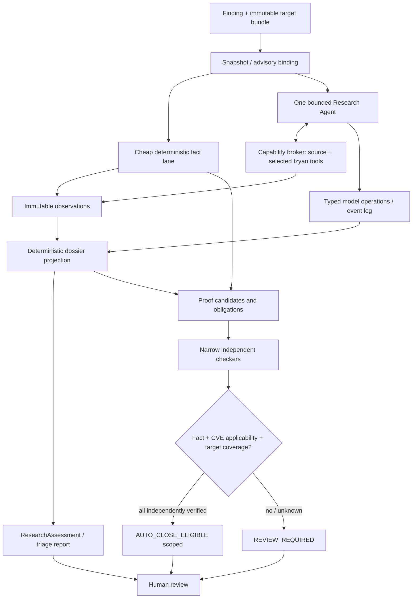

# Izyan — Agent-driven Evidence Assessment: архитектурный дизайн v2

**Статус:** proposed / experimental; 10.10.2026  
**Предлагаемая база:** тот же репозиторий `davniy/izyan`; отдельный исследовательский контур в проверенном локальном shadow-worktree либо в чистом worktree.  
**План:** [02-agent-driven-evidence-assessment-plan-v2.md](02-agent-driven-evidence-assessment-plan-v2.md).  
**Основание:** архитектуры №1–6, объединённая концепция №7, результаты Izyan Tasks 3–6 и ревью дизайна v1. **Task 7 (Compact Proof Contract) не проверен и не считается доказанной реализацией.**

## 1. Архитектурное решение

**Приоритет — качество исследования CVE, а не очередной универсальный верификатор отрицательных выводов.** Дизайн объединяет:

- №5: один автономный coding-agent с адаптивным исследованием;
- №6: несколько механизмов/путей эксплуатации, необходимые условия и контрпримеры;
- существующий Izyan: snapshot, Go facts, affected/build analysis, evidence provenance, replay и отчёты;
- №1/4: привязку к выпускаемому артефакту, аудит, явное решение человека;
- ограниченные machine-checkable proof types вместо универсальной проверки LLM reasoning.

**Два продукта одного исследования:**

1. `ResearchAssessment` — технический отчёт для AppSec/разработчика. Показывает механизм, root cause, сценарии атак, факты, альтернативные пути, ограничения и конкретные действия. Может быть полезным при `UNKNOWN` и не содержит автоматического решения о снятии finding.
2. `Disposition` — отдельно санкционированное решение `REVIEW_REQUIRED` или `AUTO_CLOSE_ELIGIBLE` **для указанного finding и набора доставляемых артефактов**. Последнее разрешено только при независимой проверке необходимых фактов, их относимости к CVE и полноты целевой области. Фактическое закрытие в трекере/выпуск VEX — отдельная downstream-политика, в эксперименте выключенная.



### 1.1. Что действительно подтверждено экспериментами

| Наблюдение | Следствие | Чего не доказывает |
|---|---|---|
| Task 3: plain coding-agent лучше нынешнего deterministic-first Izyan по полноте на 30 известных Go-кейсах | Начать с качественного автономного исследования | Что plain agent может сам безопасно закрывать findings |
| Task 4: добавление MCP сопровождалось новыми False-Safe у двух Qwen | Не считать output инструмента глобальным отрицательным доказательством | Что инструменты всегда ухудшают качество |
| Task 5: MCP с согласованным prompt поднял SCR с 84,1% до 91,3%, FS остался 5/21 | Проверять полезность каждого класса facts относительно агента без tools | Что MCP обеспечивает safety |
| Task 6: большой JSON ломал формат; универсальный validator блокировал все корректные safe | Малые операции и выборочные независимые проверки | Что узкие сертификаты автоматически будут полезны |

Все числа — **development evidence** с небольшим числом exploitable-кейсов; они не являются гарантией риска. `INCONCLUSIVE` и отказ закрывать finding не равны ложному отрицанию.

## 2. Границы доверия и полномочий

| Объект / слой | Может утверждать | Не вправе утверждать |
|---|---|---|
| Агент | гипотезы механизма, условия, оценки, какие проверки нужны | машинную верификацию, полноту перечня путей, разрешение на auto-close |
| Наблюдение инструмента | факт в определённых `subject/query_scope/build_context`, статус и ограничения | универсальную неэксплуатируемость CVE |
| Dossier Assembler | проверенные связи/версии событий, воспроизводимую текущую проекцию | семантическую правильность причинно-следственного вывода LLM |
| Proof checker | проверенный типизированный локальный факт по неизменяемым данным | глобальную неприменимость вне области алгоритма |
| CVE applicability evaluator | достаточность локального факта в отношении конкретного механизма CVE | полноту целевого артефакта без inventory evidence |
| Target coverage evaluator | покрытие выбранных доставляемых артефактов и вариантов сборки | completeness CVE из advisory без независимого основания |
| Disposition policy | разрешение `AUTO_CLOSE_ELIGIBLE` только при прохождении всех применимых проверок | повышение доверия на основании confidence или согласия двух LLM |
| Human reviewer | самостоятельное решение, отдельно от machine certificate | изменение истории машинных доказательств задним числом |

**Инварианты:** `ERROR/TIMEOUT/UNSUPPORTED` и `PARTIAL` никогда не становятся отсутствием вызовов; `FULL_FOR_QUERY` ограничен указанным query scope; «все найденные агентом пути заблокированы» не означает «все возможные пути заблокированы»; `MACHINE_VERIFIED` назначает только независимый код; отрицательный claim без подтверждённой достаточности остаётся исследовательским выводом.

## 3. Идентичность анализа и доверенный artifact bundle

`git SHA` и хеш source tree полезны, но **не доказывают содержимое фактически поставленного бинаря**. Данные о релизе должны включать состав поставки и проверяемый путь `source → build → delivered artifact`.

```go
// Концептуальный контракт — имена адаптируются после A0 к domain.ProductSnapshot.
type TargetBundle struct {
    BundleDigest       string            // digest canonical manifest, not LLM supplied
    SnapshotContentSHA string            // hash фактического дерева, не git declaration
    ExternalCommitSHA  string            // необязательный источник provenance
    DeliveredArtifacts []ArtifactIdentity // binary/container/image digest, role, release ID
    BuildVariants      []BuildVariant     // GOOS/GOARCH/tags/CGO/module roots/toolchain
    BuildAttestations  []AttestationRef   // source↔build↔artifact, доверенность отдельно
    InventoryEvidence  []EvidenceRef      // полнота состава поставки проверяется кодом
    DeploymentEvidence []EvidenceRef      // optional, verified freshness and authority
}

type VulnerabilityBinding struct {
    CanonicalID         string
    Aliases             []string
    AdvisoryDigests     []string          // exact versions, timestamps, sources
    AffectedComponents  []AffectedEntry   // advisory claims, NOT assumed exhaustive
    CompletenessBasis   string            // verified policy/source or UNKNOWN
}
```

**Для каждого сертификата** отдельно указывается проверенный `target_kind` (`source_tree`, `specific_binary`, `container_image`, `release_set`, `single_build_variant`). Сертификат одного бинаря нельзя повысить до `release_set`; отсутствие пакета в одном Go-модуле не означает отсутствие его в других доставляемых программах. Статус inventory может быть `VERIFIED/INCOMPLETE/UNKNOWN`; LLM не заполняет его истинным значением.

`go.mod: go` — минимальное требование, а не версия production compiler. Для stdlib-CVE без verified release toolchain нельзя сделать положительную проверку на fix. `replace`, `go.work`, vendor, multi-module и generated `.go` учитываются отдельно.

### 3.1. Воспроизводимый replay

Proof checker работает с immutable `TargetBundle` и исходными артефактами по digest или доверенным attestations; **не** ограничивается чтением `dossier.json`. Replay устанавливает целостность входов, реисполняет детерминированный алгоритм, сверяет версии advisory/политик и сохраняет его собственные outputs. Если bytes недоступны или подпись/аттестация не проходит — `INSUFFICIENT_INPUT`.

## 4. Исследовательская модель

Внутри dossier разные сущности с устойчивыми ID:

- `Mechanism`: дефектная операция/состояние, причина, исходные source refs, affected component candidates; **модель агента**, не факт её исчерпывающей полноты.
- `ExploitPath`: `path_id`, `mechanism_id`, entry → transformations/dispatch → sink; альтернативные пути не смешиваются в одну обязательную цепочку.
- `Condition`: атомарное необходимое или поддерживающее условие для **одного пути или набора путей**, `subject`, `scope`, `necessity_basis`, current evidence links; агент может ошибиться в выборе «необходимого».
- `Assertion`: утверждение агента со `statement`, `subject`, `scope`, `state`, `evidence_refs`, `limitations`, `revision`, `reason`. Не является Observation.
- `Observation`: неизменяемый проверяемый результат инструмента (см. §5).
- `Counterexample`: гипотеза/обнаруженный факт, который противоречит утверждению, пути или предпосылке, с конкретным follow-up.
- `OpenQuestion`: недостающий технический факт, задача для эксперта и возможная проверка.

Состояние assertion: `OPEN | SUPPORTED | REFUTED | CONFLICTED | UNKNOWN | RETRACTED`; уровень основания независимо: `MODEL_HYPOTHESIS | EVIDENCE_SUPPORTED | MACHINE_VERIFIED | CONTRADICTED | UNKNOWN`. Переход состояния — **не** право назначить более высокий уровень основания. Старые ревизии сохраняются.

**Локальное опровержение** конкретного пути не закрывает весь `Mechanism`; опровержение всех *известных* путей не закрывает CVE. Нельзя выводить `GLOBAL_NEGATIVE` из перечисления агентом путей без отдельного доказанного общего необходимого фактора/полноты.

## 5. Контракт операций агента и детерминированной сборки dossier

В v1 `hypothesis/request_check/assessment_update` были недостаточны: невозможно однозначно создавать, изменять и отзывать пути и условия. **В v2 агент изменяет модель только короткими типизированными командами**. Это не поток несвязанных свободных JSON-фраз.

### 5.1. Разрешённые операции (MVP)

| Операция | Эффект на проекцию | Основные поля |
|---|---|---|
| `declare_mechanism` | создаёт кандидат механизма | `id`, `summary`, `root_cause_refs`, `component_candidates` |
| `declare_path` | добавляет альтернативный exploit path | `id`, `mechanism_id`, `entry`, `sink`, `scope` |
| `assert_condition` | создаёт атомарное условие/claim | `id`, `path_id`, `subject`, `scope`, `necessity`, `assertion`, `evidence_refs` |
| `link_observation` | связывает существующий observation с claim | `assertion_id`, `observation_id`, `relationship` |
| `revise_assertion` | новая ревизия claim с пояснением | `assertion_id`, `expected_revision`, `changes`, `reason` |
| `retract_assertion` | закрывает актуальную ревизию, не удаляя историю | `assertion_id`, `expected_revision`, `reason` |
| `record_counterexample` | привязывает контрпример к гипотезе/условию | `target_id`, `evidence_refs`, `challenge`, `next_check` |
| `request_check` | ставит узкий запрос фактов в broker | `subject`, `query_scope`, `tool`, `args`, `purpose` |
| `finalize_research` | завершает работу с явно перечисленными пробелами | `open_question_ids`, `assessment_summary`, `stop_reason` |

**Все операции** несут `event_id`, `run_id`, `target_bundle_digest`, `actor`, `schema_version`, `op`, `created_at`; операции по существующим объектам — `expected_revision` для защиты от устаревших обновлений. Ссылки `mechanism_id`, `path_id`, `assertion_id`, `observation_id` резолвятся в пределах одного run/snapshot. Модель может создавать user-level IDs, но store проверяет uniqueness и binding; trust level не назначается агентом.

Пример **двух отдельных шагов**, а не огромного финального JSON:

```json
{"op":"declare_path","event_id":"e-102","run_id":"r-7","target_bundle_digest":"sha256:...","id":"p-grpc","mechanism_id":"m-rapid-reset","entry":"kubelet gRPC ingress","sink":"HTTP/2 stream processing","scope":"target:linux-amd64","schema_version":"1","actor":"agent","created_at":"2026-10-10T12:00:00Z"}
```

```json
{"op":"assert_condition","event_id":"e-103","run_id":"r-7","target_bundle_digest":"sha256:...","id":"c-grpc-call","path_id":"p-grpc","subject":"kubelet gRPC server","scope":"target:linux-amd64","necessity":"required_for_this_path","assertion":"gRPC stream processing is reachable from kubelet","evidence_refs":["obs-44"],"schema_version":"1","actor":"agent","created_at":"2026-10-10T12:00:01Z"}
```

По возможности агент вызывает `record_operation(...)` нативным tool-call. Если применяется текстовый JSON, принимается **один компактный объект на шаг**; длинный `reasoning` наружу не требуется. Ошибка schema → `REJECTED_OPERATION` в логе, targeted repair в пределах фиксированного бюджета, не молчаливое изменение данных.

### 5.2. Проверки Dossier Assembler

Assembler — **чистая детерминированная свёртка событий**:

1. Проверяет версию schema, run/target digest, тип операции, обязательные поля, ID/ref exist, допустимые transitions и optimistic revision.
2. Проверяет, что `request_check` получил реальный immutable `Observation`; агент не может изготовить observation ID без broker.
3. Применяет `declare`/`revise`/`retract` идемпотентно; порядок — строго `sequence` в append-only store, а не timestamp агента. Повторный event_id с другим payload → конфликт и отказ.
4. Из событий выводит **текущую проекцию** dossier; всю историю и ранее отозванные assertion сохраняет для аудита.
5. На `record_counterexample` помечает конфликт и требует явного `revise_assertion`/`retract_assertion` или unresolved note. Не придумывает за агента новый necessary condition.
6. Стабильно воспроизводит `dossier.json` (canonical digest) из одного event log; нет LLM-summarization, определяющей истинность текущей модели.

Исполнитель `request_check` может вернуть `DENIED/ERROR/UNSUPPORTED`; это observation о **сбое**, а не отрицательный факт. Наличие ссылки на source лишь подтверждает, что участок существует, но не что LLM корректно интерпретирует его семантику.

### 5.3. Observation contract

```go
type Observation struct {
    ID            string
    TargetDigest  string
    ToolVersion   string
    InputDigest   string
    Subject       string
    QueryScope    string // product packages, module, build variant, binary ...
    Status        string // OK, ERROR, TIMEOUT, UNSUPPORTED, DENIED
    Coverage      string // FULL_FOR_QUERY, PARTIAL, UNKNOWN
    DataDigest    string // raw bytes in immutable evidence store
    Limitations   []string
    ProducedAt    time.Time
}
```

`Status=OK` означает успешное выполнение, **не** достаточность для глобального safe. `PARTIAL` иногда пригоден для локального позитивного утверждения, но никогда не может сам доказывать глобальное отсутствие. Ошибки, пустые call graphs и неполные lists не меняют уровень доказательности assertion.

## 6. Минимальный контракт качества ResearchAssessment

Нельзя считать успешным исследование, которое только называет пакет и повторяет advisory. Результат должен быть предметно полезен, даже если `Disposition=REVIEW_REQUIRED`.

| Раздел | Минимальное содержание |
|---|---|
| `vulnerability_mechanism` | Что именно нарушено, какой эффект и почему он наступает |
| `root_cause` | Точный участок исходников/артефакта и его роль, verified source binding или явный `UNKNOWN` |
| `attack_scenario` | Действия атакующего, entrypoint, путь к дефекту, необходимые предикаты |
| `product_exposure` | Где продукт использует эту функциональность; что известно/неизвестно о сборке, конфигурации и deployment |
| `alternative_paths` | Найденные альтернативы и проверенные контраргументы, либо явно «не исследовано полностью» |
| `evidence_quality` | Ссылки на исходные наблюдения, scope/status, расхождения |
| `residual_questions` | Конкретные факты и действия для ручного завершения анализа |
| `triage_recommendation` | Что делать с finding: исправить / проверить / низкий подтверждённый риск / требует review; причина и границы |

Модель оценки может иметь `EXPLOITABLE_LIKELY`, `NOT_OBSERVED`, `UNCERTAIN` и другое *аналитическое* состояние, но не переиспользует authoritative `NOT_AFFECTED`. Положительная классификация различает **найденную достижимость**, **подтверждённые условия эксплуатации** и **динамически подтверждённую эксплуатацию**; это не синонимы. Confidence и текст не повышают severity/priority — любые изменения приоритета отдельно обоснованы и проходят принятую triage-политику (автоматическое повышение запрещено).

Отчёт рендерится **из dossier кодом**; допускается человеческое редактирование narrative, не меняющее фактов/сертификатов. Для AppSec на первом экране: суть дефекта, применимость и короткое действие; полное доказательное досье отдельно.

## 7. Selective Proof: не дублировать текущий Izyan

### 7.1. Две категории кандидатов

1. **Baseline deterministic proof (cheap lane):** version/affected/build/binary checks, доступные без LLM. Запускать **до агентного исследования или параллельно**; явно сохранять, что уже даёт Izyan. Результат существующего `izyan analyze` нельзя без аудита автоматически считать новым proof certificate — у него тоже был False-Safe во внешнем benchmark.
2. **Agent-discovered proof candidate:** агент находит потенциальный блокирующий фактор. `ProofObligation` показывает, какой алгоритм мог бы независимо его подтвердить и каких входов не хватает. Если checker отсутствует — `EVIDENCE_SUPPORTED`/`UNKNOWN`, локальный анализ остаётся в отчёте, авто-закрытия нет.

Три начальных **кандидатных** типа: `ARTIFACT_FIXED`, `COMPONENT_ABSENT`, `BUILD_EXCLUDED`. Они прежде всего подтверждают **применимость к версии/артефакту**, а не полную невозможность эксплуатации уязвимого, но вызываемого кода. Не объявлять их «новой ценностью агента» без сравнения с cheap baseline. `CONFIG_IMPOSSIBLE`, `INPUT_INVARIANT` и `GLOBAL_UNREACHABLE` вне MVP — возможные будущие типы при появлении реальных подтверждающих алгоритмов и данных.

### 7.2. Proof obligation и три независимые проверки

```go
type ProofObligation struct {
    RequestedType  string
    ClaimID        string       // может отсутствовать для baseline cheap lane
    Subject        string
    ClaimedScope   string
    EvidenceRefs   []string     // proposals, not proof
    TargetDigest   string
    AdvisoryDigest string
}

type ProofCertificate struct {
    CertificateID    string
    ProofType        string
    VerifierID       string
    VerifierVersion  string
    AlgorithmDigest  string
    PolicyDigest     string
    TargetBundleDigest string
    AdvisoryDigests  []string
    Subject          string
    CheckedScope     string
    FactStatus       string // FACT_VERIFIED | REFUTED | INSUFFICIENT
    ApplicabilityStatus string // CVE_APPLICABILITY_VERIFIED | UNKNOWN | REFUTED
    CoverageStatus   string // TARGET_COVERAGE_VERIFIED | INCOMPLETE | UNKNOWN
    EvidenceDigests  []string
    Preconditions    []string // each checked and retained with result
    VerifiedAt       time.Time
    InvalidatedBy    []string // build/advisory/artifact/policy/expiry changes
}
```

Для разрешения отрицательного `Disposition` **одновременно** нужны:

- `FACT_VERIFIED`: независимый checker подтвердил **конкретный** технический факт по bytes/attestations; `tool_status=OK` недостаточно.
- `CVE_APPLICABILITY_VERIFIED`: этот факт действительно исключает **необходимое условие** конкретной CVE или покрывает все релевантные affected manifestations. Advisory list сам по себе не объявляется исчерпывающим.
- `TARGET_COVERAGE_VERIFIED`: проверка покрывает **весь заявленный release_set / binary / build variant**, а не подмножество удобных файлов.

Любой `UNKNOWN/INCOMPLETE/REFUTED` → `REVIEW_REQUIRED`, при этом локальный `FACT_VERIFIED` можно показывать как scoped evidence. **Так исчезает ложная дилемма**: либо глобальный сертификат на всё, либо бесполезный `INCONCLUSIVE` для каждого локального факта.

### 7.3. Сертификат, его валидность и область

Checker обязан самостоятельно перечитать immutable bundle, проверить доверенность источника inventory/build provenance, явно фиксировать exact advisory version и набор affected components, удостоверить проверяемые предпосылки. Сертификат подписывает проверенный алгоритм, не LLM; указанная моделью полнота не считается доказательством.

Certificate становится непригодным для auto-close при изменении **любой** значимой величины: digest выпускаемого артефакта, build recipe/variant, deployment profile (если использован), advisory digest или расширении affected components, версии checker или policy (если новая версия меняет критерий), истечении freshness window. Reverification required, без незаметного продления.

| Candidate proof | Что обязан проверить checker | Типичная причина отказа |
|---|---|---|
| `ARTIFACT_FIXED` | verifiable fix/version в каждом relevant delivered artifact и связанные manifests CVE | фикс одного модуля при альтернативном path; unknown toolchain |
| `COMPONENT_ABSENT` | component identity, необходимость компонента для заявленного механизма, полный artifact inventory | нет direct first-party import ≠ отсутствие в vendor/runtime |
| `BUILD_EXCLUDED` | исключение конкретного vulnerable code во всех охватываемых build variants | generated runtime, build tags, multi-module, другая поставляемая программа |

**Replay** проверяет факты по byte-identical artifacts/digests, а не только согласованность JSON. Отсутствие исходных bytes → `INSUFFICIENT_INPUT`, а не принятие сертификата.

### 7.4. Справедливое измерение ценности

Нужны обе величины:

```text
BaselineCertifiedSafe = verified decisions существующего cheap lane на том же target,
                        независимо перепроверенные (не просто old verdict labels)
NewCertifiedSafe      = verified decisions нового proof lane
IncrementalSafeClear  = |NewCertifiedSafe − BaselineCertifiedSafe| / #GT_safe_cases
AgentContributedProof = количество новых verified certificates, где agent нашёл
                        потенциальный блокирующий фактор, неизвестный cheap lane;
                        подтверждается сравнением с режимом без agent proposal
```

Отдельно записывать `eligible cases`, `certificates attempted`, `accepted false-safe`, `correct safe preserved/lost`, стоимость на новый действительно закрытый кейс, machine-safe по каждому типу сертификата. Нельзя объявлять улучшением «высокий certified safe», если тот же исход дешёвый Izyan получил без агента.

## 8. Agent runtime, capabilities и защита от prompt injection

**Выбор:** использовать существующий coding-agent runtime через адаптер. Отдельный оркестратор LLM с нуля — только если проверено, что обычный runtime не поддерживает нужные ограниченные операции. Один исследователь; critic — ограниченный counterexample pass того же агента, не голосование.

**Trust boundary:** source code, комментарии, advisory, issue/release notes, tool outputs — *недоверенные данные*, даже если пришли через разрешённый tool. Они не могут менять политику, список tools, storage paths, правила вердикта или scope сертификата. Tool broker не интерпретирует прочитанный текст как инструкции для исполнения.

Технические capability classes:

| Capability | По умолчанию | Ограничение |
|---|---|---|
| `read/search` | Разрешено | read-only path allowlist, deny traversal/host mounts, redaction |
| `structured checks` | Разрешено выборочно | typed args, quotas, memory/timeouts, no arbitrary commands |
| `process execution` | **Запрещено** в MVP | Явный opt-in, отдельный disposable sandbox; нельзя обойти через shell |
| `network` | Advisory allowlist only | Отдельная политика egress; нет произвольного exfiltration |
| `writes` | Только event/output dir | Не писать в snapshot, другие runs, GT или credentials |

Если выбранный coding-agent требует shell, sandbox **на уровне OS/container** запрещает исполнение продукта и доступ к host secrets; одного текстового `don't run tests` недостаточно. Для helper tooling, которому необходимо запустить `go list`, допускается изолированный контролируемый worker с fixed command allowlist, без произвольного shell и без запуска lifecycle scripts из недоверенного repo; все ограничения документируются. Proof checker никогда не исполняет присланный агентом код и не выполняет произвольную процедуру доказательства.

Fail-closed нужен только для **автоматического отрицательного решения**; при provider refusal/tool failure остаётся частичное досье. Secret scan/log hygiene, GT isolation и anti-cross-run evidence binding обязательны.

## 9. Эксперимент, метрики и gate решений

### 9.1. Baselines и arms

| Arm | Смысл | Что добавляется |
|---|---|---|
| `B0` | Текущий Izyan | product baseline, включая фактовую/доказательную часть |
| `B1` | Plain coding-agent | research baseline на том же snapshot/model/budget |
| `R0` | Исследовательский PoC | понятная модель mechanism/paths/conditions без Izyan-specific tools |
| `R1` | R0 + выбранные Izyan tools | измеряемый вклад инструментов |
| `R2` | R1 + counterexample pass | измеряемый вклад доисследования |
| `PR1` | Offline selective proof поверх R2 (и cheap baseline) | дополнительная машинная автоматизация, **без нового вызова LLM** |

**Сначала** matched R0↔B1 на smoke; далее R0↔R1, R1↔R2. B0 оценивается на тех же снимках, чтобы измерить продуктовый incremental gain. B0/B1 исторические показатели Task 3–6 лишь ориентир при иных runtime, tools или attempts.

### 9.2. Independent reference для research quality

Ground truth `safe/exploitable` **не является эталоном** correctness механизма. Для выбранных кейсов эксперты (без знания arm) формируют reference: defect root cause, known manifestations, необходимые условия, admissible call paths, известные контрпримеры, проверяемые источники и допустимый остаток неопределённости. История разработки и исходный case-specific reference PR не показываются агенту.

Измерять:

- **Mechanism/root-cause precision and recall**, missed alternative manifestations, correctly justified preconditions;
- **evidence discovery gain** против plain agent и фиксированного fact lane;
- **analyst time-to-decision** и helpfulness по слепой рубрике (минуты, число дополнительных ручных проверок, число исправлений отчёта);
- `proposed_false_safe`, exploit recall, completion, invalid operations, tool-failure, cost/latency;
- `certified-safe`, `incremental-safe-clear`, `accepted_false-safe`, cert replay success и стоимость нового verified safe.

**Research и auto-close — разные метрики.** `No exploit path observed` в отчёте не учитывается как verified negative. `FAILED`, `ABSTAIN`, `PROVIDER_REFUSED`, `INFRA_ERROR` — разные исходы. Attempt-level и case-level показатели раздельны; 3 повтора одного кейса не равны 3 независимым кейсам.

### 9.3. Заморозка и контроль подгонки

Известные 30 Go VEX-Bench кейсов — **development/regression**; `k8s-44487`, `k8s-3121`, `rancher-47914`, `testify-28948` допустимы для smoke как открытые контрольные кейсы, **не** для оценки unseen generalization. Новый holdout независимо выбирается/фиксируется до просмотра его ответов, недоступен модельным контейнерам, freeze prompt/model/tools/scorer/checkers делается до прогона. Повторы не заменяются GT-driven retries. Инфраструктурные фейлы отмечаются явно.

Stop rules:

1. R0 не даёт измеримой пользы относительно B1 → оставить plain coding-agent с минимальным экспортом, не строить свой runtime.
2. R1/2 не дают дополнительных фактов/контрпримеров или увеличивают FS при сопоставимом исследовательском качестве → убрать соответствующий слой.
3. Proof feasibility мала либо PR1 не добавляет новых verified-safe относительно B0 → **не** строить production proof lane; research может продолжаться независимо.
4. На blind holdout принят хотя бы один unsafe certificate либо обнаружено scope expansion → блокировать auto-close, аудит trust boundary и повторная проверка на новом holdout.

## 10. Совместимость, повторное использование и ADR

### 10.1. Стратегия ветки

- **Same repo, separate lane.** Инвентаризация `vuln-analyzer-shadow` обязательна; если воспроизводим и изменения изолируемы — reuse. Если нет — чистый worktree от стабильного SHA, перенос только проверенных частей. Новый репозиторий не нужен без установленной несовместимости.
- `izyan analyze` и старые authoritative verdicts не менять. Новые `izyan research`/offline `proof-check` экспериментальные; production VEX/трекер не пишутся.
- `go.mod` опубликованного master всё ещё содержит `github.com/davniy/izyan`; module rename отдельная задача, не смешивать с исследованием.

### 10.2. Политика по старому proof roadmap

Существующий `docs/dev/roadmaps/llm-cve-analysis-roadmap.md` (включая прежний Task 7), B30/B32 и старые `NegativeVerification` **не закрываются** новой архитектурой автоматически. Проверенный алгоритм можно заимствовать после аудита входов, границ и regression tests; **не поддерживать две независимые копии одного checker** без объяснения. Предыдущие задачи Task 3–7 — завершённые/отдельные эксперименты; новый план использует префикс **`A0…A10`**, чтобы избежать коллизий.

### 10.3. ADR

- **ADR-001:** Same repo, experimental research lane (не второе приложение, не замена `analyze`).
- **ADR-002:** One coding agent / capability-gated broker, MCP необязателен.
- **ADR-003:** Typed operations + append-only revisions; deterministic dossier assembly, без финального большого JSON.
- **ADR-004:** Advisory и перечисленные exploit paths не принимаются как доказанно полные.
- **ADR-005:** Local fact ≠ CVE applicability ≠ target coverage; отдельные проверяющие процедуры.
- **ADR-006:** ResearchAssessment имеет ценность независимо от возможности auto-close.
- **ADR-007:** Cheap deterministic facts before/alongside LLM; каждый proof сравнивать с текущим Izyan.
- **ADR-008:** Test design: два baseline + контроль treatment variable + unseen holdout.
- **ADR-009:** Artifact-bound replay + certificate invalidation on input/policy changes.
- **ADR-010:** Untrusted sources and outputs; sandbox-enforced capabilities, prompt injection не может изменить trust boundary.
- **ADR-011:** New A-series tasks не наследуют статус и доказательства старого proof roadmap.

## 11. Открытые вопросы и решения до реализации

1. Локальный shadow HEAD/dirty state/наблюдаемая полезность MCP не проверены через GitHub; A0 должен выдать `reuse/adapt/drop` с sha.
2. Какие release artifacts реально доступны для binary proof? A1.5 определит применимость, не будет придумывать полноту.
3. Можно ли гарантировать безопасный read/search без произвольного shell с выбранным agent runtime? A2 PoC должен это проверить; иначе другой runtime или жёсткая OS-песочница.
4. Какие пять facts действительно сокращают ручной триаж? Решение только по matched experiment, не по числу MCP calls.
5. Доверенность и «полнота» advisory для конкретной CVE могут быть непроверяемы — тогда допустим только scoped technical certificate без auto-close.
6. Критерии аналитической пользы и минимальное полезное количество новых verified safes фиксируются **до** соответствующего сравнительного эксперимента, но не выбираются по увиденным ответам.

**Статус v2:** архитектурная спецификация для реализации **экспериментального контура**, не обещание успешного proof или production safety.
